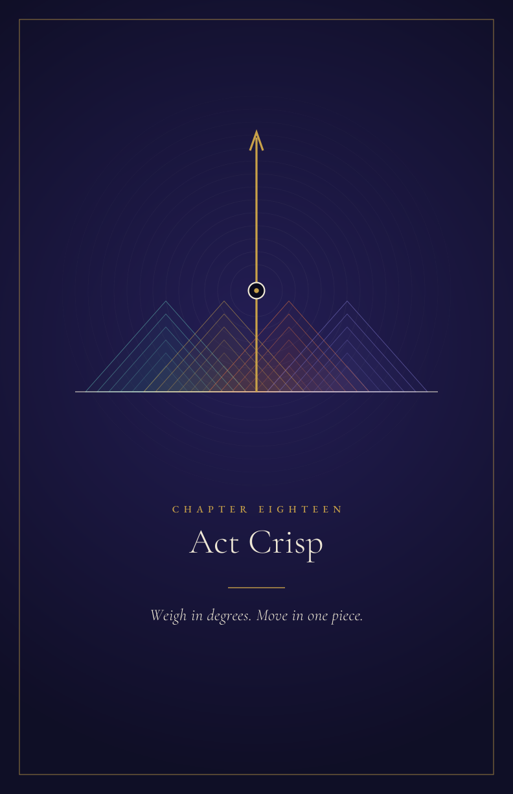
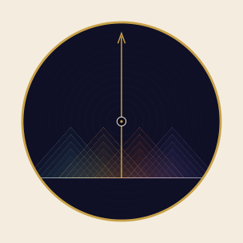
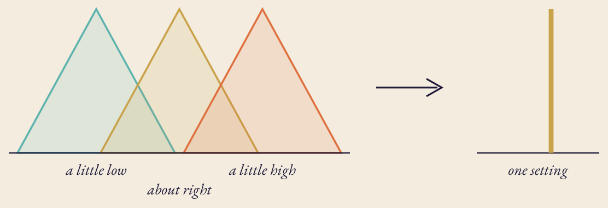

THE GEOMETRY OF EXISTENCE · LEVEL THREE · THE DEGREE · PAGES 115–118

  

CHAPTER EIGHTEEN

# Act Crisp

> *Weigh in degrees. Move in one piece.*

  

You can be six-tenths ready to leave and four-tenths ready to stay. You cannot six-tenths leave.

This is the last thing the degree has to teach, and it protects you from the degree itself. Grades are for weighing. The act is whole.

`ON RECORD` Engineers learned this in the 1970s. A controller built on graded rules — *if the pressure is a little low, add a little heat* — holds many partial truths at once, each true to its own degree. But at every moment it sends its machine exactly one setting. The first such controller, reported in 1975, ran a small laboratory steam engine. In 1987 a subway line in Sendai, Japan, opened with its trains driven the same way. Graded inside. One definite act outside.

  

<i>Several partial truths, each held to its own degree, resolve into a single setting. The weighing is graded. The output is not.</i>

A life works the same way or it does not work. The person who acts at one-half — half in the job, half in the marriage, half in the project — has not found a middle. They have built the waiting room of Chapter Nine and furnished it with a number.

The procedure has three steps.

**Grade.** For the decision in front of you, name the two or three lines that matter and mark where you stand on each, with anchors. *How drained am I by this work: seven. How long could I live on what I have saved: eight.*

**Rule.** Say the rule you are using, out loud, with its “and” or its “or.” *If the work is draining and I can afford to go, I go.* Both are required, so take the lower: seven. A seven is a lean, not a certainty. That is all the weighing can ever give you.

**Commit.** One whole act, with a date. Not “start moving toward leaving.” *I give notice on the first of March.* Then the clause from Chapter Twelve: the observation that would reverse you, named before the date arrives.

Three ways this goes wrong.

**The unlosable grade.** “I am about seventy percent committed” can never be caught out. No event counts against it. A grade about yourself must cash out in something another person could watch: what you did, on which days, when no one was checking. If it cannot, it is not a measurement. It is a mood with a number on it.

**Grading the Given.** Some things are zero or one. The door is closed. The hour is spent. Chapter Five warned you that some pairs are real. To call a real zero “maybe a two” is erasure with a decimal point. To call a real six “basically zero” is worship with a decimal point. They are the same twins Chapter Two introduced, wearing arithmetic.

**Grading what is not yours to grade.** You may grade your conduct, your ground, your reach. You may not grade a person’s right to be here. There is exactly one thing in this book that does not come in degrees, and the next level is about it.

When you have graded honestly, taken the lowest where both are required, and moved in one piece with your reversal named in advance, you have done everything a mind can do with an uncertain world. The rest is the Given, and the Given will answer.

> **▲ Practice**
>
> Take one deferral from your null audit in Chapter Nine. On one card write four lines: the grades, with anchors; the rule, with its “and” or “or”; the act, with its date; and the observation that would reverse it. Sign the card. Put it with the papers from Chapters Ten and Twelve.

> **◆ Audit**
>
> Where are you acting at one-half? Name the thing you are half in. Then choose, in writing: raise it to a whole act with a date, or close it with the one-sentence certificate from Chapter Nine. Both are honest. Staying at one-half is the only answer this chapter refuses.

---

[← The Weakest Link](17-the-weakest-link.md) · [Contents](../README.md) · [The Graded Audits →](19-the-graded-audits.md)

