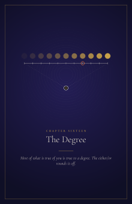
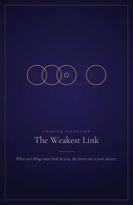
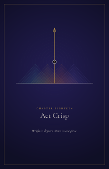

THE GEOMETRY OF EXISTENCE · LEVEL THREE · THE DEGREE · PAGE 105

  

LEVEL THREE

# The Degree

> *for the one who has stopped rounding*

<!-- level-strip -->
## In this level

<table>
<tr><td align="center" valign="top" width="25%"> 16 · The Degree</td><td align="center" valign="top" width="25%"> 17 · The Weakest Link</td><td align="center" valign="top" width="25%"> 18 · Act Crisp</td><td align="center" valign="top" width="25%"><a href="19-the-graded-audits.md"><b>The Graded Audits</b></a> pp. 119–120</td></tr>
</table>
<!-- /level-strip -->

---

[← The Fifteen Lines](../2-the-manual/16-the-fifteen-lines.md) · [Contents](../README.md) · [PDF ↓](../../edition/README.md) · [The Degree →](16-the-degree.md)

