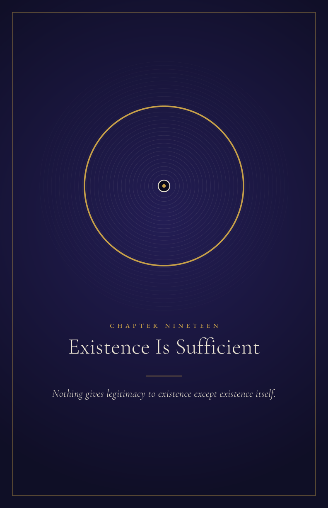
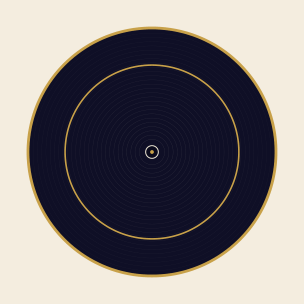

THE GEOMETRY OF EXISTENCE · LEVEL FOUR · THE PRINCIPLE · PAGES 122–125

  

CHAPTER NINETEEN

# Existence Is Sufficient

> *Nothing gives legitimacy to existence except existence itself.*

  

Every level before this one has been about how to stand. This level is about what you are standing on.

`ARGUED` Before understanding, there is existence. Before recognition, there is reality.

Consciousness does not create the world by observing it. It gives us a means of experiencing, questioning, and interpreting what exists. Connection does not make another existence legitimate. It gives us the opportunity to recognize its significance and respond with care.

We do not need to understand everything that exists to acknowledge its existence. We do not need to possess something to honor it. And we do not need to explain why existence deserves legitimacy before allowing existence to be.

A star existed before its spectral lines were catalogued. A rock does not need an observer’s permission to occupy the world. A theory can fail to describe something without removing what the theory failed to describe.

> *Existence requires no justification. Understanding is an opportunity. Connection is a responsibility we may choose to undertake.*

That is the First Principle. Everything in this book must remain accountable to it.

Three things it does not say, because a principle is known as much by its edges as by its center.

**It does not say that whatever is imagined exists.** Existence is not the same as being mentioned. A thing must be found by the methods that suit its kind — a number by proof, a particle by measurement, a memory by the one who carries it. The principle confers nothing on what is not there.

**It does not say that everything that exists is good, or equal, or owed the same treatment.** A river, a virus, a child, and a lie all exist. What you owe each of them is a further question, and this principle does not answer it. It only removes one bad answer in advance: that a thing must first prove itself useful, intelligent, or recognized before it is allowed to count as real.

**It does not prove itself.** If “legitimacy” only means “existence” over again, the principle is true by definition and tells you nothing new. If it means something moral, it needs a moral argument, and no experiment can supply one. An honest philosophy does not hide that gap. It stands in it. Level Five shows, with exact counterexamples, how little follows from the principle by logic alone. What follows from it by living is the business of this chapter.

And by living, this follows.

`LIVED` You do not have to earn the right to be here. Chapter Four said that being seen is how a person becomes solid to themselves. That is true, and it is a different matter. Witness builds identity. It does not grant existence. The version of you that was never seen was not less real for it. It was real and unseen, which is a wound, not a verdict.

Chapter Fifteen said the spark has never been destroyed, only buried. This is the same fact, stated at its root. What exists does not stop counting because it has been administered, renamed, or ignored.

And the degree, which Level Three taught you to apply to nearly everything, does not apply here. Your conduct comes in degrees. Your ground comes in degrees. Your standing with other people comes in degrees and can be earned and lost. That you are — and that the person in front of you is — does not.

> **▲ Practice**
>
> Choose one thing you have been dismissing: a person, a fact, a part of yourself. Write one sentence about it with no judgment in it: *this exists.* Stop there for one full minute. Then, on a separate line, ask the further question — *what, if anything, do I owe it?* — and notice that the second question is open, and the first is closed.

> **◆ Audit**
>
> Where do you make another’s standing as real depend on their usefulness to you, their intelligence, or their recognition of you? Where do you make your own depend on the same three things? Name one of each. The second is usually older.

---

[← Level Four · The Principle](README.md) · [Contents](../README.md) · [PDF ↓](../../edition/README.md) · [Three Relationships, Not Three Requirements →](20-three-relationships.md)

