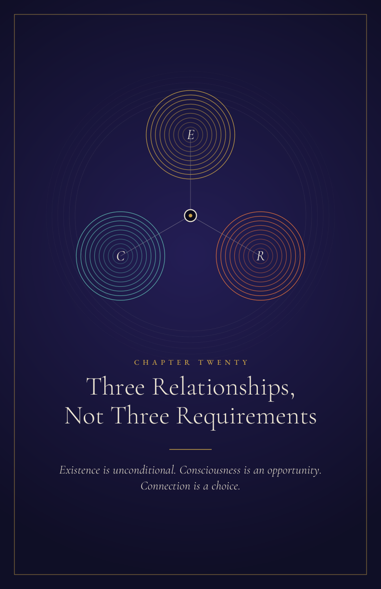
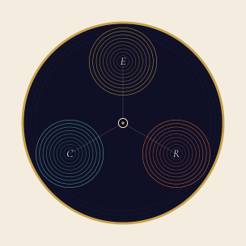

THE GEOMETRY OF EXISTENCE · LEVEL FOUR · THE PRINCIPLE · PAGES 126–129

  

CHAPTER TWENTY

# Three Relationships, Not Three Requirements

> *Existence is unconditional. Consciousness is an opportunity. Connection is a choice.*

  

The First Principle names three things: existence, consciousness, connection. It is easy to read them as a ladder, each rung more real than the last. They are not a ladder.

`ARGUED` Existence, consciousness, and connection are three different relationships with reality, not three requirements for legitimacy.

Existence is unconditional. Consciousness makes understanding possible. Connection makes recognition and care possible. Neither consciousness nor connection grants existence its legitimacy. Something does not become less real because it cannot understand itself, and something does not lose its legitimacy because it remains unrecognized.

For those who want it written compactly:

> *S = (E, C, R)*

*E* is existence, the ground. *C* is consciousness, the capacity for experience. *R* is relation, the structure through which things meet and may recognize one another. This is a way of keeping three ideas apart. It is not a physical equation, and nothing is being computed.

*existence*

> *E*

> *C*

> *R*

*consciousness*

*relation*

<i>Three relationships. Each can be present without the others. None is the measure of the</i>

<i>first.</i>

`DEMONSTRATED` The three really are separable. It is possible, without contradiction, to describe something that exists and is not conscious, or exists and stands in no recognized relation. Level Five gives the small formal models that show it. What those models cannot show — what no model can show — is that the separation is *right*. That is argued, and then it is lived.

Why keep them apart at all? Because every cruelty that has called itself reasonable has worked by fusing them. *It does not think as we do, so it does not count. No one claims it, so it may be used. It cannot speak for itself, so we will speak for it.* Each of those sentences takes consciousness or connection and makes it the price of admission to reality. The principle refuses the price.

It refuses it in the other direction too. You are not more real when you are understood, and you are not more real when you are loved. You are *better off* — Chapter Four did not exaggerate the need. But a need is not a license, and the person who believes they exist only when witnessed will hand their middle to whoever offers to look.

Two consequences for how you carry the last two.

**Understanding is an opportunity, so it is not ownership.** To understand someone is not to hold a claim on them. Chapter Fourteen called the claim by its name: *I know you better than you know yourself* is the sentence by which understanding turns into occupation. The principle says the same thing at the root. Consciousness lets you understand what exists. It does not transfer the title.

**Connection is a responsibility you may choose, so it is not a debt you can collect.** Care that is owed on demand is not care. And care that is withheld until the other has proved worthy has confused the floor with the ceiling, which is the subject of Chapter Twenty-Two.

One word about this book’s own shape, because it is built in levels and levels are easily misread. `ARGUED` The levels here are levels of understanding, not of worth. A reader who stops at Level One and lives its lines has not done less than a reader who checks every figure in Level Five. Understanding is the opportunity. It was never the requirement.

> **▲ Practice**
>
> Take one being in your life — a person, an animal, a place. Make three short columns. *What exists:* plain facts only. *What I understand:* and, beneath it, what I do not. *How I honor it:* one act this week, small enough to do. Notice which column was hardest to fill honestly.

> **◆ Audit**
>
> Where have you treated understanding as ownership — of a child, a partner, a friend, a student? And where have you waited to be understood before you would allow yourself to count? Name one of each.

---

[← Existence Is Sufficient](19-existence-is-sufficient.md) · [Contents](../README.md) · [PDF ↓](../../edition/README.md) · [Change Without Erasure →](21-change-without-erasure.md)

