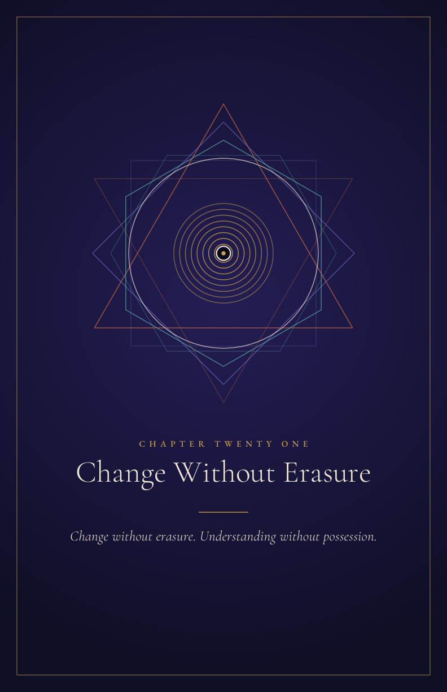
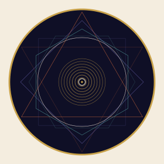

THE GEOMETRY OF EXISTENCE · LEVEL FOUR · THE PRINCIPLE · PAGES 130–133

  

CHAPTER TWENTY ONE

# Change Without Erasure

> *Change without erasure. Understanding without possession.*

  

You have been told that to become someone new you must first stop being who you were. Burn it down. Start from zero. Wipe the slate.

This chapter says no, and it takes its word for the alternative from biology.

`ON RECORD` *Transdifferentiation* is the biologist’s name for a cell of one settled kind becoming a cell of another kind directly, without first being returned to a blank, unspecialized beginning. It has been done in the laboratory — cells taken from skin have been turned directly into working nerve cells, for one — and it stands in contrast to the better-known route that first resets a cell to an embryo-like state and then starts again.

`ARGUED` The biology is where the word comes from. It is not the proof of what follows. What follows is a philosophy of change in four principles, and it has to earn its keep in a life, not in a dish.

**Conserved specificity.** What you have become is carried forward. The years you spent learning the wrong trade taught your hands something. The marriage that ended taught you how you love. Change that throws these away is not bold. It is wasteful, and you will pay again to relearn what you already owned.

**Rejection of the null point.** Change does not have to pass through nothing. Chapter One said a null is not a state. The same holds for a life: “I’ll figure out who I am after I’ve cleared everything away” is a waiting room with a demolition permit. There is no blank you. There is only you, reorganizing.

**Adjacent possibility.** Growth moves into what is reachable from where you stand. Not anything is possible next. What is possible next is what touches what you already are. This is not a limit on ambition. It is the route ambition actually takes, one reachable step after another, each one changing what the next step can reach.

**Non-regressive growth.** You do not have to give up earned structure in order to move on. You may have to rearrange it. You may have to stop using some of it. But tearing down what holds weight, to prove you are serious about changing, is the gesture of someone who has mistaken destruction for depth.

Set these beside Chapter Eleven and they lock together. The channel is what is conserved. The water is what is permitted to change. A river does not return to the spring in order to turn a bend.

`DEMONSTRATED` There is a small exact fact underneath this, and it is worth having. If you can say precisely which part of a thing is protected, and every change you make is confined to the rest, then the protected part is not merely *mostly* preserved. It is untouched, whatever the changes are. The whole difficulty is in the first clause. You must be able to say which part.

And the honest other half. `ARGUED` A finite life cannot carry everything forward. Something is always left. Conserved specificity is therefore not “keep it all.” It is the decision — yours, made on purpose — about what is carried. Chapter Ten warned that a discipline of holding which cannot let go is a sunk-cost religion. This chapter does not repeal that warning. Non-regressive does not mean never losing. It means never calling a loss a method.

> **▲ Practice**
>
> Before your next real change — of work, of place, of habit — write two lists. *Carried:* three things this change must bring through intact. A skill. A relationship. A way of noticing. *Free:* everything else, named, that may be revised without betrayal. Make the change against the lists.

> **◆ Audit**
>
> Where have you tried to change by wiping — the new city, the new name, the deleted history? What, specifically, did you lose in the wiping that you later had to rebuild? Estimate what the rebuilding cost. That number is the price of the null point.

---

[← Three Relationships, Not Three Requirements](20-three-relationships.md) · [Contents](../README.md) · [Dignity Is Owed, Respect Is Earned →](22-dignity-is-owed.md)

