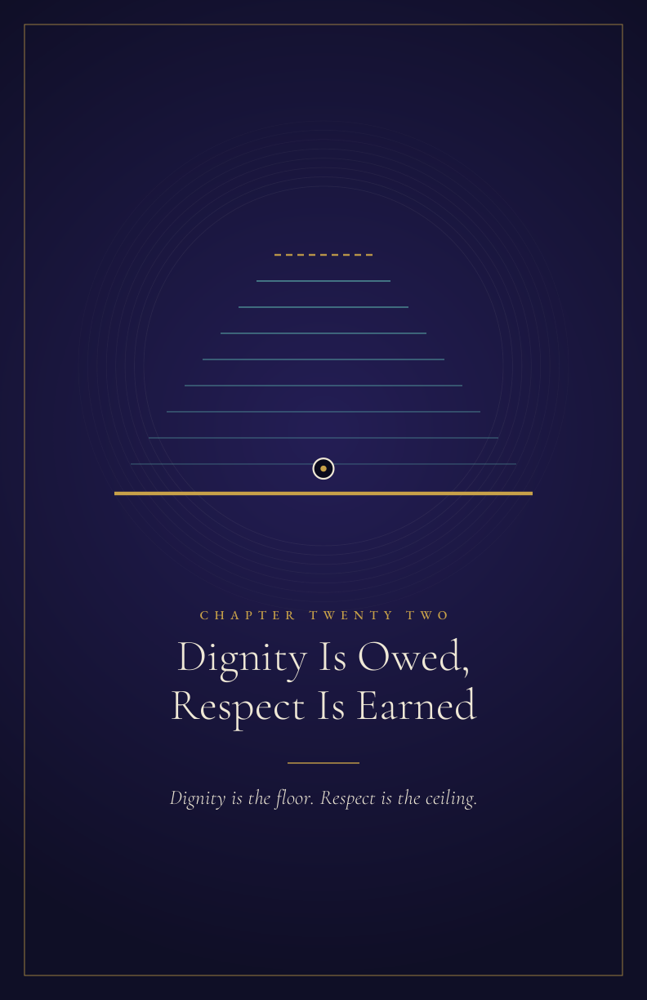
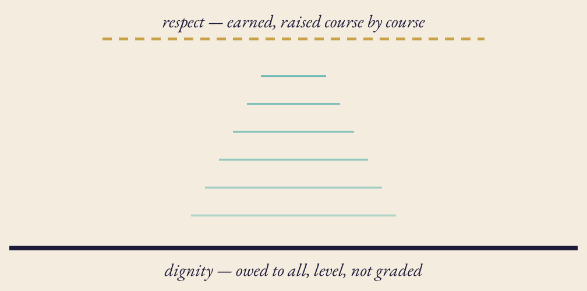

THE GEOMETRY OF EXISTENCE · LEVEL FOUR · THE PRINCIPLE · PAGES 134–137

  

CHAPTER TWENTY TWO

# Dignity Is Owed, Respect Is Earned

> *Dignity is the floor. Respect is the ceiling.*

  

There is a creed that came out of dance floors in the 1990s and has outlasted most of the philosophies that looked down on it. Four words: peace, love, unity, respect.

The author of this book lives by it. This chapter is about the fourth word, because the fourth word is the one the creed is usually accused of being naive about.

It is not naive, if you keep two things apart.

**Dignity is owed.** It is the floor, and Chapter Nineteen laid it: what exists does not have to prove anything in order to count. Decency, safety, and the plain acknowledgment that someone is there are not rewards. You do not hold them back until they are deserved. Dignity does not come in degrees.

**Respect is earned.** It is the ceiling, and it is built: trust, standing, being taken at your word. It comes entirely in degrees. It rises with what you have done and falls with what you have done, and Level Three applies to it without exception. It moves on evidence other people can see. Where several things are required of you, your standing is the lowest of them.

`ON RECORD` Philosophers have drawn nearly this line. In 1977 Stephen Darwall separated the respect owed to every person simply as a person from the respect a person earns by their conduct and character. The creed and the seminar arrived at the same place.

  

<i>The floor is level and holds everyone. The ceiling is raised by conduct, one course at a time.</i>

There is a third thing that borrows the name. **Demanded respect is fear.** When someone requires the ceiling as if it were the floor — *you will respect me* — what they receive, if they receive anything, is caution. Caution looks like respect from across a room. It does not survive the person leaving it.

So the fourth word of the creed reads like this. Peace, love, and unity are what you bring, to everyone, unearned. Respect is what you prove.

*Earn your reality* is the short form, and it needs its boundary stated at once, because without the boundary it becomes cruel. `ARGUED` Not everything in your reality was earned. Chapter Two is still in force. Illness, birth, loss, and luck are handed out by the Given, which keeps no accounts. A person with less has not thereby earned less. The phrase governs only the part of your reality that answers to conduct — your word, your standing, the trust placed in you, the rooms you are welcome in — and over that part its rule is exact: it responds to what you have done, not to what you have claimed.

The instrument is a ledger with three columns.

*What I gave* — dignity given, including to people who had not earned my respect. *What I earned* — things done that someone could point to. *What I spent* — standing drawn down: a broken word, a shortcut, a claim made ahead of the deed.

The ledger runs both ways, and it begins at home. Self-respect is not a feeling you summon. It is the balance of promises you made to yourself and kept.

Then the rest of the creed, read through the manual. *Peace* is the kept middle of Chapter Eight — not the absence of conflict, but a place to stand inside it. *Love* is the witness that stays without fixing, and the welfare column that does the harder thing. *Unity* is not the merging of interiors. Chapter Fourteen forbids that. Unity is thresholds kept, each side inviolate, the door between them open.

> **▲ Practice**
>
> Keep the ledger for seven days. Three columns, one line a day in each: given, earned, spent. Do not total it. On the seventh day read down the third column and choose one entry to repair.

> **◆ Audit**
>
> Where do you demand a respect you have not earned? And where do you withhold dignity until it has been earned? Both are the same confusion of floor and ceiling, run in opposite directions. Name one of each.

---

[← Change Without Erasure](21-change-without-erasure.md) · [Contents](../README.md) · [PDF ↓](../../edition/README.md) · [Level Five · The Proof and Its Limits →](../5-the-proof/README.md)

