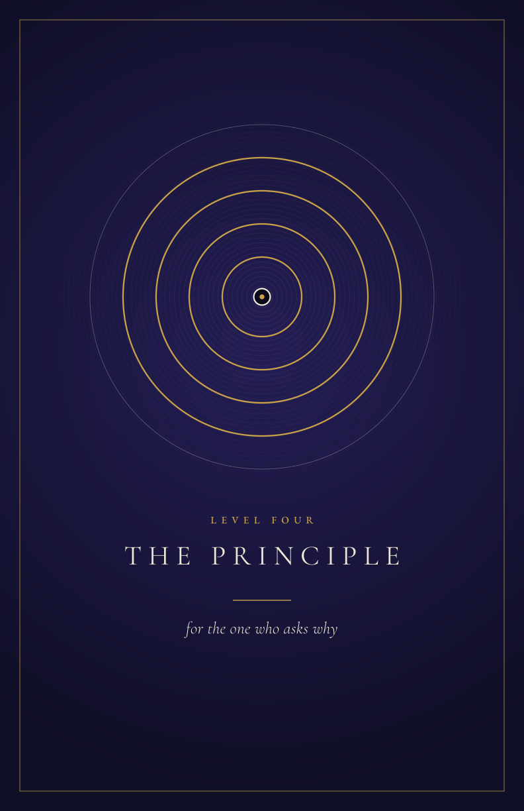
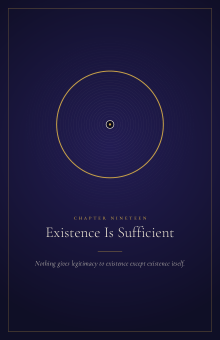
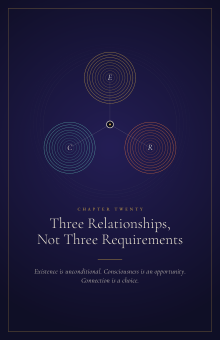
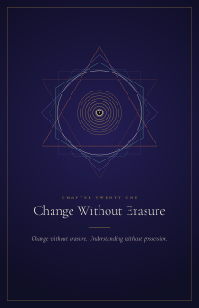
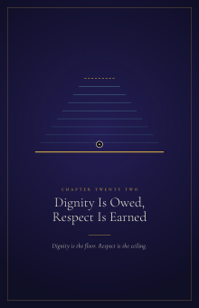

THE GEOMETRY OF EXISTENCE · LEVEL FOUR · THE PRINCIPLE · PAGE 121

  

LEVEL FOUR

# The Principle

> *for the one who asks why*

<!-- level-strip -->
## In this level

<table>
<tr><td align="center" valign="top" width="25%"> 19 · Existence Is Sufficient</td><td align="center" valign="top" width="25%"> 20 · Three Relationships, Not Three Requirements</td><td align="center" valign="top" width="25%"> 21 · Change Without Erasure</td><td align="center" valign="top" width="25%"> 22 · Dignity Is Owed, Respect Is Earned</td></tr>
</table>
<!-- /level-strip -->

---

[← The Graded Audits](../3-the-degree/19-the-graded-audits.md) · [Contents](../README.md) · [PDF ↓](../../edition/README.md) · [Existence Is Sufficient →](19-existence-is-sufficient.md)

