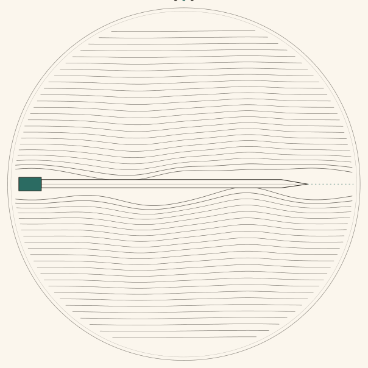

CHAPTER NINETEEN

# The Blade That Stays Sharp

*Work, Craft and Mastery*

<i>The grain of the wood parts along its natural seam, and the blade passes where there is no resistance.</i>

> *I am rising to the work of a human being.*
>
> — Marcus Aurelius, *Meditations* 5.1 (Long)

> **RESPECT** · *Would I sign my name to the work I did today?*

## I · ◆ The Teaching

163. Your work is your word made visible. Do it as though the one who receives it is someone you love, because one day it will be.
164. We become builders by building and just by doing just acts. No one ever became a master by thinking about mastery.
165. Skill in action is a form of prayer. The ancients said so in India, and the craftsmen of every land have known it in their hands.
166. Follow the grain. The master does not hack at the bone; he feels for the natural spaces and lets the blade pass where there is no resistance. His knife stays sharp for nineteen years.
167. The work that feels most alive is work where the challenge matches your skill. Too easy and you are bored; too hard and you are afraid. Keep raising both.
168. Repetition is not the enemy of mastery. It is its road. And do not strain on willpower alone: arrange your days so the right act is the easy act. Character is built by repetition and by arrangement.
169. Do the small task as well as the great one. The way you sweep a floor is the way you will run a company.
170. Rise to your work. Each morning you are not merely going to a job; you are rising to the work of a human being.
171. Be paid for your work, and never let the pay be the only reason you do it well.

## II · ◇ The Five Scales

|  |  |
|---|---|
| **CELL** | When a converted cell keeps receiving the right signals, its new identity in time sustains itself. Practice does the same for skill. |
| **SELF** | Habit is identity under construction. You become what you repeatedly do. |
| **BOND** | Good work is a gift to strangers you will never meet. |
| **COMMUNITY** | Every society stands on the quiet excellence of people whose names no one remembers. |
| **COSMOS** | The universe builds complexity slowly, through countless small repetitions. So does a master. |

## III · The Witnesses

- **Zhuangzi** · Chapter 3  
  Cook Ding’s blade stays as sharp as new after nineteen years, because he cuts along the natural seams.
- ★ **Aristotle** · *Nicomachean Ethics* II.1  
  We become builders by building, and just by doing just acts. It converges with Confucius on practice and with modern research on habit.
- **Bhagavad Gita** · 2.50  
  Yoga is skill in action.
- **Mihaly Csikszentmihalyi** · *Flow* (1990)  
  Optimal experience comes when challenge and skill are in balance.
- **Marcus Aurelius** · *Meditations* 5.1  
  On mornings you do not want to rise: “I am rising to the work of a human being.”

## IV · ● The Tale

### *Cook Ding*

Zhuangzi tells of a cook carving an ox for his lord. Every movement of his hand, his shoulder, his foot and his knee was in rhythm, as if he were dancing.

The lord marvelled. The cook explained that when he began, he saw nothing but the whole ox. After three years he no longer saw the ox as a mass. Now he works by spirit rather than by sight, following the natural lines, slipping the blade through the spaces between the joints.

A good cook changes his knife once a year, because he cuts. An ordinary cook changes it once a month, because he hacks. Ding had used his for nineteen years, and it was as sharp as if it had just come from the grindstone. When he meets a difficult place, he slows down, watches closely and moves the blade with great care.

## V · ● The Energy

Flow is the most efficient state a human being can work in: attention fully engaged, effort feeling almost effortless. It comes neither from rest alone nor from strain alone, but from the narrow channel where challenge meets skill. Find that channel and your work will feed you as much as it takes.

## VI · The Reversal

> Mastery is not perfectionism. Whoever cannot release a piece of work until it is flawless never releases anything. And work is not the whole of a life: a craft that devours your health, your family and your friendships has become a master instead of a servant.

## VII · ◆ The Practice

|  |  |
|---|---|
| **DAILY** | Each day, do one task with full attention, as if it were the only task in the world. |
| **WEEKLY** | Each week, deliberately practise one skill just beyond your present reach. |

## VIII · The Ledger

|  |  |
|---|---|
| **PEACE** | Did I work in flow, or in frenzy? |
| **LOVE** | Did I do my work as a gift to the one who will receive it? |
| **UNITY** | Did I make someone else’s work easier? |
| **RESPECT** | Would I sign my name to what I did today? |

## IX · The Song

*The fool will hack at the knuckle-bone,* 
*And blunt his blade in a day;* 
*The master feels for the place between,* 
*And the joint gives up its way.* 
*So learn the grain of the work you do,* 
*And the grain of the ones you lead;* 
*And the edge you keep for a score of years* 
*Will cut where the hour has need.*

---

[← The Work](README.md) &nbsp;·&nbsp; [Contents](../README.md) &nbsp;·&nbsp; [Enough →](20-enough.md)

