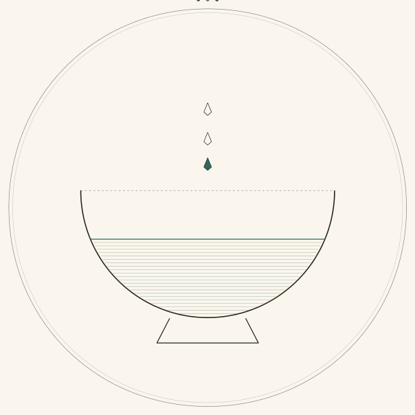

CHAPTER TWENTY

# Enough

*Money, Desire and Enough*

<i>A vessel filled to the golden section and no higher. It can be carried without spilling.</i>

> *He who is satisfied with his lot is rich.*
>
> — *Tao Te Ching* 33 (Legge)

> **PEACE** · *How much is enough, and do I already have it?*

## I · ◆ The Teaching

172. Who is rich? The one who rejoices in his portion. Every tradition that has thought hard about wealth has come to the same verdict.
173. Money is trust given a number. Handle it carelessly and you handle trust carelessly.
174. Pay your debts where people can see. Owe no one in secret.
175. Desire is a fire. It warms the house or burns it down. The difference is whether you tend it or it tends you.
176. It is not money that is the root of evil, but the love of it. Use money; love people. The disaster begins when those two verbs trade places.
177. Do not measure a person by what they own. Wealth is what you hold. Worth is what you are when it is gone.
178. Earn honestly, spend wisely, give freely. The highest giving is the kind that makes the receiver no longer need to receive.
179. Never trade your integrity for an advantage. Competence lost can be rebuilt with practice. Integrity lost is the slowest coin in the world to earn back.
180. Enough is a relationship with money, not an amount of it. Wanting more is not the trouble. Needing more in order to feel worthy is.

## II · ◇ The Five Scales

|  |  |
|---|---|
| **CELL** | A cell takes only the energy it can use; when growth ignores every limit, it is disease, not health. |
| **SELF** | Whoever knows “enough” is free. Whoever does not is never paid in full. |
| **BOND** | Money handled honestly between people builds trust; handled in secret, it poisons love. |
| **COMMUNITY** | An economy is a vast web of trust, and every fraud tears it. |
| **COSMOS** | Energy is never made from nothing. Wealth, too, is directed energy: received, transformed and passed on. |

## III · The Witnesses

- ★ **Laozi** · *Tao Te Ching* 33, 44, 46  
  Whoever knows he has enough is rich. It converges with Pirkei Avot 4:1, Epicurus and Seneca.
- **Pirkei Avot** · 4:1  
  “Who is rich? One who rejoices in his portion.”
- **Epicurus** · *Vatican Sayings* 68  
  Nothing is enough for the one to whom enough is too little.
- **Paul** · 1 Timothy 6:10  
  “The love of money is the root of all evil.”
- **Maimonides** · *Mishneh Torah*, Gifts to the Poor 10:7–14  
  Eight levels of giving; the highest helps a person become self-sufficient.

## IV · ● The Tale

### *Two Companies*

Arthur Andersen was founded in 1913 and grew into one of the most trusted accounting firms in the world. When its client Enron collapsed in 2001, Andersen staff were found to have shredded large quantities of documents. The firm was convicted of obstruction of justice in June 2002. In 2005 the Supreme Court unanimously reversed the conviction, but by then it did not matter. The clients had fled, and an institution nearly ninety years old had in effect ceased to exist. Its only real product had been trust.

In the autumn of 1982, seven people in the Chicago area died after taking Tylenol capsules that someone had laced with cyanide. The maker, Johnson & Johnson, had not caused the tampering. It recalled about thirty-one million bottles anyway, at a reported cost of around a hundred million dollars, and brought the product back in tamper-resistant packaging. The brand many expected to die recovered.

One company spent its integrity to protect its money. The other spent its money to protect its integrity.

## V · ● The Energy

Money is stored energy: hours of human work frozen into a number and released when spent. Ask of every dollar where its energy came from, and where you are sending it. The evidence is honest in both directions: for most people, happiness keeps rising slowly with income, so money is not nothing. But across hundreds of studies, people who make wealth and possessions central to their worth report lower well-being. The danger is not money. It is what you ask money to prove.

## VI · The Reversal

> “Enough” is easy to preach from comfort. For someone who cannot pay the rent, struggling for more money is not greed; it is survival, and no philosophy should shame it. Contentment is a virtue for the satisfied, not a sermon for the poor. Earn what you need with dignity; then learn where enough lies.

## VII · ◆ The Practice

|  |  |
|---|---|
| **DAILY** | Each day, notice one thing you already have that you once wished for. |
| **WEEKLY** | Each week, review your money honestly: what came in, what went out, and whether it went where your values say it should. |

## VIII · The Ledger

|  |  |
|---|---|
| **PEACE** | Did desire drive me today, or did I drive it? |
| **LOVE** | Did I give something without needing anything back? |
| **UNITY** | Did I deal honestly with money that touched others? |
| **RESPECT** | Did I trade any integrity for any advantage? |

## IX · The Song

*The bowl that is filled to the brim, my child,* 
*Will spill on the road to the door;* 
*And the one who must carry the most of all* 
*Is the one who is begging for more.* 
*So fill it to where you can walk with it straight,* 
*And give from the top as you go;* 
*For the rich are the ones who have learned what is “enough,”* 
*And the poor are the ones who don’t know.*

---

[← The Blade That Stays Sharp](19-the-blade-that-stays-sharp.md) &nbsp;·&nbsp; [Contents](../README.md) &nbsp;·&nbsp; [The Headland →](21-the-headland.md)

