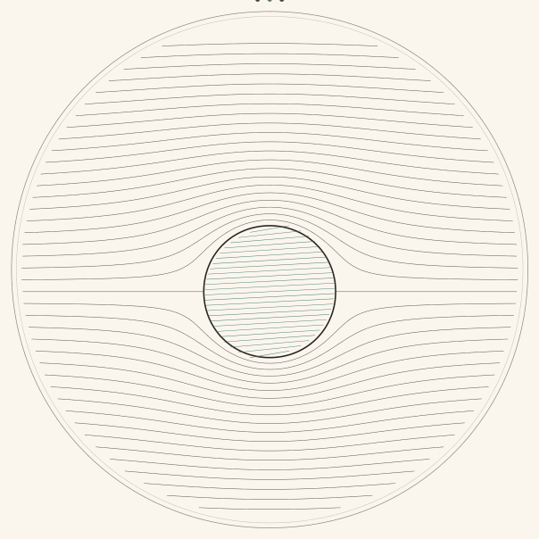

CHAPTER TWENTY-ONE

# The Headland

*Suffering, Failure, Grief and Resilience*

<i>Ideal flow past a fixed stone: the streamlines part, close again behind it, and the stone remains.</i>

> *Be like the promontory against which the waves continually break, but it stands firm and tames the fury of the water around it.*
>
> — Marcus Aurelius, *Meditations* 4.49 (Long)

> **PEACE** · *Can I stand like the headland while this wave breaks?*

## I · ◆ The Teaching

181. Suffering is the first truth, not the last. It is to be understood, not denied. Whoever pretends there is no pain cannot learn how to carry it.
182. Be like the headland. The waves break on it day and night. It does not break. And around it, the water grows calm.
183. Before a great task is given, the mind is often first schooled in hardship. Your trials may be your training.
184. Failure is information. It tells you where the road is not. Read the map it gives you, then walk on.
185. Fall seven times, stand up eight. Not because falling does not hurt, but because the standing is what makes you.
186. Grief is love with nowhere to go. Let it move. Grief held still turns to stone.
187. When the ship is going down, the measure of a person is whether they stay with the passengers.
188. Collapse is not always the end. Sometimes it is the beginning of reorganization. There are creatures in the sea that, under stress, fold back into an earlier form and begin again.
189. You do not have to be strong alone. Even the headland is part of the continent.

## II · ◇ The Five Scales

|  |  |
|---|---|
| **CELL** | Under damage or starvation, the medusa *Turritopsis* can revert to an earlier stage and regrow. Not immortal, but remarkably resilient. |
| **SELF** | Resilience is not never breaking. It is the power to reorganize after breaking. |
| **BOND** | Shared suffering, faced together, can forge bonds nothing else can. |
| **COMMUNITY** | Peoples that have survived catastrophe carry hard-won wisdom about what matters. |
| **COSMOS** | Stars collapse, and from their wreckage new stars and planets form. Endings feed beginnings. |

## III · The Witnesses

- **The Buddha** · First Noble Truth, *Saṃyutta Nikāya* 56.11  
  There is suffering; it is to be fully understood.
- **Marcus Aurelius** · *Meditations* 4.49  
  Be like the headland on which the waves break.
- **Mencius** · *Mencius* 6B15  
  When Heaven is about to give someone a great task, it first exercises their mind with hardship.
- **Viktor Frankl** · *Man’s Search for Meaning* (1946)  
  When we can no longer change a situation, we are challenged to change ourselves.
- **Al-Ghazali** · *Deliverance from Error*  
  At the height of his fame he suffered a crisis so severe he could not speak; he left his post, sought truth through practice, and returned transformed.

## IV · ● The Tale

### *Who Stays with the Ship*

On January 13, 2012, the cruise ship *Costa Concordia*, carrying more than four thousand people, struck rocks off the Italian island of Giglio and began to capsize. Her captain, Francesco Schettino, left the ship while passengers were still aboard. Thirty-two people died. He was convicted of manslaughter and of abandoning ship and sentenced to sixteen years, a judgment upheld by Italy’s highest court in 2017.

Almost a century earlier, Ernest Shackleton faced a far worse sea with far less. Stranded after the loss of *Endurance*, he set out from Elephant Island on April 24, 1916, in the *James Caird*, a lifeboat barely seven metres long, with five companions, across some eight hundred miles of the most violent ocean on earth. They reached South Georgia, crossed its unmapped mountains on foot, and Shackleton went back again and again until every man left behind was rescued.

A uniform confers authority. Suffering reveals whether it was ever earned.

## V · ● The Energy

Suffering consumes great energy, much of it spent resisting what has already happened. Acceptance does not mean approval; it means you stop pouring strength into wishing the past were different, and turn it toward what can still be done. That turning is what resilience feels like from the inside.

## VI · The Reversal

> Talk of resilience can become cruelty when it tells suffering people they should simply be stronger. Some pain is too heavy to carry alone, and needing help is not failure. If your suffering includes thoughts of harming yourself, or feels unbearable, reach out now to someone you trust and to professional help. The headland is strong because it is joined to the land.

## VII · ◆ The Practice

|  |  |
|---|---|
| **DAILY** | Each day, name one difficulty honestly, without swelling it or denying it. |
| **WEEKLY** | Each week, ask one person for help with something, or offer help to someone who is struggling. |

## VIII · The Ledger

|  |  |
|---|---|
| **PEACE** | Did I accept what could not be changed? |
| **LOVE** | Did I stay with someone in their suffering? |
| **UNITY** | Did I let others carry some of my weight? |
| **RESPECT** | Did I meet my failure without contempt for myself? |

## IX · The Song

*The sea comes in like a regiment,* 
*And it breaks on the rock like glass;* 
*And it comes again, and it breaks again,* 
*And the rock lets the regiments pass.* 
*But the rock is not a lonely thing,* 
*Though it stands at the end of the land;* 
*It is held by the whole of the continent,* 
*And so, if you let it, is your hand.*

---

[← Enough](20-enough.md) &nbsp;·&nbsp; [Contents](../README.md) &nbsp;·&nbsp; [The Book of Earned Power →](22-the-book-of-earned-power.md)

