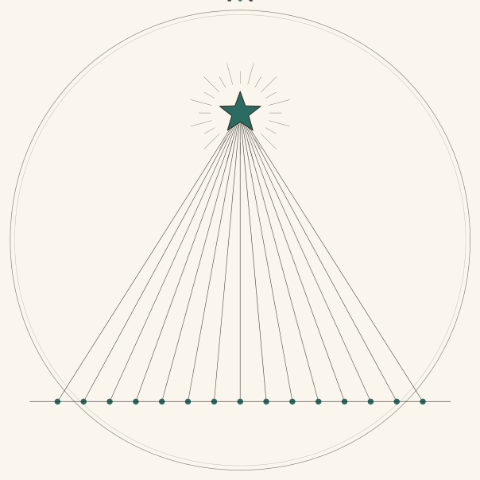

CHAPTER TWENTY-TWO

# The Book of Earned Power

*Power and Responsibility*

<i>Fifteen lines rising from the ground to hold up a single point. The star does not stand on its own; it is carried.</i>

> *Whosoever will be great among you, shall be your minister.*
>
> — Mark 10:43 (KJV)

> **RESPECT** · *Would the people my power touches be glad I hold it?*

> *Power is the capacity to change another person’s reality. Everyone holds some. Power does not only corrupt; it reveals, magnifying whatever was already in you. Here, condensed, are the fifteen laws of power that is earned rather than taken.*

## I · ◆ The Teaching

190. **Let others inform your temperature; never let them set it.** Whoever can provoke you can steer you.
191. **Hold your aims firmly and your outcomes lightly.** The weight you hang on an outcome is what makes your hands shake.
192. **Make the peace that needs no guard,** and keep the guard until the peace no longer needs it.
193. **Build trust from small stones.** Promise less; deliver all of it.
194. **Show up when it costs.** Costly loyalty is the only kind people fully believe.
195. **Take the reaching hand quickly the first time;** the second time, ask what has changed.
196. **Build a fellowship, not a following.** Measure your power by how well things run when you leave the room.
197. **Seat your rivals at the table** when their interests can be tied to the table’s survival; otherwise keep them where you can see them.
198. **Distrust the unity that needs an enemy.** It turns on its own when the outsiders run out.
199. **Never lower the floor.** Withhold trust if you must; never withhold dignity.
200. **Never extract by threat what you must earn.** Respect taken by fear is only fear, and fear waits for your fall.
201. **Never trade integrity for advantage.** It is the slowest coin in the world to earn back.
202. **Prefer the power that is given, and build it before the storm:** in fear, people hand power to the loudest.
203. **Beware the greater good that requires a lesser person.** The end keeps moving; the means stay exactly as terrible.
204. **Keep the voices that can say no,** real ones, not appointed ones. A ruler surrounded by agreement has gone blind.

## II · ◇ The Five Scales

|  |  |
|---|---|
| **CELL** | A master regulatory factor holds power over thousands of genes. When it acts without the cell’s checks, the result is disease. |
| **SELF** | Your first kingdom is the gap between what happens and what you do. Lose that one and every other kingdom is borrowed. |
| **BOND** | In every bond someone holds more power at a given moment. Love is how that power is used. |
| **COMMUNITY** | Power that serves is renewed by those it serves. Power that rules must be defended against them. |
| **COSMOS** | The greatest forces in nature act through relation: gravity shapes galaxies without commanding anything. |

## III · The Witnesses

- ★ **Plato** · *Republic* I, 347b–d; II, 359c–360d  
  The best rulers do not want to rule; and the Ring of Gyges asks what you would do with power no one could see. It converges with Laozi and the Gospels.
- **Laozi** · *Tao Te Ching* 17  
  Of the best rulers, when their work is done, the people say they did it themselves.
- **Jesus** · Mark 10:42–45  
  Whoever would be great among you must be your servant.
- **Hannah Arendt** · *On Violence* (1970)  
  Power and violence are opposites: where one rules absolutely, the other is absent.
- **Martin Luther King Jr.** · “Where Do We Go From Here?” (August 16, 1967)  
  Power without love is reckless and abusive; love without power is sentimental and anaemic.
- **Marcus Aurelius** · *Meditations* 6.30  
  “Take care that thou art not made into a Caesar, that thou art not dyed with this dye.” (Long)

## IV · ● The Tale

### *Two Crowns, and a Balcony*

On December 23, 1783, in the Maryland State House at Annapolis, George Washington handed back his commission as commander of the Continental Army. He had the army’s loyalty and the nation’s gratitude; he could have taken far more. King George III, hearing that Washington might give up power, reportedly told the painter Benjamin West that if he did, he would be the greatest man in the world. Six years later the nation asked him to lead it.

On December 2, 1804, in the cathedral of Notre-Dame, Napoleon took the imperial crown and placed it on his own head, with the Pope looking on. His empire depended on victories that had to keep coming. When they stopped, the nations he had humiliated combined against him.

On December 21, 1989, the Romanian dictator Nicolae Ceaușescu stood on a balcony in Bucharest before a crowd assembled to cheer him. Partway through the speech, it began to jeer. He fled the next day, was captured, and was executed with his wife on December 25. The respect his regime had demanded for decades had never existed. It had only been fear, waiting.

## V · ● The Energy

Taken power is expensive to hold: it needs constant watching, enforcement and suspicion. Given power is cheap to hold, because the people beneath it are working to keep it in place. The best long-run evidence agrees. In a fourteen-year study that measured personality before people entered the workforce, selfish, deceitful and aggressive people were no more likely to gain power than generous ones: their intimidation helped them, and their damaged relationships cancelled the gain (Anderson and colleagues, 2020).

## VI · The Reversal

> Dominance is a real road to rank, and this book will not pretend otherwise. It wins where relationships do not repeat, where reputations do not travel, and where people cannot leave: in crises, one-time encounters and captive groups. In those places, do not play the martyr. Answer in proportion, find allies, use the law, and protect yourself. And when you must take power in an emergency, take only what the moment requires, explain yourself openly, and give it back when the danger passes. Love without power cannot protect anyone.

## VII · ◆ The Practice

|  |  |
|---|---|
| **DAILY** | Each day, notice one power you hold over someone, and use it in their favour. |
| **WEEKLY** | Each week, ask someone who can tell you no what you are getting wrong, and thank them. |

## VIII · The Ledger

|  |  |
|---|---|
| **PEACE** | Did I govern myself before trying to govern anyone else? |
| **LOVE** | Did I use my power to raise someone up? |
| **UNITY** | Did I keep near me people who can tell me no? |
| **RESPECT** | Was any of my power demanded rather than given? |

## IX · The Song

*The crown that you set on your own two brows* 
*Must be guarded by night and by day,* 
*And the hands that you broke to lift it there* 
*Are the hands that will tear it away.* 
*But the crown that is handed you, child, by the ones* 
*Who have watched how you carried the load,* 
*Is light on the head, and it needs no guard,* 
*And it goes with you down the road.*

---

[← The Headland](21-the-headland.md) &nbsp;·&nbsp; [Contents](../README.md) &nbsp;·&nbsp; [The Becoming →](../5-the-becoming/README.md)

