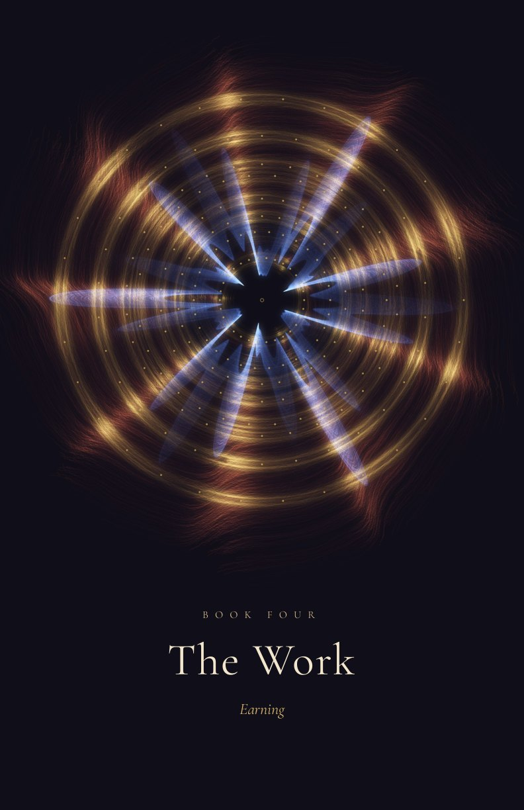

BOOK FOUR

# The Work

*Existence is given. Consciousness and connection are offered. Everything else is earned. This Book concerns the work by which a life is built: craft and mastery, money and desire, endurance through suffering, and the right use of power. It is where the creed meets Monday morning.*

19. [The Blade That Stays Sharp](19-the-blade-that-stays-sharp.md)
20. [Enough](20-enough.md)
21. [The Headland](21-the-headland.md)
22. [The Book of Earned Power](22-the-book-of-earned-power.md)

---

[← Repair](../3-the-bond/18-repair.md) &nbsp;·&nbsp; [Contents](../README.md) &nbsp;·&nbsp; [The Blade That Stays Sharp →](19-the-blade-that-stays-sharp.md)

