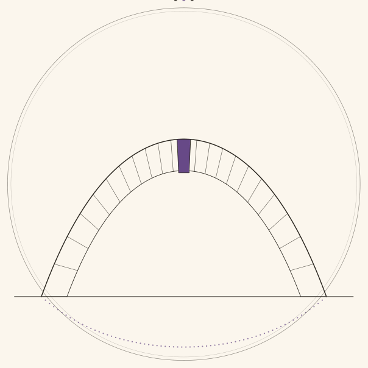

CHAPTER TWENTY-THREE

# Becoming Without Erasing

*Change, Transformation and Becoming*

<i>The inverted chain. A hanging chain takes the one curve in which every link pulls true; turned over, it is the arch that stands by its own weight.</i>

> *Be ye transformed by the renewing of your mind.*
>
> — Romans 12:2 (KJV)

> **UNITY** · *Can I hold who I was and who I am becoming in one self?*

## I · ◆ The Teaching

205. You cannot step into the same river twice, for it is not the same river and you are not the same one who steps. Stop mourning that you change. You were always going to.
206. Become who you are. Not who you were told to be, not who you fear you are, but the one waiting in the grain of you, as the statue waits in the stone.
207. You do not have to go back to zero to begin again. The cell that changes its kind does not return to the beginning. It crosses the ridge into a new valley, directly. So can you.
208. Learn the four principles of becoming. *Conserved specificity:* what you have built is material, not rubble. *Rejection of the null point:* you never have to go back to zero. *Adjacent possibility:* your next form must be reachable from your present one. *Non-regressive growth:* change that destroys what was good is not growth. Change without erasure.
209. The first hard, honest act opens what habit had sealed shut. Do that act. The rest will follow it through the door.
210. Hold the new way until it holds you. A new self must be fed until it can feed itself. In the best-known study of habit, the median time for a new behaviour to become automatic was sixty-six days, and the estimates ran from eighteen to two hundred and fifty-four. Missing one day did not break it.
211. Most change is partial. You will live for a while between the old valley and the new one. Do not call that failure. It is the crossing.
212. Carry your history without shame. The memory of what you were is not a stain on what you are becoming. It is your lineage.
213. A human being is a bridge, not a destination. The point is not to arrive and stop. The point is to keep crossing toward something better.

## II · ◇ The Five Scales

|  |  |
|---|---|
| **CELL** | Transdifferentiation: one mature kind of cell converted directly into another, without going back to an embryonic state. |
| **SELF** | Real personal change is the same: a direct crossing into a new way of being, with memory intact. |
| **BOND** | Bonds transform too. The friend becomes the partner; the rival becomes the ally; the child becomes the equal. |
| **COMMUNITY** | Nations can change their character within a generation, for better or worse, by the commitments they keep. |
| **COSMOS** | Everything that exists is in transformation: stars into elements, elements into planets, planets into life. |

## III · The Witnesses

- ★ **Heraclitus** · Fragment B91  
  You cannot step into the same river twice. It converges with the Buddha’s impermanence and Zhuangzi’s “transformation of things.”
- **Friedrich Nietzsche** · *The Gay Science* §270; *Thus Spoke Zarathustra*, Prologue §4  
  “Become who you are”; a human being is a bridge, not a goal.
- **Zhuangzi** · Chapter 2  
  He dreamed he was a butterfly, and woke unsure whether he was a man who had dreamed of being a butterfly or a butterfly dreaming of being a man: the transformation of things.
- **Paul** · Romans 12:2  
  “Be ye transformed by the renewing of your mind.”
- **Confucius** · *Analects* 2.4  
  At fifteen he set his heart on learning; at seventy he could follow his heart’s desire without overstepping what was right: a map of becoming across a lifetime.

## IV · ● The Tale

### *The Emperor of Kalinga*

Around 261 BCE, eight years after his consecration, the Mauryan emperor Ashoka conquered the kingdom of Kalinga on India’s eastern coast. By the figures in his own inscription, a hundred and fifty thousand people were carried away, a hundred thousand were killed, and many more died.

Then he did what few conquerors have done. In an edict cut into rock, known today as Major Rock Edict XIII, he publicly confessed remorse for the suffering and declared that he would seek conquest by righteousness, *dhamma*, rather than by war. For the rest of his reign he promoted moral conduct, tolerance among religious communities, and care for the sick.

He did not erase his past; the edict names it. And history is honest about the limits of his change: that very edict is missing from the two rock inscriptions set up inside Kalinga itself. Yet more than two thousand years later, the lion capital from one of his pillars is the national emblem of India, and his wheel turns at the centre of its flag.

## V · ● The Energy

Changing the pattern of a life takes the most force at the beginning, like pushing a ball over a ridge. Once over, the new valley does the work: habits form, and the new way becomes the easy way. That is why the first weeks of any change feel hardest, and why they are worth it.

## VI · The Reversal

> Where the metaphor breaks: cells do not choose, and you do. Biology is morally neutral, so the direction of your change must be justified by your values, not by the image. Changing gene expression is not rewriting DNA, and no thought rewrites your genes. And not every change is growth: people transform for the worse as easily as for the better. Choose the valley you are crossing toward.

## VII · ◆ The Practice

|  |  |
|---|---|
| **DAILY** | Each day, do one act that belongs to the person you are becoming. |
| **WEEKLY** | Each week, write down one way you differ from who you were a year ago, and one way you mean to differ a year from now. |

## VIII · The Ledger

|  |  |
|---|---|
| **PEACE** | Did I accept the in-between without despair? |
| **LOVE** | Did I honour the one I was while choosing who to become? |
| **UNITY** | Did I let others see and support my change? |
| **RESPECT** | Did the new self keep its promises today? |

## IX · The Song

*Hang up the chain and it finds its line,* 
*And every link pulls true;* 
*Then turn it over and set it in stone,* 
*And the arch will carry you.* 
*So hang your life by the things you hold,* 
*And let it find its curve;* 
*Then stand it up, and cross upon it,* 
*And it will bear, and serve.*

---

[← The Becoming](README.md) &nbsp;·&nbsp; [Contents](../README.md) &nbsp;·&nbsp; [The Wheel →](24-the-wheel.md)

