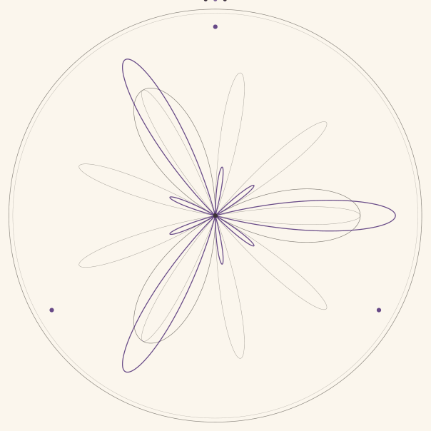

CHAPTER TWENTY-FOUR

# The Wheel

*Ritual, Symbol and the Honest Magic*

<i>Rose curves of three and nine petals, and their sum. The compound keeps the threefold symmetry they share: the Law of the Third.</i>

> *Generate the third. Do not select it.*
>
> — *Lingua Rotarum*, the Language of the Wheels

> **UNITY** · *What rituals bind my days, and my people, together?*

## I · ◆ The Teaching

214. Strip every tradition of magic of its claims and one true thing remains: attention shaped by symbol and ritual changes the one who practises it. That is the honest magic, and it is enough.
215. A ritual is an action repeated with meaning. It can steady the hands before a trial and give grief somewhere to go. The evidence is modest and still uncertain, and where rituals work, they work on the one who performs them.
216. A symbol is a compressed intention. Draw it, wear it, set it where you will see it, and it will call your attention back to what you chose.
217. Keep a ward: not against demons, but against forgetting. One figure that stands for the person you have decided to be. When you see it, return.
218. Every working begins with a mark: refuse, hold or assent. Know which one you are making before you act. And remember the fourth mark, which stands outside yes and no.
219. Generate the third; do not select it. When two options trap you, do not merely pick one. Look for the new axis from which both can be seen.
220. Magic that claims to bend the world by will alone will fail you when you need it most. Magic that bends your attention toward what you have chosen will serve you every day.
221. Never perform a working to control another person. The honest magic works only on the willing, and the first willing person is you.
222. Make your practice beautiful. Beauty is not decoration. It is how the mind marks what matters.

## II · ◇ The Five Scales

|  |  |
|---|---|
| **CELL** | Cells keep time by circadian clocks: biological rituals renewed every day. |
| **SELF** | Ritual turns intention into habit by tying it to a fixed moment. |
| **BOND** | Shared rituals, a toast, a handshake, a bracelet traded hand to hand, make an invisible bond visible. |
| **COMMUNITY** | Every lasting people keeps a calendar of rites. |
| **COSMOS** | The heavens move in cycles. The oldest rituals were human beings keeping time with the sky. |

## III · The Witnesses

- **Martin Lang, Jan Krátký and Dimitris Xygalatas** · *Scientific Reports* (2022)  
  A predictable, ritual-like sequence reduced physiological anxiety only modestly compared with control tasks, and most clearly in those most affected by the anxiety task; the estimates were uncertain. The best-known earlier study claiming that rituals improve performance (Brooks and colleagues, 2016) was disowned in 2023, when its own authors asked the journal to retract it.
- **Nicholas Hobson and colleagues** · *Personality and Social Psychology Review* (2018)  
  Rituals may regulate emotion, performance goals and social connection; some of the studies this review drew on have since been questioned.
- ★ **The PLUR handshake** · Rave culture, 1990s onward  
  Peace, love, unity and respect enacted with the hands as a bracelet passes between wrists: a modern rite that binds strangers, as ancient rites did.
- **Massimo Panella** · *Lingua Rotarum* (2026)  
  A constructed notation of marks, stems and bindings, drawn from real mathematics, offered as a language of attention.

## IV · ● The Tale

### *The Language of the Wheels*

&lt;em>Lingua Rotarum is a notation built from real mathematics. Every word begins with a mark: Refuse, Hold or Assent, and a fourth that stands outside the lattice of yes and no. Its meaning is carried by twelve stems, among them Witness, Ground, Hold, Refuse, Bind, Release, Audit, Build and Return, each drawn as a rose curve, *r* = cos(*kθ*).

Words are bound by chords across the Kamea of the Sun, the six-by-six magic square in which every row, column and diagonal sums to 111, and every word is closed inside a ring drawn from the E8 root system. Two stems combine by the Law of the Third: the compound’s symmetry is the greatest common divisor of their two orders. All of it is computed and checked.

And the book says plainly what it is not. It claims no power over the world. It is a notation for attention: a way to set down, in a figure you can see, what you refuse, what you hold and what you assent to. Its standing ward reads: *hold; attend to the strongest case against.* That is magic with the lights on.

## V · ● The Energy

A ritual spends a little energy once in order to save a great deal later. It removes the need to decide again, marks a moment as one that matters, and gathers scattered attention into a single act. That, more than any charm, is why athletes, monks and mourners keep them.

## VI · The Reversal

> Ritual can harden into superstition or compulsion. A widely reported finding that lucky charms improve performance failed to replicate when other scientists tested it carefully. If skipping a ritual fills you with dread, or you repeat it over and over to quiet anxiety, it is no longer serving you; talk to someone. And no symbol, figure or word in this book has power over the world, over other people or over chance. Its power is over your attention, which is power enough.

## VII · ◆ The Practice

|  |  |
|---|---|
| **DAILY** | Each morning, set a mark on one matter: refuse it, hold it or assent to it, and act accordingly. |
| **WEEKLY** | Each week, design or renew one personal ritual, and keep it every day of that week. |

## VIII · The Ledger

|  |  |
|---|---|
| **PEACE** | Did a ritual steady me today? |
| **LOVE** | Did I share a ritual with someone I love? |
| **UNITY** | Did I keep the rites that bind my circle? |
| **RESPECT** | Did I keep my practice honest about what it can and cannot do? |

## IX · The Song

*Draw the wheel with a steady hand,* 
*And mark it yes, or no,* 
*Or hold the line in the middle place* 
*Till the third way starts to show.* 
*It will not stop the rain, my child,* 
*Nor turn a single stone;* 
*It turns the eye of the one who draws,* 
*And the eye is yours alone.*

---

[← Becoming Without Erasing](23-becoming-without-erasing.md) &nbsp;·&nbsp; [Contents](../README.md) &nbsp;·&nbsp; [The Author →](25-the-author.md)

