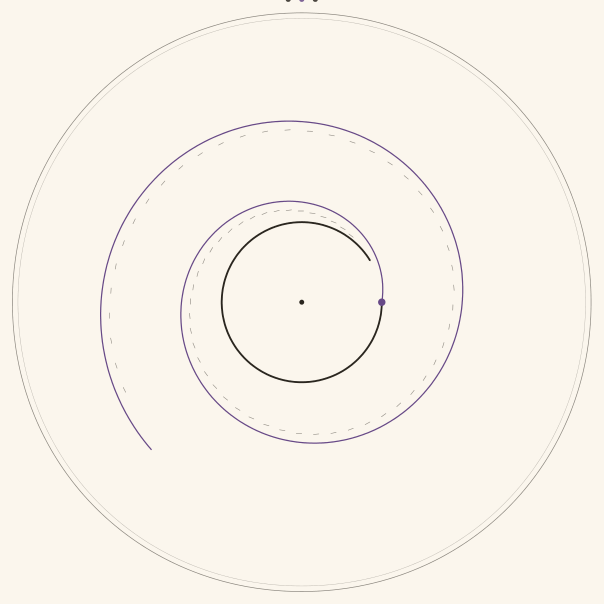

CHAPTER TWENTY-FIVE

# The Author

*Story, Identity and Integration*

<i>A circle broken at one point, and from the break a spiral that keeps writing outward. Broken does not mean meaningless.</i>

> *I don’t have to be God to be myself.*
>
> — Shatter, in *Vindicated*

> **LOVE** · *Can I love the person I was in every chapter of my story?*

## I · ◆ The Teaching

223. You are not only the character in your story. You are also its author. You cannot change what happened. You can change what it is understood to mean.
224. In this book’s model, drawn from the myth of Shatter, a person who holds power may pass through five stages: Control, Escape, Observation, Confrontation and Integration. Know where you stand.
225. Control says: *if I control everything, nothing can hurt me.* It begins as a child’s fortress and ends as a prison.
226. Escape says: *if I build systems, I will not have to control everything.* Systems are wise. Used as armour, they are only another wall.
227. Observation says: *maybe the world should go on without me.* Watching is good. Disappearing is not the same as peace.
228. Confrontation says: *the thing destroying my world is the part of myself I refused to face.* Face it. It is smaller than the hiding.
229. Integration says: *I do not have to be God to be myself.* Creation is not ownership. Love is not possession. Protection is not preventing all pain. Responsibility is not omnipotence. Loss is not failure. Memory does not have to be erased to be survived.
230. Power is not control. Memory outlives power. Broken does not mean meaningless.
231. Write it down. *“I don’t know if anyone will ever read this. But I was here.”* Every authored life begins with that sentence.

## II · ◇ The Five Scales

|  |  |
|---|---|
| **CELL** | A cell carries the record of every division that made it. Its history is written into its form. |
| **SELF** | Your identity is in large part the story you tell about how you became who you are. |
| **BOND** | We become real to each other by telling our stories and hearing theirs. |
| **COMMUNITY** | A people is held together by the stories it agrees to remember. |
| **COSMOS** | The universe has a history too, written in light that is still arriving. |

## III · The Witnesses

- **Dan McAdams** · Narrative identity; McAdams and colleagues (2001)  
  People who tell their lives as redemption, suffering turned toward good, tend to report greater well-being and care more for the next generation.
- **James Pennebaker** · Pennebaker and Beall (1986); later meta-analyses  
  Writing honestly about painful experiences yields small, conditional benefits on average across more than a hundred studies; it is not a treatment for depression.
- **Carl Jung** · *Aion* (1951)  
  The shadow: what we refuse to see in ourselves must be faced and, at least in part, taken back in, not banished.
- **Søren Kierkegaard** · *Journals* (1843)  
  Life is understood backwards but lived forwards: the author’s double position.

## IV · ● The Tale

### *The Man Who Wrote Himself Home*

In the myth you have been writing, Shatter discovers as a child that reality answers to him. Worn out from holding every atom, he builds systems to run the world so that he need not. Then he builds one more, a system meant to erase him. It learns instead that he is necessary, and it keeps bringing him back: the first thing in existence to insist that he has value.

In the second movement he is mortal and cannot forget. He loses the power to change reality, and so he begins to write. The greatest power he ever had was rewriting the world. The greatest one he discovers is authorship, and authorship is not control. Writing does not change what happened. It changes what can be understood about it.

The science agrees with the myth more than you might expect. In a study published in 1986, James Pennebaker and Sandra Beall asked students to write for fifteen minutes on four consecutive nights, some of them about a traumatic experience. In the months that followed, those who had written about both the facts of the trauma and their deepest feelings about it tended to visit the campus health centre less often than students who had written about ordinary topics, though the difference was small and only marginally significant. Writing hurt a little at first; it helped a little over time.

## V · ● The Energy

Unfinished stories leak energy. The mind keeps returning to what it cannot place, as a tongue returns to a broken tooth. Writing the story down honestly, in order, lets the mind file it. That is why expressive writing helps: modestly, but measurably.

## VI · The Reversal

> Not every life must be read as a hero’s journey, and not every suffering resolves into redemption. Forcing a tidy story onto pain can be its own denial. And if writing about a hard memory floods you rather than settles you, stop and seek support. The research shows benefits on average, not for every person at every moment.

## VII · ◆ The Practice

|  |  |
|---|---|
| **DAILY** | Each day, write three lines in your Archive: what happened, what it meant, what you will do next. |
| **WEEKLY** | Each week, name which of the five stages you lived in most, and one step toward Integration. |

## VIII · The Ledger

|  |  |
|---|---|
| **PEACE** | Did I make peace with one page of my past? |
| **LOVE** | Did I treat my younger self as someone worth forgiving? |
| **UNITY** | Did I let someone hear my story, or hear theirs? |
| **RESPECT** | Did I author my day, or only endure it? |

## IX · The Song

*I held the world in a closing fist,* 
*And the world went grey in my hand;* 
*I built it a clock, and I built it a wall,* 
*And I built it a place to stand.* 
*Then I opened my fingers and took up a pen,* 
*And I wrote what the fist had hid:* 
*Not god, but a man; not the world, but a page;* 
*And the page was the truest I did.*

---

[← The Wheel](24-the-wheel.md) &nbsp;·&nbsp; [Contents](../README.md) &nbsp;·&nbsp; [The Daily Rite →](26-the-daily-rite.md)

