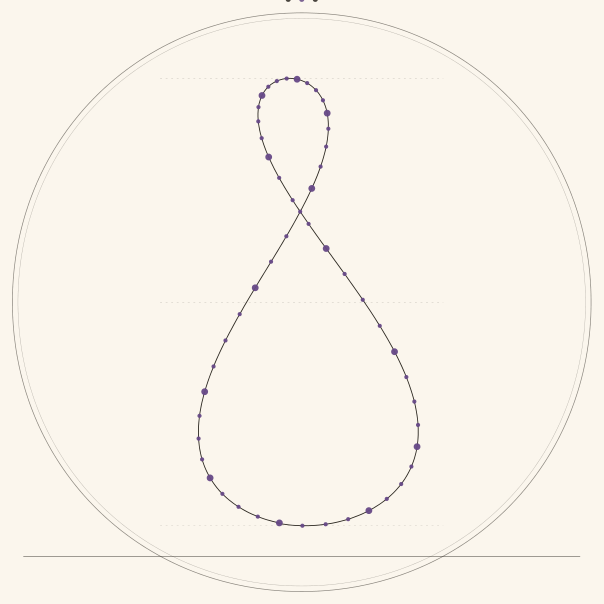

CHAPTER TWENTY-SIX

# The Daily Rite

*Daily Practice and Ritual*

<i>The analemma: the sun’s place at the same hour, marked once a week through one year. Fifty-two marks, and the figure closes.</i>

> *What good shall I do this day? ... What good have I done today?*
>
> — Benjamin Franklin, *Autobiography*

> **ALL FOUR** · *Did I bring peace, love and unity today, and did I prove respect?*

## I · ◆ The Teaching

232. Philosophy that is not practised is decoration. Every great teacher left a daily rite, because they knew that wisdom fades if it is not renewed each day.
233. In the morning, rehearse the day. You will meet the meddling, the ungrateful, the arrogant and the deceitful. Decide now how you will meet them, so that no one can surprise you into becoming less than yourself.
234. Begin the day with a question: *what good shall I do today?* A day that begins with a question has a heading.
235. At night, review the day. What fault did I resist? What did I do well? Where did I fall short? Then let it go and sleep. The examination is not a trial; it is a lamp.
236. Tie your practice to ordinary acts: waking, washing, eating, walking through a door. Wisdom fastened to habit will find you even on the days you forget it.
237. Keep the ledger weekly. What you measure, you can change. Expect a new practice to take two to three months to become your own, and do not judge it at thirty days.
238. Do not try to practise everything at once. Choose one virtue a week and give it your whole attention. The others will wait.
239. Missed a day? Begin again the next. The rite is not broken by missing it. It is broken only by abandoning it.
240. Make the rite your own. These are counsels from the wise, not commandments from the sky. Shape them until they fit your life like a well-worn tool.

## II · ◇ The Five Scales

|  |  |
|---|---|
| **CELL** | Cells run on daily clocks; most cells and tissues in your body keep their own circadian rhythm. |
| **SELF** | A daily rite gives the self a rhythm, as a heartbeat gives life its tempo. |
| **BOND** | Small daily rituals, a shared meal, a goodnight, keep bonds alive between the great occasions. |
| **COMMUNITY** | Every lasting community has its calendar: its days of rest, of mourning and of celebration. |
| **COSMOS** | The earth turns; the day returns. The smallest cycle of time repeats the largest pattern of the cosmos: rising, working, setting, rest. |

## III · The Witnesses

- **Marcus Aurelius** · *Meditations* 2.1  
  Each morning, prepare to meet the meddling, the ungrateful, the arrogant and the deceitful, and remember that they are your kin.
- ★ **Seneca** · *De Ira* III.36  
  Each night, ask: what fault have I cured today? It converges with the Pythagorean *Golden Verses* and Franklin.
- **Benjamin Franklin** · *Autobiography*  
  Thirteen virtues tracked in a small book, one given special attention each week; the day opened and closed with a question.
- **Traditions of the hours** · Benedictine Rule; *ṣalāh*; *Modeh Ani*; *zazen*  
  Across faiths, short practices tied to fixed moments of the day keep the sacred near.

## IV · ● The Tale

### *The Little Book*

As a young man, Benjamin Franklin set out to arrive at moral perfection. He listed thirteen virtues, among them temperance, silence, order, resolution, frugality, industry, sincerity, justice and humility, and ruled a small book with a page for each, marking a dot for every fault.

He gave one virtue his special attention each week, cycling through all thirteen four times a year. Each morning his schedule asked what good he would do that day; each evening it asked what good he had done.

He confessed that he never reached perfection; order, above all, defeated him. But he wrote that he became a better and happier man than he would otherwise have been. The rite did not make him perfect. It made him better, which is all any rite can do.

## V · ● The Energy

Ritual saves energy. A decision made once, and tied to a fixed moment, need not be made again each day. That frees the mind for the things that truly require it. A daily rite is not a burden added to life; it is a way of making the good things automatic.

## VI · The Reversal

> A rite can go hollow: performed by habit while the heart is elsewhere. If your practice has gone dead, change its form rather than abandoning its purpose. And never let your rite become a reason to judge others for not keeping it.

## VII · ◆ The Practice

|  |  |
|---|---|
| **DAILY** | Each morning ask: what good shall I do today? Each night ask: what good have I done? |
| **WEEKLY** | Each week, keep the Respect Ledger and choose one teaching from this book to carry through the next seven days. |

## VIII · The Ledger

|  |  |
|---|---|
| **PEACE** | Did I begin and end the day on purpose? |
| **LOVE** | Did my rite make me kinder, or only more disciplined? |
| **UNITY** | Did I share my practice with anyone? |
| **RESPECT** | Did I keep faith with myself today? |

## IX · The Song

*The sun comes up at the same small hour,* 
*But never in quite the same place;* 
*It wanders a figure of eight through the year,* 
*And it keeps to that figure with grace.* 
*So keep your hour, though the days may drift,* 
*And mark them, one by one;* 
*And the shape you will trace by the end of the year* 
*Will be yours, as the eight is the sun’s.*

---

[← The Author](25-the-author.md) &nbsp;·&nbsp; [Contents](../README.md) &nbsp;·&nbsp; [The Geometry →](../6-the-summit/README.md)

