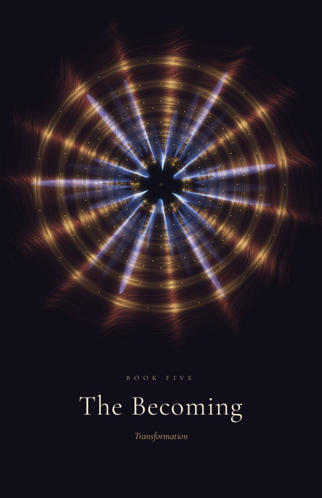

BOOK FIVE

# The Becoming

*Nothing living stays as it is. This last Book concerns how a person changes: not by erasing himself back to nothing, but by crossing, deliberately, into a new form while carrying the old one honestly. And it gives you the daily rite by which every teaching in this book becomes your own.*

23. [Becoming Without Erasing](23-becoming-without-erasing.md)
24. [The Wheel](24-the-wheel.md)
25. [The Author](25-the-author.md)
26. [The Daily Rite](26-the-daily-rite.md)

---

[← The Book of Earned Power](../4-the-work/22-the-book-of-earned-power.md) &nbsp;·&nbsp; [Contents](../README.md) &nbsp;·&nbsp; [Becoming Without Erasing →](23-becoming-without-erasing.md)

