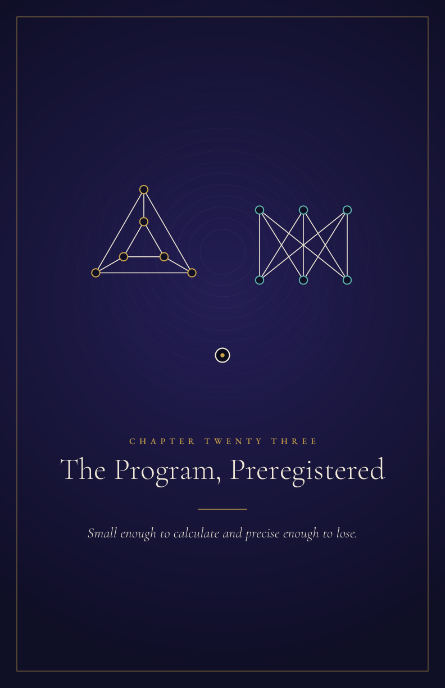
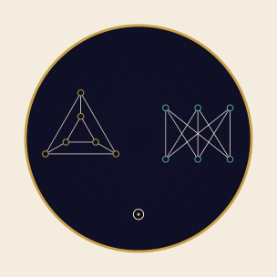
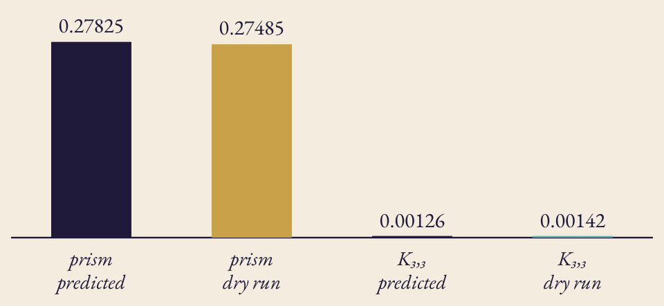
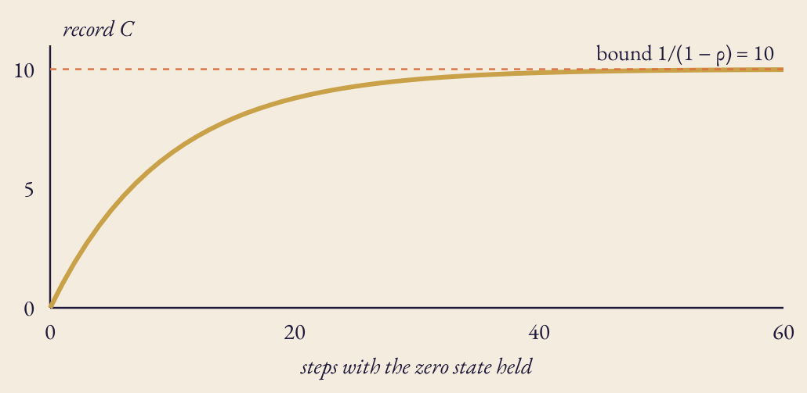

THE GEOMETRY OF EXISTENCE · LEVEL FIVE · THE PROOF AND ITS LIMITS · PAGES 188–193

  

CHAPTER TWENTY THREE

# The Program, Preregistered

> *Small enough to calculate and precise enough to lose.*

  

The research book ends by saying that its tests must be able to fail. This chapter records what was done about that afterward.

In November 2026 three things were laid down in the author’s workshop: two frozen protocols, and a survey of where they might one day be run. Each protocol was fixed in writing before any outcome was examined. Each was then exercised on simulated data — not to learn about the world, but to find out whether the protocol itself was sound.

### Protocol one: equal size, unequal shape

`DEMONSTRATED — COMPUTATION` The frozen model is the pair of six-site graphs of §16: the triangular prism and K₃,₃, with Δ/J = 3/4 and βJ = 3. The predicted difference in zero-site occupancy is 0.276990454809.

The protocol fixes, in advance: calibration of the couplings and temperature before any outcome data is taken; 10,000 samples from each graph; an analyst blind to which graph is which, enforced by a committed fingerprint; a decision rule of five standard errors; and two controls, one that swaps the graph labels and one that switches the coupling off.

The dry run on a simulated sampler returned 0.27485 for the prism and 0.001417 for K₃,₃: a difference of 0.273433, with standard error 0.001500, which lies 2.37 standard errors from the prediction and inside the frozen band. Re-run for this edition, the frozen code returned the same digits and the same fingerprint.

  

<i>Zero-site occupancy on the two graphs: exact prediction beside the simulated dry run. A dry run tests the procedure. It is not a measurement.</i>

### What the dry run was for

The first version of the sampler had a defect. Its moves offered a site only +1 or −1, so a site that left the zero state could never return to it. The simulated system was confined to a corner of its own possibilities, and it would have reported almost no zeros on either graph.

On a real device, that would have looked like a dramatic anomaly. It would have looked like a discovery.

It was caught before any data existed, because the protocol required the procedure to be run on a case whose answer was already known. That is the entire purpose of a dry run, and it is Chapter Twelve applied to an instrument: before you trust what it tells you, find out whether it is able to tell you that you are wrong.

### Protocol two: the record

`DEMONSTRATED — COMPUTATION` The second protocol tests the consequence model of §15, with the three-body term switched off so that the record is the only channel under test. Its parameters are βD = βJ = ln 2, βχ = 2 ln 2, and ρ = 0.9. It has three parts.

*The response.* The log-odds of the zero state must rise with the record at a slope of exactly βχ = 2 ln 2 ≈ 1.3863. The simulated slopes were 1.3811 and 1.3790 under the two boundary settings. With the coupling set to zero the slopes were flat, at −0.0009 and −0.0001, as they must be.

*The frozen record.* With the record held at C = 1, the zero-state probability must be 32/49 ≈ 0.6531 for aligned boundaries and 4/5 for opposed ones. The simulation gave 0.653225 and 0.79898. (The opposed value here is 4/5, not the 1/5 of §14, because the three-body term is off. The protocol says so in writing, to keep the two experiments from being mixed.)

*The loop.* When the unit feeds its own record, two independent methods — direct simulation and an exact transfer calculation — must agree. They did, to within 0.34 standard errors. Both show the zero state taking over almost entirely. The protocol had flagged this in advance: feedback this strong does not nudge the system, it pins it.

  

<i>The record under the frozen retention ρ = 0.9. However long the zero state is held, the record cannot exceed 1/(1 − ρ) = 10.</i>

The second dry run caught a second defect, of a different kind. The physics passed every check, and the analysis failed: the first fitting routine regressed the raw probability on the record, where the prediction concerns the log-odds. The error was in the estimator. It was found before data and corrected.

Two defects. Both were in the experimenter’s own tools. Neither was in the theory, and neither would ever have been found by admiring the theory.

### Where it could be run

`SOURCE-REPORTED` A survey in the workshop ranks candidate laboratory platforms for both protocols. Its reading of the experimental literature was not re-checked for this edition, so no claim about any platform is printed here as fact. Its own conclusion is modest and worth keeping: the choice among platforms reduces to a single calibration — which of them can first show a verified thermal distribution on a three-state system at βJ = 3.

### What this is not

`MEASURED` Nothing. No laboratory has run either protocol. A dry run on simulated data validates a procedure; it says nothing about the world.

And as §16 and §20 state without softening, a successful run would confirm established statistical mechanics. It would not establish Sophonticism as new physics. The mathematics of the program is complete. Its physics has not begun.

**The strongest objection.** A protocol that can only confirm what the textbooks already predict risks nothing new. That is correct. Its worth is as a calibration: a program that cannot yet pass a test whose answer it knows has no business proposing one whose answer it does not.

---

[← Appendices A–D](sophonticism/5-appendices.md) · [Contents](../README.md) · [PDF ↓](../../edition/README.md) · [What the Axiom Does Not Prove →](24-what-the-axiom-does-not-prove.md)

