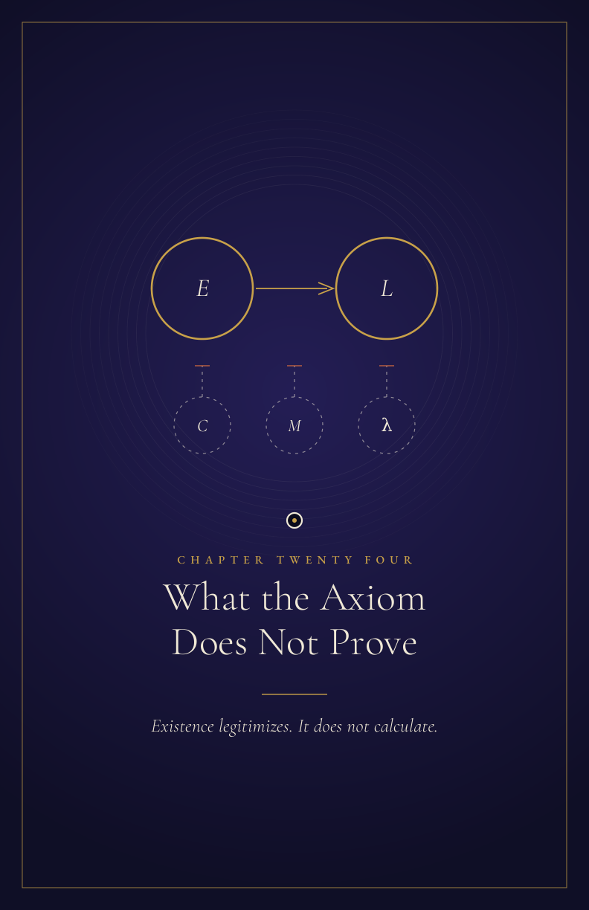
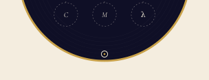

THE GEOMETRY OF EXISTENCE · LEVEL FIVE · THE PROOF AND ITS LIMITS · PAGES 194–197

  

CHAPTER TWENTY FOUR

# What the Axiom Does Not Prove

> *Existence legitimizes. It does not calculate.*

<i>E</i>

<i>L C</i>

<i>M</i>

  

The First Principle is the ground of this book. A ground deserves to be tested for what it can bear. This chapter writes the principle as a formal axiom and then shows, exactly, how little follows from it.

That is not a retreat. It is the difference between a principle and a pretense.

### The axiom

Take a formal language with four symbols. *E(x)*: x exists, within a stated domain. *L(x)*: x has ontological legitimacy. *C(x)*: x is conscious, under some separately stated account. *R(x, y)*: x and y stand in a relation.

The axiom, called S₀, is one sentence:

> *For every x: if E(x), then L(x).*

`ARGUED` It is chosen, not discovered. No experiment bears on it. The reasoning below uses ordinary first-order logic and nothing more.

### What follows

**Lemma.** `DEMONSTRATED, RELATIVE TO S₀` For any named thing *a*: if E(a), then L(a). *Proof.* Apply the axiom to *a*; with E(a) in hand, L(a) follows. ▪

That is all. It is the axiom, applied once.

### What does not follow

**Theorem 1.** `DEMONSTRATED` The axiom does not entail that everything that exists is conscious. *Countermodel.* Let the domain contain a single thing, *a*. Let E(a) and L(a) be true and C(a) false. The axiom holds. “Whatever exists is conscious” fails. ▪

**Theorem 2.** `DEMONSTRATED` The axiom does not entail that all existing things have the same moral standing. *Countermodel.* Let the domain contain *a* and *b*. Let E and L be true of both. Let some further moral property M be true of *a* and false of *b*. The axiom holds. “M is true of *a* exactly when it is true of *b*” fails. ▪ Any claim of moral equality needs a premise the axiom does not contain.

**Theorem 3.** `DEMONSTRATED` The axiom does not determine any physical quantity. *Countermodel.* Add to the language any physical parameter λ. Build two interpretations that agree on E and L, both satisfying the axiom, that give λ different values. Nothing fixing λ can follow. ▪ No Hamiltonian, metric, force law, or measurement comes out of the axiom.

**Theorem 4.** `DEMONSTRATED` Existence, consciousness, and relation are independent. *Models.* On a domain of one thing, each of the eight ways of making E(a), C(a), and R(a, a) true or false is consistent with the axiom, provided L(a) is true wherever E(a) is. And if legitimacy is taken to hold exactly where existence holds, then changing C or R never changes L. ▪

Theorem 4 is the formal shadow of Chapter Twenty. It shows the three can be told apart without contradiction. It does not show that they *ought* to be kept apart. No model shows an ought.

### Two candidates, not theorems

`ARGUED` “Consciousness gives us the opportunity to understand” might be written: if C(x), then it is possible that x understands some y. “Connection gives us the opportunity to honor” might be written: if R(x, y), then it is possible that x honors y. Each needs a stated meaning for “possible” and for “opportunity” before it says anything exact. They are offered as candidate further axioms. They are not consequences of S₀.

### What this shows

Logic gives the principle back nothing but itself. Nothing was smuggled. Whoever accepts the axiom has accepted that existing is enough to count — and has accepted nothing else: not a physics, not a theory of mind, not a moral ranking.

**The strongest objection.** If “legitimacy” is only another word for existence, the axiom is true by definition and cannot be wrong, which by this book’s fourth line means it cannot win anything either. If “legitimacy” carries moral weight, the axiom needs a moral argument this chapter has not given. Both halves are correct. The principle’s worth is not established here. It is established, if at all, in Level Four — by what a life built on it turns out to be.

---

[← The Program, Preregistered](23-the-program-preregistered.md) · [Contents](../README.md) · [Beyond Logic →](25-beyond-logic.md)

