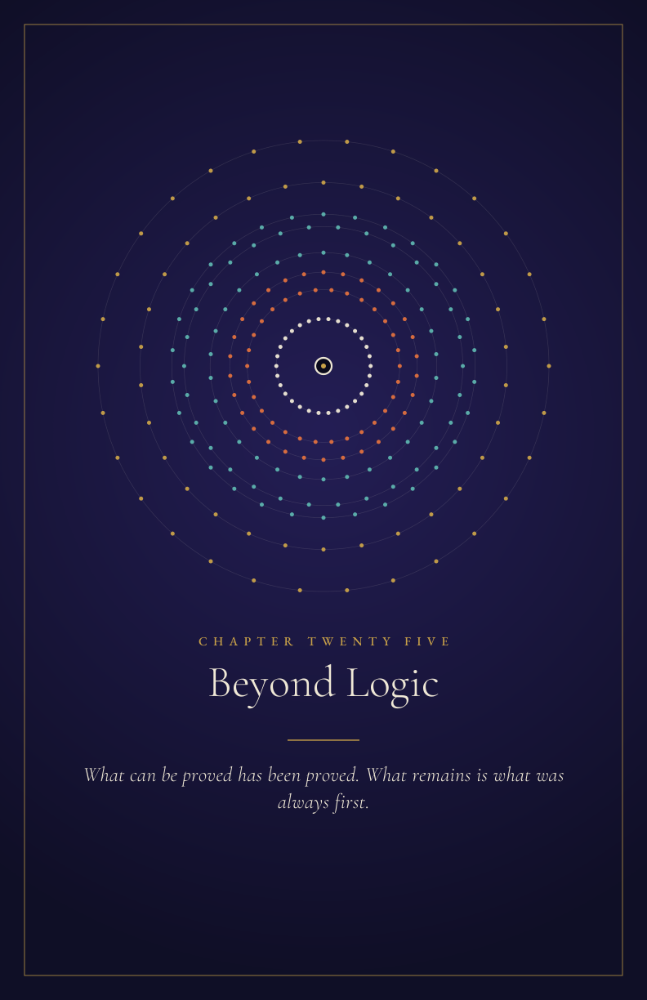
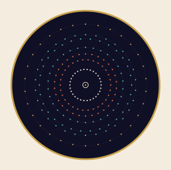

THE GEOMETRY OF EXISTENCE · LEVEL FIVE · THE PROOF AND ITS LIMITS · PAGES 198–202

  

CHAPTER TWENTY FIVE

# Beyond Logic

> *What can be proved has been proved. What remains is what was always first.*

  

You have reached the highest level of the book, and you may be expecting the final proof.

There is not one. This chapter is about why that is not a failure, and about what stands where the proof would have been.

Begin with what logic says about its own edge. `ON RECORD` In 1931 Kurt Gödel proved that any consistent system of rules rich enough to do ordinary arithmetic, whose rules can be listed, leaves some statements of arithmetic undecided — it can neither prove nor refute them — and cannot prove its own consistency. This is among the most abused results in mathematics, so be exact about it. It does not say that truth is unknowable. It does not say that logic is broken. It says nothing about minds, or God, or you. It says one thing: that proof, done perfectly, does not reach everything that is so, even about whole numbers.

So “beyond logic” is not a place this book had to invent. Logic drew that line itself.

Now look at what the book has been doing since its first page. It has used four kinds of knowing, and it has marked which is which, because none of them can do another’s work.

What is **demonstrated** is certain — and only about its own definitions. The arithmetic of three digits is flawless and proves nothing about the forces of nature. Level Five said so, at length.

What is **measured** touches the world — and is never final. The next measurement may differ.

What is **argued** gives reasons — and compels no one. A reader may follow every step of Level Four and decline the principle without contradicting themselves. Chapter Twenty-Four showed exactly that.

What is **lived** cannot be handed over at all. `ON RECORD` Philosophers separate knowing *that* from knowing *how*. No one has been argued into staying five minutes with another person’s pain. You stay, or you do not, and afterward you know something no sentence gave you.

`ARGUED` Most of the confusion in a life, and most of the overreach in the pages this book grew from, comes from letting one of these impersonate another. A proof is asked to settle a question of worth. A feeling is promoted to a fact. A measurement is treated as a permission to exist. An experience is used as a shield against being wrong. The discipline of this book, from the Stance to the last appendix, has been one refusal repeated: **let no kind of knowing wear another’s clothes.**

That is the whole of the new paradigm, stated without inflation. It is not a logic that overturns logic. Nothing here asks you to accept a contradiction, or to stop checking. It is a way of standing — the zero of Chapter Eight, carried up five levels: the place from which the proved, the measured, the argued, and the lived are all in reach, and none is mistaken for the others.

`ON RECORD` Others have marked this edge. A Buddhist philosopher eighteen centuries ago laid out four answers — it is, it is not, both, neither — and in places declined all four. The Jain logicians taught that a claim holds *in some respect*. A philosopher of the last century ended his book by calling its own sentences a ladder, to be climbed and then let go. This book claims no authority from any of them. It notes the company.

Then the question this edition was asked to answer: *can a book be made that cannot be wrong?*

There are three ways. The first is to say nothing — to print only definitions, which cannot be wrong because they are about nothing. The second is to refuse every test, which is the cell of Chapter Twelve: unfalsifiable, and for that reason worthless to stand on. The third is the only honest one, and it is the one this book has tried to build. **Make a book that is not ruined by being corrected.**

Mark every claim by its kind, so that an error, when it is found, damages one sentence and not the reader’s trust in the rest. Recompute every number, and print the list. Name the channel and the water, as Chapter Eleven taught: the channel of this book is the First Principle and the four lines of the Stance. Those are not findings. They are a place to stand. They can be declined; they cannot be refuted, and they do not pretend to be proved. Everything else is water, and may be revised without betrayal. The pages after this one say where to send the correction.

A book built that way cannot be ruined by an error. It can only be improved by one. That is not the perfection that was asked for. It is the only kind there is.

And so the highest level turns out to be the first one, read again by someone who has done the practices.

*Nothing gives legitimacy to existence except existence itself.* On the first page that was a sentence. If the levels between have done their work, it is now ground — not because it was proved on the way up, but because you have stood on it.

The book ends where it began: with the ground, with the three, with the zero that was never a hole.

It only asks, now, to be lived.

> **▲ Practice**
>
> Return to Level One. Beside each line, write one deed from the past month in which that line was true of you — something you did, on a day you can name. Where you cannot write a deed, write nothing. For you, that line is still only argued. It is waiting for you to live it.

> **◆ Audit**
>
> Which kind of knowing do you use to escape the others? Proof, to avoid living. Feeling, to avoid checking. Experience, to avoid being wrong. Everyone has a favorite. Name yours. That is the last audit, and like the audit of Chapter Fifteen, it does not close.

---

[← What the Axiom Does Not Prove](24-what-the-axiom-does-not-prove.md) · [Contents](../README.md) · [The Discipline in One Page →](../6-back-matter/01-the-discipline-in-one-page.md)

