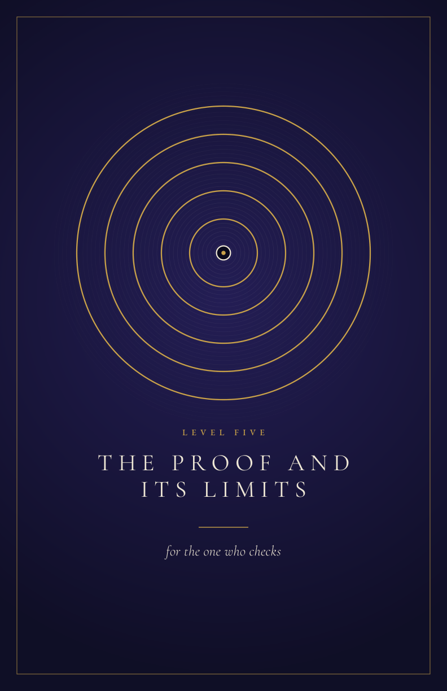
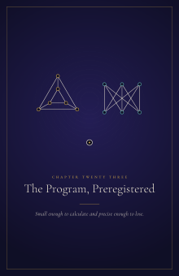
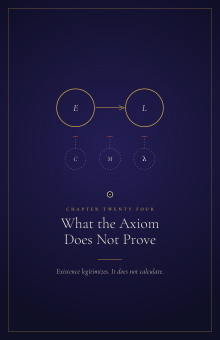
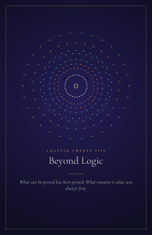

THE GEOMETRY OF EXISTENCE · LEVEL FIVE · THE PROOF AND ITS LIMITS · PAGE 138

  

LEVEL FIVE

# The Proof and Its Limits

> *for the one who checks*

<!-- level-strip -->
## In this level

<table>
<tr><td align="center" valign="top" width="25%"><a href="sophonticism/README.md"><b>Sophonticism: The Research Book</b></a> pp. 139–140</td><td align="center" valign="top" width="25%"><a href="sophonticism/1-ground.md"><b>Part I — Ground (§1–§4)</b></a> pp. 141–146</td><td align="center" valign="top" width="25%"><a href="sophonticism/2-the-established-bridges.md"><b>Part II — The Established Bridges (§5–§11)</b></a> pp. 147–155</td><td align="center" valign="top" width="25%"><a href="sophonticism/3-the-third-state-and-consequence.md"><b>Part III — The Third State and Consequence (§12–§17)</b></a> pp. 156–171</td></tr>
<tr><td align="center" valign="top" width="25%"><a href="sophonticism/4-the-frontier.md"><b>Part IV — The Frontier (§18–§22)</b></a> pp. 172–179</td><td align="center" valign="top" width="25%"><a href="sophonticism/5-appendices.md"><b>Appendices A–D</b></a> pp. 180–187</td><td align="center" valign="top" width="25%"> 23 · The Program, Preregistered</td><td align="center" valign="top" width="25%"> 24 · What the Axiom Does Not Prove</td></tr>
<tr><td align="center" valign="top" width="25%"> 25 · Beyond Logic</td></tr>
</table>
<!-- /level-strip -->

---

[← Dignity Is Owed, Respect Is Earned](../4-the-principle/22-dignity-is-owed.md) · [Contents](../README.md) · [Sophonticism: The Research Book →](sophonticism/README.md)

