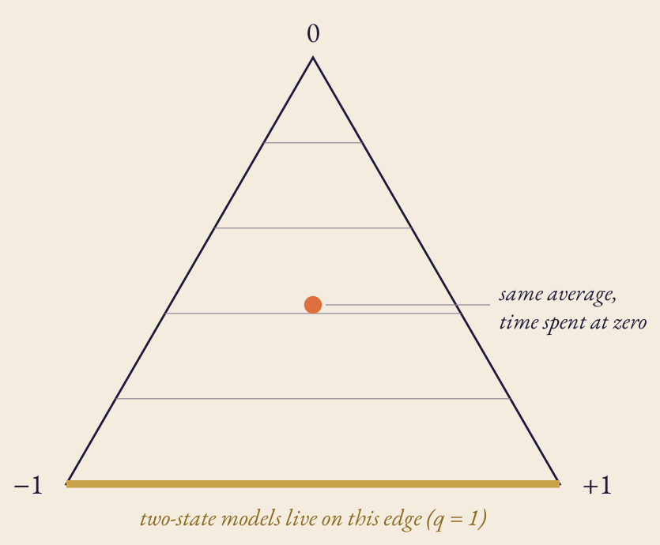

THE GEOMETRY OF EXISTENCE · LEVEL FIVE · THE PROOF AND ITS LIMITS · PAGES 141–146

## Part I · Ground

### §1 The axiom before the measurement

`ARGUED` Existence is prior to our descriptions of it. A star existed before its spectral lines were catalogued. A rock does not need an observer’s philosophical permission to occupy the world. A theory can fail to describe something without removing what the theory failed to describe. The first sentence of this book is a declaration about legitimacy: existence cannot be awarded retrospectively by certification, intelligence, recognition or usefulness.

That claim is not identical to saying that everything imagined exists. **Existence is not the same as membership in a model.** A mathematical point can exist as a mathematical object; a pointlike elementary particle in a field theory does not follow from the philosopher’s assertion. Physical existence demands the methods appropriate to physical inquiry. An equation can stipulate a variable without nature being obliged to instantiate it. This distinction is the ethical and epistemic spine of Sophonticism as developed here.

Let E(x) mean ‘x exists in the domain under discussion’ and Lo(x) mean ‘x has ontological legitimacy’. The provisional axiom is:

`ARGUED` E(x) ⇒ Lo(x).

No physical experiment decides this axiom by itself. It is an interpretation of what it means to be. If ‘legitimacy’ simply redescribes ‘existence’, the axiom is tautological. If legitimacy carries moral meaning, the implication requires a moral argument: bacteria, people, rivers, pathogens, mathematical objects and hypothetical worlds do not all have identical moral standing merely because they can be mentioned.

An ambitious philosophy should not conceal this gap. It should use it. The axiom is the book’s opening, not a substitute for the scientific method. A physical bridge must predict a relation among observables that other adequate models do not already capture—or at least teach us how existing theories connect without falsifying their domains.

**The strongest objection.** The axiom is compatible with mutually inconsistent physical theories and therefore cannot select one. This is correct. Its function is philosophical orientation. A research program becomes scientific only when it introduces independently constrained variables and risks an identifiable failure.

### §2 What counts as a bridge

`DEMONSTRATED — METHODOLOGY` Two descriptions form a scientific bridge when a map relates their states or observables, preserves specified empirical quantities within a declared regime, and explains where the correspondence breaks. A bridge is not a word reused in two disciplines. It is a relationship with a domain, a transformation rule, and an error estimate or limiting procedure.

Examples already succeed. Geometric optics emerges from wave optics under short-wavelength conditions. Classical trajectories approximate quantum dynamics in appropriate semiclassical regimes, subject to important restrictions. Hydrodynamics describes certain large-scale behaviors of manyparticle systems even though molecules do not individually obey the Navier–Stokes equations. A statistical ensemble links microscopic dynamics to thermodynamic expectations. These are bridges because they preserve calculable things while changing description.

We will use a five-part bridge test. Specify (i) the two models, (ii) the translation of states and observables, (iii) the assumptions and scales under which translation works, (iv) a quantity it preserves or predicts, and (v) a mismatch that would defeat it. The same mathematics can recur in very different media without the media being identical. A diffusion equation can model heat, concentrations and probability densities; the equation alone does not turn temperature into probability.

`ARGUED` Sophonticism can be scientifically useful as a discipline of translation: an insistence that alternatives be generated but never smuggled across a boundary without paying the cost of a valid map. This is an argument for a method, not evidence for an undiscovered force.

**The strongest objection.** If the method merely recites ordinary scientific standards, it supplies no new physics. The response must be an explicit model, not a new name for caution. Part III supplies such a model; its novelty, if any, must be judged against the enormous prior literature on frustrated spin systems.

### §3 The anatomy of a physical theory

`DEMONSTRATED` A workable physical model specifies a state space X, observables O, a dynamical law D, symmetries G where relevant, and a measurement procedure M. A classical particle may have a phase-space state (q,p). A quantum system is represented by a state vector or density operator. A relativistic field is a field over spacetime with transformations prescribed by a representation of a symmetry group. A thermodynamic state is an equivalence class of many microstates with specified macroscopic variables.

These do not share one literal state space. Attempting to declare them all ‘information’ does not create a theory. Information measures require a probability model, an encoding or operational task. Likewise, treating every difference as a geometric dimension mistakes coordinates for ontology. State space is a representation whose features must be justified by what it predicts.

The universal common architecture here is schematic:

MODEL = {admissible states, transformations, constraints, observables, calibration, uncertainty}.

A model can use infinity as an idealization without claiming that experimentally accessible infinities have been measured. It can use an eight-dimensional root lattice without suggesting eight observed spatial dimensions. It can use a third state without implying that all reality is fundamentally ternary. These distinctions sound modest, but they stop a chain of analogies from becoming a false theorem.

**The strongest objection.** A sufficiently abstract ‘universal architecture’ is true but empty. It cannot replace the concrete Hamiltonian of a magnet, the field equations of gravity or the scattering amplitudes of quantum field theory. Every substantive chapter therefore descends from abstraction to a calculation.

### §4 Geometry is constraint, not destiny

`DEMONSTRATED` A binary random variable has distributions (p-,p+) with p-+p+=1: a line segment, one independent probability coordinate. A three-state variable has (p-,p0,p+) with p-+p0+p+=1: a triangle, two independent probability coordinates. The third state changes the dimension of the *simplex of distributions*, not the dimension of physical space.

For S ∈ {-1,0,+1}, define m=⟨S⟩ and q=⟨S²⟩. Algebra gives p0=1-q and p±=(q±m)/2, with |m|≤q≤1. In a strictly two-state model, q=1 identically; in a three-state model q can vary. Two systems with m=0 can therefore differ: one may alternate + and -, while the other spends time at zero. The difference can be measured through q.

A second geometric lesson is topological. A line with its origin removed has two disconnected components: there is no continuous route from -1 to +1 that avoids zero. A plane with its origin removed is connected; a semicircular route exists. An added degree of freedom can remove an obstruction. It does not guarantee an improvement in every task, and the enlarged representation still needs a mechanism of access.

`ARGUED` The phrase ‘dimension governs transformation’ becomes precise if it means this: the accessible geometry constrains the set of possible trajectories. Dimension does not tell the system which trajectory to take. Dynamics must do that work.

**The strongest objection.** A new coordinate can be redundant. Expanding the parameterization without expanding reachable states or controllable operations adds no capability. A new dimension must be operationally independent, not an impressive-looking axis.

  

<i>The simplex of three-state distributions. A third state adds a coordinate to the space of probabilities, not a dimension to physical space.</i>

---

[← Sophonticism: The Research Book](README.md) · [Contents](../../README.md) · [Part II — The Established Bridges (§5–§11) →](2-the-established-bridges.md)

