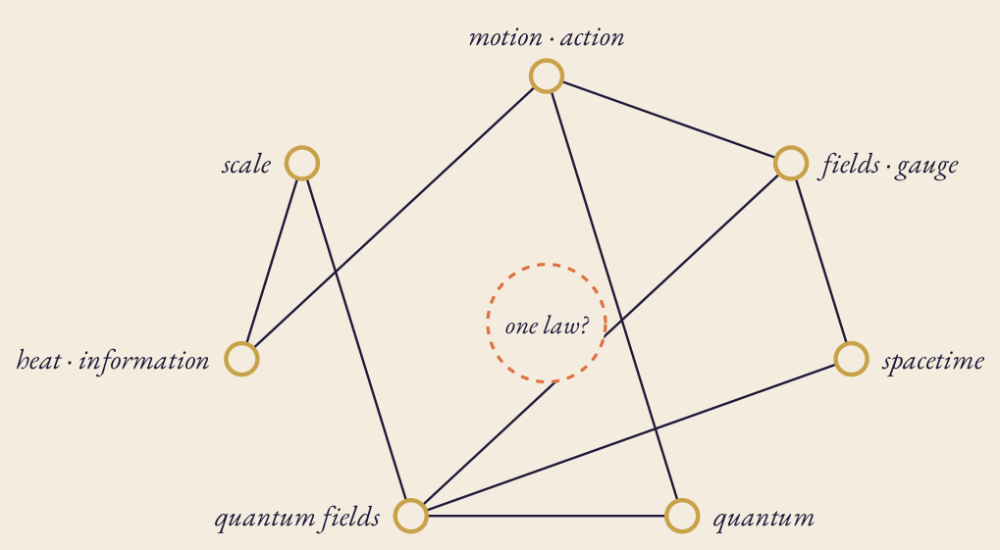

THE GEOMETRY OF EXISTENCE · LEVEL FIVE · THE PROOF AND ITS LIMITS · PAGES 147–155

## Part II · The Established Bridges

### §5 Motion, action and symmetry

`DEMONSTRATED` For a classical coordinate q(t), the action S[q] is the integral of a Lagrangian L(q, dq/dt, t). Requiring the first variation to vanish for variations fixing the endpoints yields the Euler–Lagrange equation:

d/dt [∂L/∂(dq/dt)] − ∂L/∂q = 0.

For L=(1/2)m(dq/dt)² − V(q), this becomes m d²q/dt² = −dV/dq, Newton’s second law for a conservative one-dimensional force. This is a genuine bridge: one variational formulation reproduces a familiar dynamical law. The action principle does not mean nature consciously minimizes a goal; stationary action need not be a minimum.

Take V=(1/2)k q². The equation becomes d²q/dt² + ω²q = 0 with ω²=k/m. Solutions oscillate. A Hamiltonian representation instead uses coordinates (q,p) and H=p²/(2m)+kq²/2; its trajectories obey dq/dt=∂H/∂p and dp/dt=−∂H/∂q. The two descriptions are connected by a Legendre transform when that transform is nondegenerate.

`DEMONSTRATED` Noether’s theorem connects differentiable continuous symmetries of the action with conserved currents, subject to appropriate conditions and boundaries [R3]. Time translation of an autonomous mechanical system leads to conserved energy; spatial translation leads to momentum. This is a deeper bridge than the superficial recurrence of ‘balance’: symmetry specifies a conserved, measurable quantity.

**The strongest objection.** Not every physical process has an ordinary single-coordinate Lagrangian. Dissipation, measurement and coarse-grained open systems require care, additional variables or alternative formalisms. Nor does stationarity solve the problem of quantum gravity. It supplies a language, not the answer to every question.

### §6 Fields, electromagnetism and gauge freedom

`DEMONSTRATED` A field assigns values to spacetime events. Electromagnetism can be represented by a four-potential Aμ and the antisymmetric field tensor Fμν=∂μAν−∂νAμ. In natural units and suitable sign conventions, the Maxwell action with a current is schematically:

S[A]=∫d⁴x [−(1/4)FμνFμν − JμAμ].

Varying A produces the sourced Maxwell equations with convention-dependent sign choices; the identity ∂[λFμν]=0 supplies the homogeneous equations. A gauge transformation Aμ→Aμ+∂μχ leaves F unchanged. This redundancy of description has physical consequences through the structure of coupling and conservation.

Geometry matters here but must be used correctly. The exterior derivative d maps the potential one-form A to the field-strength two-form F=dA, and dF=0 follows from d²=0. This differential-geometric fact says nothing about an E8 substrate. The observed electromagnetic field does not become an eight-dimensional lattice because both subjects use geometric language.

`ARGUED` The recurring pattern is that the most useful freedom may be a *redundancy of coordinates* rather than a new physical state. Sophonticism must not confuse gauge choices, which represent the same physical state, with genuinely new possibilities.

**The strongest objection.** The potential formulation has global subtleties and boundary effects; some configurations require patches or nontrivial bundles. A bare local expression cannot capture every topology. Conversely, invoking sophisticated gauge geometry does not prove any particular new physical claim.

### §7 Spacetime as geometry

`DEMONSTRATED` Special relativity organizes spacetime using Lorentzian geometry. The interval ds²=gμν dxμdxν is invariant under changes of coordinates that preserve the metric. General relativity allows the metric to vary: spacetime curvature is tied to stress-energy through Einstein’s field equations,

Gμν + Λgμν = (8πG/c⁴) Tμν.

This is an established relation between geometric and material quantities, not a statement that all geometry is gravity. Its predictive content includes the bending of light, gravitational time dilation and gravitational waves, each with detailed empirical tests.

The Einstein–Hilbert action combines the scalar curvature R, metric determinant and a cosmological term. Variation gives the gravitational field equations after the appropriate boundary treatment and matter coupling. The result is an especially clear example of geometry as dynamics: the metric is not merely a drawing of interactions; it is a physical field with measured consequences.

`ARGUED` The legitimate bridge to our three-state models would require deriving a continuum limit, a spacetime geometry, and gravitational observables. Simply replacing gμν by an unspecified ‘supermetric’ has no such power. A tensor index is not a prediction.

**The strongest objection.** General relativity is classical. It does not by itself provide a complete ultraviolet quantum description of gravitational dynamics, especially in regimes where quantum fluctuations of spacetime are unavoidable. The existence of this frontier is a reason to investigate, not permission to declare it solved.

### §8 The quantum departure

`DEMONSTRATED` Quantum theory attaches probability amplitudes to outcomes, not merely ordinary probabilities to hidden alternatives. A state |ψ⟩ evolves unitarily under the Schrödinger equation iℏ∂t|ψ⟩=H|ψ⟩ for closed systems. An ideal projective measurement of a projector P has probability ⟨ψ|P|ψ⟩. Interference occurs because complex amplitudes combine before their squared magnitudes are taken.

This is not the same as three-state classical probability. A three-level quantum system (a qutrit) has a three-dimensional complex Hilbert space. Its normalized pure physical states form a projective space with four real dimensions, whereas the probability simplex of three measurement outcomes has two independent real coordinates. Coherences matter. A ternary numeral or three-state magnetic variable has no quantum coherence merely by having three symbols.

The classical limit is conditional. Ehrenfest’s theorem gives d⟨x⟩/dt=⟨p⟩/m and d⟨p⟩/dt=−⟨V′(x)⟩. It reduces to Newton’s equations for expectation values when the wavepacket is suitably localized or the force is effectively linear over its support. Coarse-graining and decoherence help explain effective classical records, but the interpretation of quantum measurement remains contested.

`ARGUED` A proposed bridge from agency to quantum physics must predict an observable effect beyond the standard measurement probabilities. ‘Choice’ cannot be smuggled into wavefunction collapse through vocabulary alone.

**The strongest objection.** Quantum theory successfully describes interference and entanglement without an agreed single metaphysical interpretation. A philosophical story cannot displace it unless it changes a measurement, and many such stories make identical empirical predictions.

### §9 Quantum fields and the Standard Model

`DEMONSTRATED` Quantum field theory combines quantum principles with relativistic locality in field descriptions. The Standard Model uses a gauge structure conventionally written SU(3)C×SU(2)L×U(1)Y, with specified matter representations, symmetry breaking and experimentally determined parameters. It has extraordinary empirical success in particle physics. It does not include a complete theory of gravity, and it does not by itself explain dark matter or every cosmological observation [R1].

A gauge group’s name is not enough. A usable candidate must specify its fields, representations, couplings, action, quantum consistency, symmetrybreaking mechanism and observational predictions. In four-dimensional chiral gauge theories, anomaly cancellation is a nontrivial algebraic requirement. Displaying the requirement Σi Ai=0 does not calculate the actual coefficients.

Physics also distinguishes symmetries of laws from symmetries of states. A gauge-invariant Lagrangian can have an equilibrium state with less manifest symmetry; phase transitions and the Higgs mechanism require this care. The symbolic similarity between ‘higher state’, ‘higher dimension’ and ‘higher gauge group’ is not a derivation.

**The strongest objection.** Even the successful Standard Model has free parameters and incompletenesses. That does not license an unspecified alternative. It sets a high standard: a new theory must match existing scattering, precision electroweak, hadronic and gravitational data at least where those theories are already tested.

### §10 Heat, probability and information

`DEMONSTRATED` An equilibrium system with microstates i of energy Ei has canonical partition function Z=Σi exp(−βEi), where β=1/(kBT). Its state probabilities are pi=exp(−βEi)/Z. The mean energy is U=−∂lnZ/∂β; the Helmholtz free energy is F=−kBT lnZ. These are identities within the canonical model, subject to its assumptions.

Boltzmann’s constant kB makes temperature and energy commensurable in statistical mechanics and is exact in the modern SI definition [R4]. Entropy can be written S=−kB Σi pi ln pi for a classical discrete equilibrium distribution. Shannon entropy H=−Σi pi log₂pi is an information measure in bits. Their expressions have a common mathematical form, but they have different operational units and interpretations. A coincidence of algebra does not make every information-processing task a heat engine.

The data-processing inequality gives an especially useful negative result. If X→Y→Z is a Markov chain, processing Y into Z without external information cannot increase mutual information about X: I(X;Z)≤I(X;Y). Changing a numeral alphabet does not create information about the world by itself. A representation can improve efficiency or make a learning algorithm easier to optimize without increasing the information present in a fixed input dataset.

**The strongest objection.** Real systems may be far from equilibrium; open quantum systems, active matter and biological networks need more than a single canonical Z. Moreover, the choice of coarse-grained states affects entropy. The standard calculation is strong within its domain and weak when casually transported elsewhere.

### §11 Scale, emergence and the renormalization group

`DEMONSTRATED` The renormalization group studies how descriptions change when short-distance details are integrated out or rescaled. Near certain continuous phase transitions, different microscopic systems can share critical exponents and scaling behavior: universality. This is a genuine cross-domain bridge, not because the microscopic objects become identical, but because particular long-distance observables become insensitive to many microscopic details [R5, R6].

A coarse-graining map R takes a microscopic model with couplings g to an effective model R(g) at a larger scale. Fixed points R(g∗)=g∗ organize scale invariance. Relevant perturbations grow under repeated coarse-graining; irrelevant perturbations shrink. This offers a disciplined account of when microscopic geometry matters. Different graph topologies can profoundly change frustration on six sites while becoming less important for some bulk observables in suitable scaling regimes. Neither behavior is universal without assumptions.

The geometric temptation is to identify every observed power law with a fundamental fractal universe. But finite-range scaling is common. A measured exponent requires a measurement window, an estimator, finite-size corrections and competing explanations. A mathematical Cantor set has arbitrary-depth structure by definition. A rock formation, network or cloud is observed at finite resolutions.

`ARGUED` The phrase ‘dimension governs transformation’ gains an empirical interpretation when dimensionality is specified as a property of coarse-grained accessible degrees of freedom and linked to an observable scaling law. That is a research question, not an established cosmology.

**The strongest objection.** Renormalization and effective theories already explain many scale bridges. A new philosophical vocabulary must make an additional prediction; without it, the framework is an organized guide to existing science rather than new science.

  

solid lines: bridges physics already has · centre: not established

<i>The bridges of Part II. Each solid line is a calculable relation between two descriptions,</i>

<i>valid in a stated regime. No line reaches a single law.</i>

---

[← Part I — Ground (§1–§4)](1-ground.md) · [Contents](../../README.md) · [PDF ↓](../../../edition/README.md) · [Part III — The Third State and Consequence (§12–§17) →](3-the-third-state-and-consequence.md)

