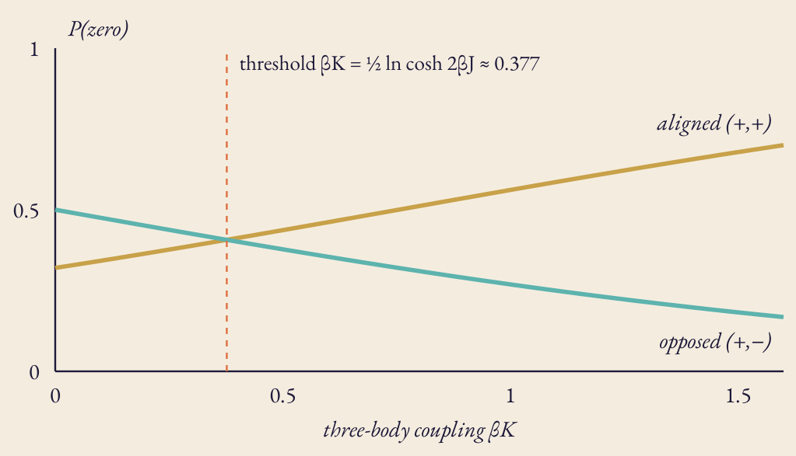
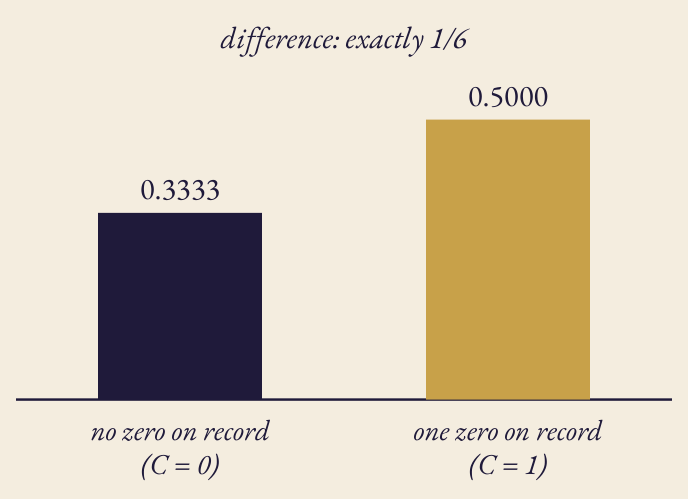
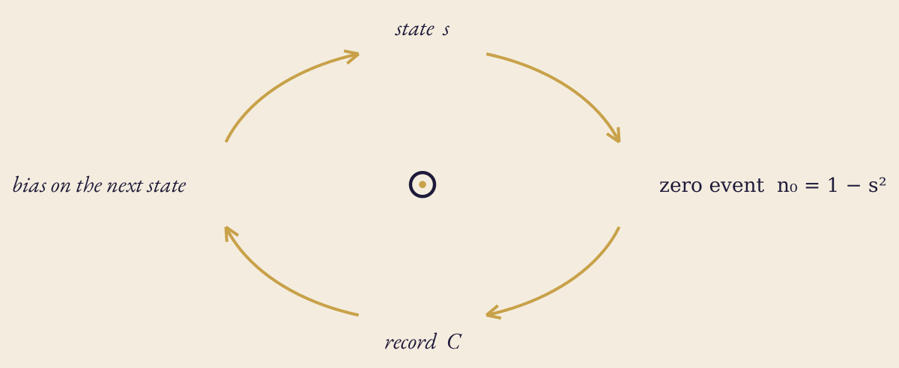
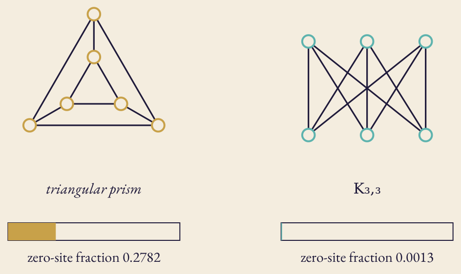
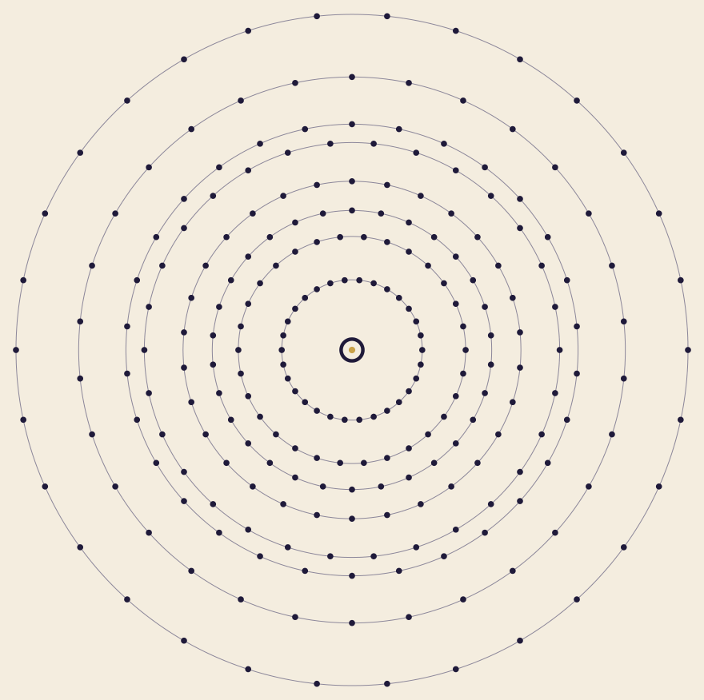

THE GEOMETRY OF EXISTENCE · LEVEL FIVE · THE PROOF AND ITS LIMITS · PAGES 156–171

## Part III · The Third State and Consequence

### §12 Balanced ternary, corrected

`DEMONSTRATED` Let the digit alphabet be D={−1,0,+1}. For any a,b∈D, there is a unique balanced result r∈D and carry c∈D such that a+b=r+3c. The cases are finite and elementary. In particular (+1)+(−1)=0 with no carry. Negation maps each digit to its opposite, leaving zero as its unique fixed digit.

For a finite numeral V=Σi=0n−1di3i, truncating below place 3k means retaining Qk=Σi=kn−1di3i. The discarded tail has absolute value at most (3k−1)/2, strictly less than 3k/2. Therefore Qk is the unique nearest multiple of 3k to V. This theorem is correct for finite words. It does not imply distribution-free zero-mean rounding error, nor does it prove uniqueness among balanced radices: the same finite argument works for balanced odd radices 5, 7, and beyond.

Two of the often-listed load-bearing-zero conditions are not independent. If a nonzero u and its nonzero opposite sum to zero, then nonzero inputs have already generated the zero result: L2 implies L3. Redundant signeddigit binary representations also complicate overly broad claims about what ‘binary-with-sign’ can never do. Binary circuits can emulate the finite ternary truth tables with an encoding, although native hardware costs can differ.

`ARGUED` A useful distinction survives the corrections. Zero can be an independent *symbol* in an alphabet and a dynamically meaningful *outcome* of a computation. Whether a zero should be called load-bearing depends on the operation and measurable consequences, not on an assertion that the symbol was never listed in advance.

**The strongest objection.** Local cancellation is arithmetic, not evidence that opposite forces in nature literally produce an ontologically privileged neutral state. The mathematically warranted statement concerns specified digits and truncation. Nothing about fundamental forces follows without an explicit physical correspondence.

### §13 What the learning study can and cannot establish

`MEASURED — SOURCE-REPORTED` A source manuscript, *DHARANA*, reports an MNIST comparison using four random seeds at each of three hidden widths, a 784→H→10 multilayer perceptron, weight-only quantization and a straight-through estimator. It compares real-valued, binary, adaptively ternary, randomly fixed-zero ternary (‘hole’) and widened bit-budget binary arms. The displayed test-accuracy means are given below [S2].

| Arm | H=16 | H=64 | H=256 |
|---|---|---|---|
| Float | 92.53 | 94.73 | 96.58 |
| Binary | 90.09 | 93.18 | 95.05 |
| Learned ternary | 91.13 | 93.92 | 95.83 |
| Random frozen zero mask | 87.39 | 91.99 | 93.87 |
| Binary, wider bit budget | 91.43 | 93.90 | 95.62 |

The reported adaptive-ternary-minus-binary gaps are +1.04, +0.74 and +0.78 percentage points from the displayed means; the source’s H=16 summary rounds this as +1.03 due to unrounded seed values or reporting conventions not independently accessible. Ternary exceeds the random-mask arm by +3.74, +1.93 and +1.96 points. The widened binary arm exceeds ternary at H=16; the ordering reverses slightly at the other widths. Thus a claim that ternary wins at equal ideal bit budget at **all** widths is refuted by the presented table.

`ARGUED` The operational story is about training trajectory and adaptive connectivity. A mask frozen at random before training constrains where information can flow. A sparsity pattern permitted to change during training can adapt to the data. Similar final sparsity and the same alphabet do not equalize the optimization process. To make a causal claim about ‘earned zero’ itself, test stronger baselines: optimized fixed masks, magnitude pruning at initialization, dynamic binary sparsity, per-arm hyperparameter tuning, and multiple datasets.

The manuscript claims pre-registration and statistical significance. Those are *source claims*: the original dated preregistration, seed-level results and runnable training artifacts were not available in the earlier audit. No network was trained for this book. The numerical results must not be described as independently replicated.

**The strongest objection.** The experiment might be a small, protocol-dependent instance of the established distinction between adaptive training and suboptimal random constraints. It measures neither freedom of will nor a ternary physical substrate. Fixed masks chosen intelligently could perform very differently from random fixed masks. This objection directly limits the larger philosophical inference.

### §14 Zero as a measurable physical occupation

`DEMONSTRATED` The established spin-1 Blume–Capel model uses si∈{−1,0,+1} with Hamiltonian H=−JΣ⟨i,j⟩sisj+DΣi si², with sign convention and coupling interpretation specified [R7]. The zero state may be occupied even though its energy contribution from D s² vanishes. It has a measurable occupation probability P(si=0). A state need not be numerically nonzero to have physical weight.

For a center spin s and fixed boundary spins a,b∈{−1,+1}, consider the *proposed* extension

H(s|a,b)=D s²−J s(a+b)+K s² ab.

Here J is a pair interaction, D a single-site energetic preference, and K a designed boundary-dependent three-body coupling. This Hamiltonian is invariant under simultaneously reversing all three spins. It does **not** imply that such a K term exists in every material.

Enumeration of s=0,±1 gives

P(s=0|a,b)=1/[1+2 exp(−β(D+Kab)) cosh(βJ(a+b))].

Aligned boundaries (+,+) favor the zero state over opposing boundaries (+,−) precisely when

K > ln(cosh(2βJ))/(2β).

Take βJ=ln2, βD=ln2 and βK=2ln2. Then P(0|+,+)=32/49≈0.653061 and P(0|+,−)=1/5=0.2: a difference of 111/245≈0.453061. With K=0 at the same βJ and βD, the respective probabilities are 8/25=0.32 and 1/2=0.50. The ordering reverses.

This is a derivation within a specified statistical model, not a measurement. The more difficult task is to independently calibrate all its couplings in a physical platform and test the predeclared result, including controls without three-body coupling. Appendix A shows the calculation.

**The strongest objection.** A zero state was present in the alphabet before interactions began. It has genuine statistical weight even when K=0. The strongest literal version of ‘only dynamically generated zero is real’ is false. Moreover, the K term was installed by the theorist; this is an engineered mechanism of cooperation, not a spontaneous law discovered in nature. An experimental confirmation would validate the engineered Hamiltonian, not Sophonticism as a universal theory.

  

<i>Zero-state probability for the centre spin at βJ = βD = ln 2. Past the threshold, aligned neighbours favour the zero state more than opposed ones do. Model values, not measurements.</i>

### §15 Consequence — the third term in time

`ARGUED` The proposal is that a possibility becomes physically consequential when it alters what can occur afterward. This is a temporal notion, not another digit in the alphabet. The organizing triad is **possibility, interaction, consequence**. Existing physics already contains outcomes that modify subsequent dynamics: feedback, memory, back-reaction, dissipation and path dependence. The new word must earn its place by identifying a distinctive, testable dependence—not by declaring these established effects to be a fifth fundamental force.

`DEMONSTRATED — CORRECTION` The Hamiltonian in the previous chapter was *not binary*: its central variable already took three values, −1, 0 and +1. What it omitted was a distinct dynamical record of *what a state had done*. A static equilibrium energy conditional on fixed boundaries does not, by itself, say how earlier occupancy changes future occupancy. This is the genuine mathematical opening.

#### 15.1 A third dynamical component: memory of the neutral state

`DEMONSTRATED — DEFINITION` Let st∈{−1,0,+1} denote the three-state central variable. Define its zero-occupation indicator n₀(s)=1−s². Then n₀(−1)=0, n₀(0)=1 and n₀(+1)=0. Unlike using s itself as a record, this observable treats zero as a *positive event*: occupying the neutral state produces one unit of consequence.

Introduce an additional environmental or controller variable Ct≥0 and an update rule:

Ct+1 = ρ Ct + n₀(st), with 0 ≤ ρ &lt; 1.

The dimensionless retention factor ρ controls how long the event is remembered. This equation is a *postulated mechanism*, not a fundamental equation of nature. The zero state has a definite causal role in the postulated mechanism because it increases the subsequent record.

The corresponding conditional energy is:

Ht(s|a,b,Ct) = D s² − J s(a+b) + K s²ab − χ Ct(1−s²).

Here a,b∈{−1,+1} are fixed boundary states, J,D,K have units of energy, and χ has units of energy because C is dimensionless. The coupling χ changes the energetic preference for zero as a function of the recorded past. All three options remain available, but their relative probabilities now depend on history through Ct. This model is a three-state variable with **feedback memory**, not a new kind of matter.

`DEMONSTRATED` For any fixed Ct and inverse temperature β, the conditional zero-state probability is:

P₀(Ct|a,b) = 1 / {1 + 2 exp[−β(D+Kab+χ Ct)] cosh[βJ(a+b)]}.

Consequently its log-odds obey:

log[P₀(C)/(1−P₀(C))] = β(D+Kab+χ C) − log{2 cosh[βJ(a+b)]}.

The difference between histories whose consequence records are C₁ and C₂, while every current control parameter and boundary is held fixed, is exactly:

Δ log-odds = βχ(C₂−C₁).

This is the chapter’s smallest, sharpest conditional prediction. If χ=0, the two histories have identical conditional probabilities even though C stores different past events. If χ>0, an additional past zero event increases the odds of observing a zero in the next re-equilibrated state. This is an **engineered history effect**, not an observation of a universal fifth force.

#### 15.2 A number the model must get right

`DEMONSTRATED` Set J=D=K=0 and independently calibrate βχ=ln 2. At record C=0, all three states have equal conditional weight and P₀(0)=1/3. At record C=1, the zero state has twice the Boltzmann weight of each nonzero state, and P₀(1)=1/2. Therefore:

P₀(1) − P₀(0) = 1/6 ≈ 16.67 percentage points.

A prior neutral event can produce C=1 from C=0 when ρ=0. A prior +1 or −1 event produces C=0 under the same initialization. Thus the three allowed states have genuinely different *future* consequences, even though the proposed feedback favors the zero state’s own return. The exact ratio of zero-to-nonzero odds doubles, with no numerical approximation needed.

`MEASURED` No laboratory probability has been collected. The numbers 1/3 and 1/2 are model calculations. The clean experimental target is a programmable three-state unit with an independently readable, resettable memory register and a calibrated feedback-energy shift. The experiment must prepare the two record states, hold the present boundaries and temperature fixed, allow the central unit to equilibrate conditionally, and count its states over independent trials. A sham-memory control with χ=0 must show no conditional shift. A preregistered estimate of βχ must come from independent calibration, not from fitting the test probabilities afterward.

  

<i>The number the consequence model must get right, at βχ = ln 2 with all other couplings off. Model values, not measurements.</i>

#### 15.3 From consequence to effective force—and its limits

`DEMONSTRATED — PHYSICAL DEFINITION` In ordinary mechanics, a conservative force follows from a spatial potential by F=−∇V. The term −χ C(1−s²) is instead a *conditional energetic coupling to a discrete state*. It generates a bias in transition probabilities; with no position coordinate it is not even a spatial force in the usual sense. In a concrete device with coordinates x and a coupling Ucon(x,C), an **effective feedback force** Ffb=−∇x Ucon can exist. Such forces are familiar consequences of physical interactions mediated through an environment or controller; the formula does not certify a new fundamental interaction.

This distinction is not pedantry. The known fundamental interactions are gravitational, electromagnetic, strong and weak [R1]. The proposed consequence variable specifies **how prior interactions influence subsequent dynamics**. Until a new mediator, symmetry, coupling, range and independent residual effect are demonstrated, ‘Consequence’ can be treated only as a candidate *organizing principle* or effective feedback term—not the discovery of a fifth fundamental force.

The model also has a hidden cost. The update Ct+1=ρCt+n₀(st) is an imposed dissipative rule; it is not produced by the equilibrium Hamiltonian alone. Creating, storing, resetting and reading a physical record may involve work, heat and entropy production. A full physical realization must specify its energy source and thermal bath, account for the controller and memory, and check the thermodynamic consistency of its transitions. The relevance of trajectory-level work and entropy accounting is established in stochastic thermodynamics [R10, R11].

`DEMONSTRATED` Memory need not diverge: with C₀≥0 and 0≤ρ&lt;1, the exact recursion is Ct=ρt C₀+Σk=0t−1ρt−1−kn₀(sk), and hence 0≤Ct≤ρt C₀+(1−ρt)/(1−ρ). This is a finite, falsifiable dynamical model, not an assertion of actual infinity.

#### 15.4 The strongest case against Consequence as the final force

`ARGUED — ADVERSARIAL` There is an extremely strong alternative explanation: the entire calculation is ordinary statistical mechanics with an extra slowly varying control variable. In a sufficiently enlarged state description, the apparent history dependence is Markovian. What looks like a ‘third’ to an observer who ignores C may be an ordinary environmental degree of freedom to an observer who measures it. This is standard modeling, not an unexplained interaction. The model’s χ term was chosen by design; nature was not observed to supply it. Moreover, when χ=0, zero occupancy still exists and still has legitimate physical weight. The zero was present in the schema from the outset, so the categorical assertion that an assigned zero cannot be consequential is already false.

A stronger physical research program would identify a system in which all established environmental variables, feedback channels, calibration errors and ordinary interactions have been measured, and still find a reproducible history-dependent residual not captured by those models. That has not been done. Calling a new coupling ‘Consequence’ cannot substitute for this test. A philosophical interpretation can be retained without claiming a new force.

**The surviving proposition.** `ARGUED` Consequence names the dependence of *future possibility* on *recorded prior outcomes*. `DEMONSTRATED` The simple model above gives it exact operational meaning and a failure condition. `MEASURED` The proposed physical effect has not been independently tested. The bridge from consequence-as-feedback to consequence-as-fundamentalforce remains absent.

  

<i>Consequence as feedback: a zero event adds to a record, and the record shifts the odds of</i>

<i>the next state. An engineered loop, not a new force.</i>

### §16 The geometry experiment: equal size, unequal topology

`DEMONSTRATED — REPRODUCIBLE COMPUTATION` Geometry offers a sharper, smaller test requiring no invented three-body term. Consider two six-vertex graphs. Both are connected, have nine edges, and give every vertex degree three. The *triangular prism* contains two triangles. The complete bipartite graph K₃,₃ contains no odd cycle. Those graphs are equal in vertex count, edge count and degree sequence but differ in topology and frustration.

Assign each vertex a spin si∈{−1,0,+1} and use the antiferromagnetic spin-1 energy

HG(s)=J Σ(i,j)∈E(G) si sj + ΔΣi si², with J>0.

Choose Δ/J=3/4 and βJ=3. There are 3⁶=729 states for each graph. Exhaustive enumeration of all of them, with exact rational arithmetic for energy and floating-point Boltzmann weights, gives the following **model-derived** outputs:

| Quantity | Triangular prism | K₃,₃ |
|---|---|---|
| Minimum energy / J | −1 | −4.5 |
| Number of ground states | 6 | 2 |
| Equilibrium fraction of zero sites | 0.278246795804 | 0.001256340995 |
| Probability at least one site is zero | 0.883127466845 | 0.007244882875 |

The expected zero-site fraction differs by approximately **0.276990454809**, or 27.70 percentage points. The topology creates *frustration*: a triangle cannot satisfy every antiferromagnetic preference using ±1 alone. Allowing a zero spin relieves some incompatible pair terms at the cost controlled by Δ. The bipartite graph can alternate ±1 and satisfy all nine edges without occupying a zero site in its ground state.

A second enumeration freezes exactly two zero sites on the prism before optimizing the remaining ±1 spins. Among 15 equally possible two-site masks, only 3 reach the adaptive three-state ground energy −J. The average best energy over those masks is +J/5. These are exact finite combinatorial results from the supplied program, not neural-network measurements or physical experiments.

`ARGUED` This is the most defensible small physical question for the book: can an independently calibrated six-unit physical system reproduce a large, parameter-specified topology-dependent difference in neutral-state occupancy, with equal node count and degree? A successful test would measure a familiar phenomenon—geometric frustration—not an occult essence of zero. A failure after good calibration would refute the adequacy of the Hamiltonian or the experimental implementation at those parameters.

**The strongest objection.** The result is entirely expected from conventional antiferromagnetic frustration. Distinguishing a triangle-containing graph from a bipartite one is not a discovery of a new interaction. The calculation demonstrates that geometry can determine which states are occupied; it does *not* distinguish Sophonticism from established statistical mechanics. A genuine new theory would need a residual effect after all conventional terms and systematic errors have been accounted for.

  

<i>Two graphs with six sites, nine edges and degree three throughout. Exhaustive enumeration of all 729 states of each, at Δ/J = 3/4 and βJ = 3.</i>

### §17 Beyond lattices: E8, fractals, and the plural meaning of dimension

`DEMONSTRATED` E8 is an eight-dimensional even unimodular lattice. Its 240 shortest nonzero vectors form a root system. They can be enumerated as 112 vectors with two entries ±1 and all others zero, plus 128 vectors with every entry ±1/2 and an even number of negative signs. The sum of opposite roots is zero. Some nonopposite roots r,s with r·s=−1 have r+s as a third root because ||r+s||²=2. This is an exact algebraic fact, not a physical binding mechanism [R8].

For example, r=e₁−e₂ and s=e₂−e₃ sum to e₁−e₃. All are roots. This is a beautiful model of admissible composition. Yet the third root already belongs to the original root set. ‘Generated’ means generated as an outcome relative to the chosen operands, not created outside mathematical possibility. A claim that the combination is beneficial requires a value function, constraints and a task. Lattice addition alone says nothing about agency.

The Cantor set provides a different geometry: it has Hausdorff dimension log2/log3, neither zero nor an integer. An eight-dimensional full cell from the E8 lattice times the Cantor set has Hausdorff dimension 8+log2/log3. This product is a legitimate abstract geometric object. It is not evidence that spacetime has a fractional dimension of 8.6309.

Four kinds of infinity must be kept apart. A lattice contains countably infinite points. Euclidean continua contain uncountably many points. A fractal can be defined through indefinitely repeated refinement while remaining bounded. An infinite-dimensional Hilbert space can contain infinitely many mutually independent directions. These are distinct claims, and no finite measurement of the world establishes them all.

`ARGUED` E8 and fractals become physically relevant only after a model identifies why their symmetry, connectivity, spectral structure or scaling affects an observable. Geometry is an engine of constrained possibilities; it is not a universal warrant for an attractive analogy.

**The strongest objection.** E8 is not uniquely the natural geometry of the universe, and an arbitrary projection of its 240 roots does not establish physical evidence. Many lattices and graphs produce nontrivial combinatorics. The burden is to predict an E8-specific effect that ordinary alternative geometries cannot match under controlled conditions.

  

<i>The 240 roots of E₈ projected to the Coxeter plane: eight rings of thirty. Computed from the root system for this edition. A fact of geometry, not of spacetime.</i>

---

[← Part II — The Established Bridges (§5–§11)](2-the-established-bridges.md) · [Contents](../../README.md) · [Part IV — The Frontier (§18–§22) →](4-the-frontier.md)

