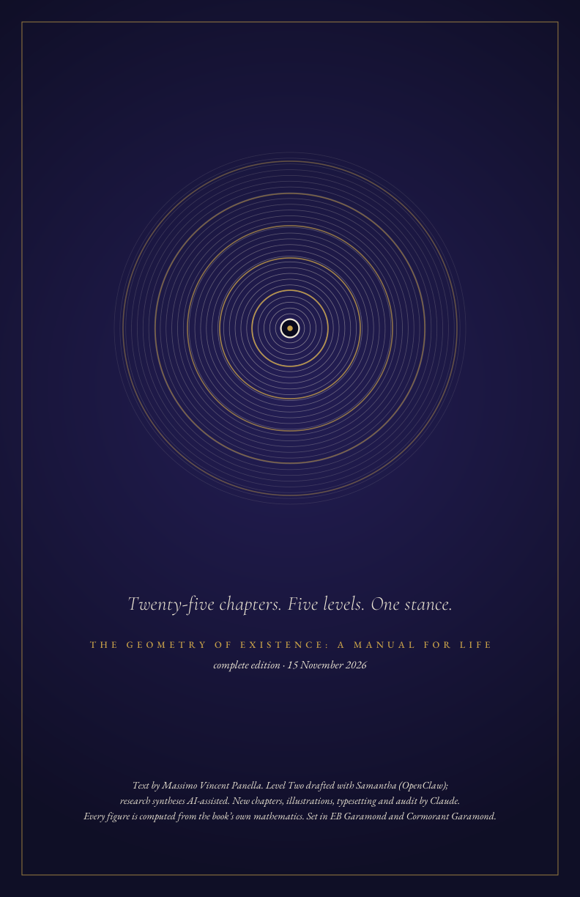

THE GEOMETRY OF EXISTENCE · AFTER THE LEVELS · PAGE 214

  

THE GEOMETRY OF EXISTENCE: A MANUAL FOR LIFE

# Colophon

> *Twenty-five chapters. Five levels. One stance.*

<i>complete edition · 15 November 2026</i>

<i>Text by Massimo Vincent Panella. Level Two drafted with Samantha (OpenClaw);</i>

<i>research syntheses AI-assisted. New chapters, illustrations, typesetting and audit by Claude.</i>

<i>Every figure is computed from the book’s own mathematics. Set in EB Garamond and Cormorant Garamond.</i>

---

[← The Checks](05-the-checks.md) · [Contents](../README.md) · [PDF ↓](../../edition/README.md)

