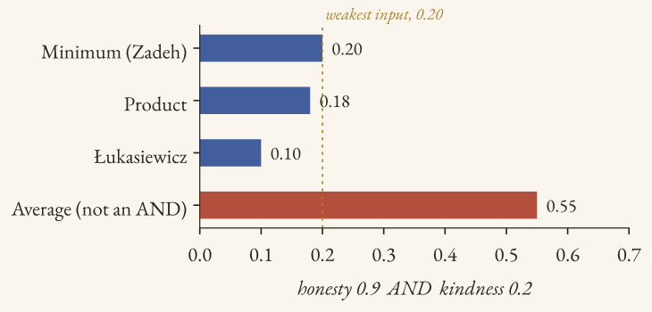
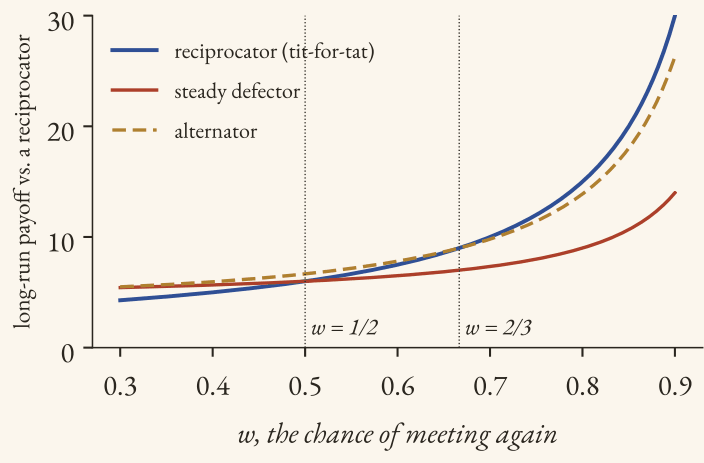
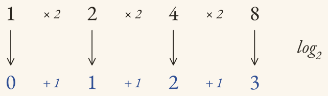
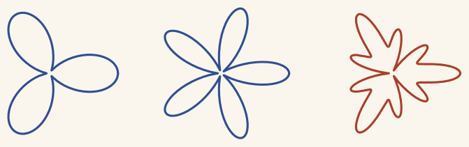
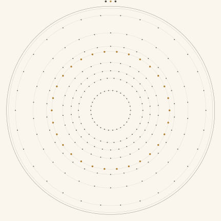
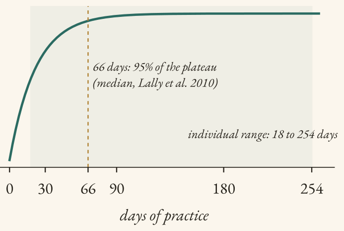

# The Geometry of Everything

## I. The Ordered Triple

**◇ ANALOGY**

Write the First Principle as an ordered triple: **S = (E, C, R).** Existence, Consciousness, Relation.

It is not an equation of physics, and it measures nothing. It is a map with an order. Existence needs neither of the others: a stone exists without knowing or meeting anything. Consciousness presupposes existence: something must be, for something to know. Relation, as this book uses it, includes both the power to meet and the standing to be held, so the newborn and the sleeper are inside it. The order is the point. You stand first, then you see, then you meet.

## II. The Trit

**● DEMONSTRATED**

|  | 81 | 27 | 9 | 3 | 1 |
|---|---|---|---|---|---|
| *37 =* |  | 1 | 1 | 0 | 1 |
| *111 =* | 1 | 1 | 0 | 1 | 0 |
| *−5 =* |  |  | T | 1 | 1 |

A balanced ternary number is written with three digits, −1, 0 and +1, often shown as T, 0 and 1. Every whole number, positive or negative, has exactly one such spelling, with no minus sign needed.

- 37, the sum of each complementary pair in the Kamea of the Sun, is 27 + 9 + 1, written 1101.
- 111, the Kamea’s magic constant, is 81 + 27 + 3, written 11010.
- −5 is −9 + 3 + 1, written T11.

Among whole-number bases, three is also the most economical, in an idealized model and for large numbers: if each digit costs in proportion to its base, the cost of writing a large number in base *b* is proportional to *b* / ln *b*, which is smallest at *e* ≈ 2.718. For base 2 it is about 2.885, for base 3 about 2.731, and for base 4 exactly the same as for base 2. The advantage is real but modest, a little over five percent. Balanced ternary is the smallest balanced odd base, not the only possible one. The three marks of this book, refuse, hold and assent, are its human reading.

## III. Degrees and the Third Axis

**● DEMONSTRATED**

<i>Three rules for AND, and the average that is not one. Every true AND scores at most the weakest input.</i>

Fuzzy logic gives truth in degrees between 0 and 1. To join two degrees with AND it uses a family of rules called *t-norms*, and every one of them is at most the smaller input. With honesty at 0.9 and kindness at 0.2, the minimum rule gives 0.20, the product rule 0.18, and Łukasiewicz’s rule 0.10. A simple average, which is not an AND at all, would give 0.55.

The first three are the mathematics of *both must pass*. People tend instead to let a high score make up for a low one, combining criteria somewhere between a strict AND and an OR (Zimmermann and Zysno, 1980). That compensating habit is exactly what this book asks you to correct. Remember too: a fuzzy 0.5 is the midpoint of a line, not a third possibility. The third lies on a new axis.

## IV. The Floor and the Running Account

**◆ COMMITMENT, MODELLED**

The Floor and the Ceiling can be written as two different kinds of quantity.

**Dignity is a constant.** For every someone *x*, D(*x*) = 1, always. Nothing is added or taken away.

**Respect is a running account.** Week by week, R(*t*) = R(*t*−1) + earned(*t*) − spent(*t*). It rises with kept promises and costly loyalty, and falls with lapses.

The figure at *The Floor and the Ceiling* shows one year of an honest ledger: the account moves, falls hard after one breach of integrity, and climbs back slowly through consistent conduct. The dignity line never moves. That is the whole moral architecture of the book in two lines of algebra. The algebra does not prove it right. It shows it is coherent.

## V. Why Earned Power Holds When the Game Repeats

**● DEMONSTRATED WITHIN THE MODEL**

<i>Long-run payoffs against a reciprocator. The steady defector is held off above w = 1/2; the alternator above w = 2/3.</i>

Game theory can test the book’s central claim about power. In the prisoner’s dilemma, two players each cooperate or defect. Take the classic payoffs: both cooperate, 3 each; both defect, 1 each; one defects on a cooperator, 5 to the defector and 0 to the cooperator.

Let *w* be the chance that the two will meet again. A player using *tit-for-tat*, who cooperates first and then mirrors the other, earns 3 / (1 − *w*) against another of its kind. A player who always defects earns 5 + *w* / (1 − *w*) against tit-for-tat, so the steady defector is held off exactly when *w* ≥ (5 − 3) / (5 − 1) = 1/2. A subtler rival alternates, defecting and then cooperating, and earns 5 / (1 − *w*²). It is held off only when *w* ≥ (5 − 3) / (3 − 0) = 2/3. Above two-thirds, no strategy can invade a community of reciprocal cooperators; Axelrod and Hamilton stated both conditions in 1981.

Mark what this does and does not show. Reciprocity, once established, holds its ground. It does not conquer a world of defectors by default: a lone cooperator among defectors still loses. When the future is likely enough, earned power wins. When it is not, in one-time encounters, defection pays. That is precisely the boundary this book prints in the chapter on power: in settings that repeat, earned power outlasts taken power; in one-shot and captive settings, protect yourself. The mathematics does not make the claim true of real life. It shows the claim is not wishful thinking.

## VI. Isomorphism

**● DEMONSTRATED**

<i>The logarithm carries multiplication to addition and loses nothing on the way.</i>

For algebraic structures, an isomorphism is a map that loses nothing: a one-to-one correspondence *f* in which every relation in the first structure is matched in the second, so that *f*(*a* ∘ *b*) = *f*(*a*) ∗ *f*(*b*).

The classic example: the logarithm turns multiplication into addition, because log(*xy*) = log *x* + log *y*. Every fact about multiplying positive numbers has a twin fact about adding real ones.

This book uses the word strictly. Its own isomorphism is its design: every chapter has the same nine movements, so the map from any chapter to any other preserves the structure exactly. Across the five scales of nature, from cell to cosmos, the book claims only structural analogy, and says so.

## VII. The Kamea of the Sun

**● DEMONSTRATED**

|  |  |  |  |  |  |
|---|---|---|---|---|---|
| 6 | 32 | 3 | 34 | 35 | 1 |
| 7 | 11 | 27 | 28 | 8 | 30 |
| 19 | 14 | 16 | 15 | 23 | 24 |
| 18 | 20 | 22 | 21 | 17 | 13 |
| 25 | 29 | 10 | 9 | 26 | 12 |
| 36 | 5 | 33 | 4 | 2 | 31 |

<i>Every row, column and diagonal: 111.</i>

The Kamea of the Sun is a six-by-six magic square of the numbers 1 to 36. Every row, every column and both diagonals sum to 111, and the whole square sums to 666. The numbers 1 to 36 form eighteen complementary pairs that each sum to 37, and in this square every pair sits symmetrically: the twelve numbers on the diagonals face their complements across the centre, and the other twenty-four face theirs across the vertical or horizontal midline. No six-by-six magic square can place every pair directly across the centre.

*Lingua Rotarum* binds its words with chords across this square. The figure is computed, and every sum has been checked.

## VIII. The Rose and the Law of the Third

**● DEMONSTRATED**

<i>Rose curves of order 3 and 5, and the compound of 3 with 9, which keeps the threefold symmetry the two share.</i>

A rose curve is drawn by *r* = cos(*kθ*). For odd *k* it has *k* petals and *k*-fold symmetry. The twelve stems of the Wheels use the odd orders 1, 3, 5 and so on up to 23.

Two stems combine by superposition, *r* = cos(*k*₁*θ*) + cos(*k*₂*θ*), and the rotational symmetry of the compound is the greatest common divisor of the two orders. Of the sixty-six possible pairs, fifty-eight share no common factor greater than one and generate no new rotational order (they keep only a mirror symmetry). Eight generate: 3 with 9, 15 and 21; 5 with 15; 7 with 21; 9 with 15 and 21; and 15 with 21. That is the Law of the Third in exact form: a third thing is generated only where two share a deeper order.

## IX. The Ground Ring

**● DEMONSTRATED**

<i>The 240 roots of E8, projected onto the Coxeter plane: eight rings of thirty. The ring in gold lies at 0.618 of the outermost.</i>

The E8 root system is one of the most symmetrical objects in mathematics: 240 vectors in eight dimensions. Projected onto a special plane, called the Coxeter plane, its 240 points fall into eight rings of thirty, each a perfect thirty-sided polygon. One ring lies at 0.618 of the largest: the reciprocal of the golden ratio. The figure is computed from the roots themselves, not drawn by hand.

In *Lingua Rotarum*, every word closes inside this ring. By chance, this book holds exactly 240 teachings. Take that as a smile, not a sign. E8 appears here as an emblem of order, not as a claim about physics.

## X. The Landscape and the Habit Curve

**● EVIDENCE, MODELLED**

<i>An asymptotic habit curve fitted to the reported median. Individuals varied widely.</i>

Waddington’s landscape, at the start of this book, pictures change as a ball crossing a ridge into a new valley. The habit curve measures the crossing in a human life.

In the best-known study of habit formation, automaticity rose quickly at first and then levelled off, like the curve shown here. Among the thirty-nine participants whose progress fitted the model well, the median time to reach the plateau was sixty-six days, and the range ran from eighteen to two hundred and fifty-four; the longest times are projections beyond the twelve-week study. Missing a single day did not materially affect the process. That is why the trial at the back of this book lasts ninety days, not thirty.

## XI. What the Mathematics Does Not Prove

**LIMITS**

- It does not prove that dignity is owed. That is a commitment, and Section IV only shows that it is coherent.
- It does not prove that the universe is made of threes. Balanced ternary is elegant and economical; it is not a law of nature.
- E8, the Kamea and the rose curves are real mathematics used as emblems. They have no power over the world.
- The game theory of Section V is a model with assumptions: players who remember, see each other’s moves and expect to meet again. Real lives are messier, which is why the book also cites long-term studies of real people.
- Analogies across the five scales show patterns. They never license sacrificing one person for the good of the whole.

---

[← The Geometry](README.md) &nbsp;·&nbsp; [Contents](../README.md) &nbsp;·&nbsp; [How This Book Could Be Wrong →](02-how-this-book-could-be-wrong.md)

