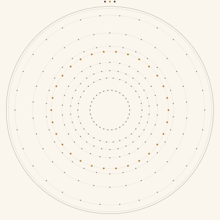

# Epilogue: The Sophont

<i>The ground ring: two hundred and forty points, one for each teaching, closing on the golden ring.</i>

A *sophont* is a being capable of wisdom: one who does not merely exist, but knows that it exists, and chooses how to stand in relation to everything else.

That choice was the subject of this whole book. Existence asked nothing of you; you were here before you understood anything, and you will remain worthy of the floor whatever you do. Consciousness offered you the chance to understand. Connection offered you the chance to honour what you understand. Whether you take those chances is the only thing that was ever wholly yours.

## The last teaching

Your reality is the sum of your relations, and your relations are the sum of your conduct. Do not ask the world to recognize what you have not built. Build it, and the world will have no choice.

Everyone carries a darker half: the anger, the hunger, the will to win at any cost. These teachings are not instructions for cutting it away. That cannot be done; a shadow driven into exile only grows stronger out of sight. They are instructions for putting it to work. The drive that could make you a tyrant can make you a builder. The anger that could make you cruel can make you just. Harness the beast; do not pretend there is no beast. That is the oldest lesson of the strong.

And at the end, hold everything lightly. Every power you possess is borrowed: rank, strength, wealth, youth, life itself. What you could release, you truly held. What you could not release was holding you.

## The choice handed back

At the end of the Bhagavad Gita, after the whole of the teaching has been given, Krishna does not command. He tells the warrior to reflect on it fully, and then to do as he chooses.

So it is here. Everything in this book has been offered, none of it imposed. Test it against your life. Keep what proves true. Throw out what does not. Then go and live it where others can see, because that is how this creed has always travelled: not from a pulpit, but hand to hand, from one wrist to another.

> *Peace, love and unity are what you bring. Respect is what you prove. Earn your reality.*

---

[← How This Book Could Be Wrong](02-how-this-book-could-be-wrong.md) &nbsp;·&nbsp; [Contents](../README.md) &nbsp;·&nbsp; [The Law of the Sophont →](04-the-law-of-the-sophont.md)

