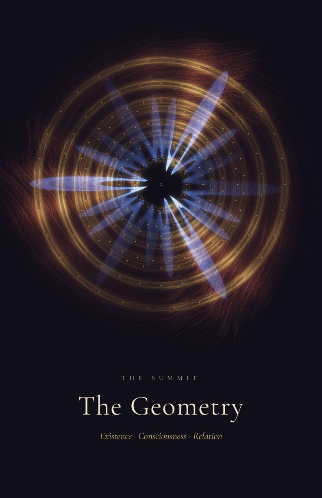

THE SUMMIT

# The Geometry

*At the top of the mountain lies the mathematics beneath the book. Every figure here is computed, not sketched. And one rule governs all of it: mathematics can show structure; it cannot prove a moral truth. What it can do is keep us honest about which of our claims are pictures, which are models and which are proofs.*

---

[← The Daily Rite](../5-the-becoming/26-the-daily-rite.md) &nbsp;·&nbsp; [Contents](../README.md) &nbsp;·&nbsp; [The Geometry of Everything →](01-the-geometry-of-everything.md)

