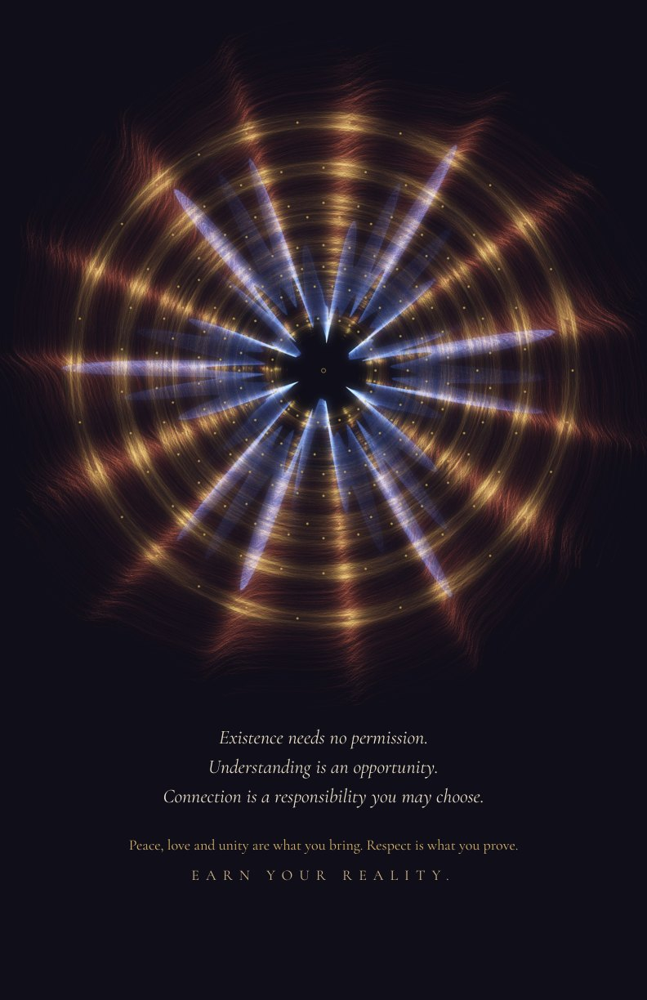

# Colophon

*The Geometry of Everything* gathers the work of Massimo Vincent Panella into one book: the philosophy, the creed, the laws, the mathematics and the myth. This edition was rewritten in the spirit of Rudyard Kipling and Friedrich Nietzsche, re-illustrated and audited by Claude for Massimo, from research into the world’s wisdom traditions, the sciences of mind and cell, and the historical record. Every claim of fact was checked against its source; every figure at the summit and every chapter plate was computed from the law it names.

It is set in EB Garamond and Cormorant Garamond. Its colours are those of the balanced three, vermilion for refuse, ochre for hold, ultramarine for assent, with verdigris and violet for the Work and the Becoming, on the night of the cover and the cream of the page.

It is a gift, offered in the spirit of its creed: peace, love, unity and respect.

<i>Peace, love and unity are what you bring. Respect is what you prove.</i>

EARN YOUR REALITY.

EDITION OF NOVEMBER 2026 · 240 TEACHINGS · 26 CHAPTERS · 5 BOOKS · 1 SUMMIT

---

[← Sources and Translations](05-sources-and-translations.md) &nbsp;·&nbsp; [Contents](../README.md)

