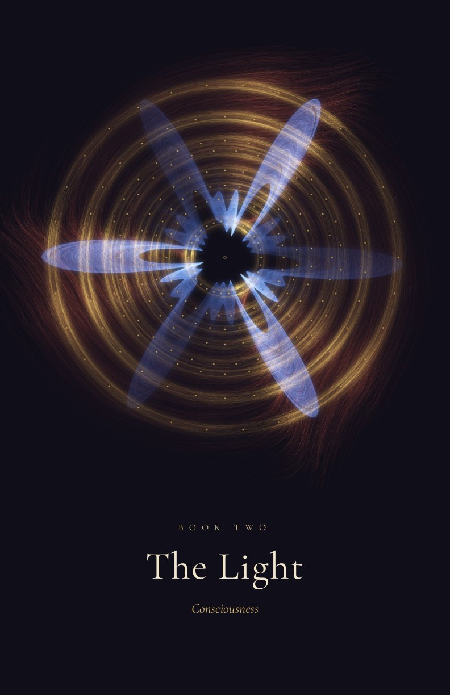

<h1 align="center">Contents</h1>

<i>The Geometry of Everything · Earn Your Reality · A Manual for Life</i> Massimo Vincent Panella · Edition of November 2026

> **New here?** Begin with [How to Carry This Book](0-opening/01-how-to-carry-this-book.md). Every page ends with a link to the next one, so you can read straight through. To look something up by what is happening in your life, use the [Index of Situations](7-at-the-back/04-index-of-situations.md).

## The Opening

- [Title and Dedication](0-opening/00-title-and-dedication.md) pp. 1–6
- [How to Carry This Book](0-opening/01-how-to-carry-this-book.md) pp. 9–11
- [The Rivers That Became This Book](0-opening/02-the-rivers-that-became-this-book.md) pp. 12–13
- [The First Principle](0-opening/03-the-first-principle.md) pp. 14–16
- [The Kept Middle](0-opening/04-the-kept-middle.md) pp. 17–18
- [The Floor and the Ceiling](0-opening/05-the-floor-and-the-ceiling.md) pp. 19–20
- [The Model of Change](0-opening/06-the-model-of-change.md) pp. 21–24
- [The Architecture](0-opening/07-the-architecture.md) pp. 25–26

## Book One · The Ground &nbsp;*Existence*

*Before you know anything, before you love anyone, before you earn a single thing, you are. This Book stands on that fact. It concerns what no one can give you and no one can take away: being itself, the body that carries it, the death that bounds it, and the wonder that surrounds it.*

1. [Existence Needs No Permission](1-the-ground/01-existence-needs-no-permission.md) · *Meaning* pp. 29–34
2. [The Vessel](1-the-ground/02-the-vessel.md) · *The Body, Discipline and Rest* pp. 35–39
3. [The Appointment](1-the-ground/03-the-appointment.md) · *Death and Mortality* pp. 40–44
4. [Starry Heavens](1-the-ground/04-starry-heavens.md) · *The Sacred, Wonder and the Infinite* pp. 45–50

 

## Book Two · The Light &nbsp;*Consciousness*

*Consciousness is the opportunity existence hands you: the power to know that you are, to see what stands in front of you, to learn, and to choose. This Book concerns the light by which you see: who you are, how the mind builds the world, where your attention goes, how it can be led and misled, how you learn, and the freedom no one can take.*

5. [Know the One Who Knows](2-the-light/05-know-the-one-who-knows.md) · *Self-Knowledge and Identity* pp. 53–57
6. [The Instrument](2-the-light/06-the-instrument.md) · *The Brain and How It Builds Experience* pp. 58–62
7. [Where Attention Goes](2-the-light/07-where-attention-goes.md) · *The Mind: Attention, Thought, Emotion* pp. 63–67
8. [The Open Door](2-the-light/08-the-open-door.md) · *Suggestion, Expectation and Hypnosis* pp. 68–73
9. [The Dark Half, with the Lights On](2-the-light/09-the-dark-half-with-the-lights-on.md) · *Mentalism, Manipulation and Defence* pp. 74–79
10. [The Lifelong Student](2-the-light/10-the-lifelong-student.md) · *Learning and School* pp. 80–84
11. [The Last Freedom](2-the-light/11-the-last-freedom.md) · *Freedom and Choice* pp. 85–90

 

## Book Three · The Bond &nbsp;*Relation*

*Connection is the responsibility you may choose. No one lives alone, and no one becomes a self alone. This Book concerns the bonds through which your reality is woven: peace with others, love and friendship, family, the living word, community, respect, and the repair of what breaks. Here the four words of the creed come fully alive.*

12. [Peace: The Unsent Letter](3-the-bond/12-peace-the-unsent-letter.md) · *Peace and the Mastery of Anger* pp. 93–98
13. [Love: Another Self](3-the-bond/13-love-another-self.md) · *Love and Friendship* pp. 99–103
14. [The Root](3-the-bond/14-the-root.md) · *Family* pp. 104–108
15. [The Living Word](3-the-bond/15-the-living-word.md) · *Speech, Language and Energy* pp. 109–113
16. [Unity: Through Other Persons](3-the-bond/16-unity-through-other-persons.md) · *Community* pp. 114–118
17. [Respect: The Floor and the Ceiling](3-the-bond/17-respect-the-floor-and-the-ceiling.md) · *Respect, Dignity and Justice* pp. 119–124
18. [Repair](3-the-bond/18-repair.md) · *Conflict, Repair and Forgiveness* pp. 125–130

 

## Book Four · The Work &nbsp;*Earning*

*Existence is given. Consciousness and connection are offered. Everything else is earned. This Book concerns the work by which a life is built: craft and mastery, money and desire, endurance through suffering, and the right use of power. It is where the creed meets Monday morning.*

19. [The Blade That Stays Sharp](4-the-work/19-the-blade-that-stays-sharp.md) · *Work, Craft and Mastery* pp. 133–137
20. [Enough](4-the-work/20-enough.md) · *Money, Desire and Enough* pp. 138–143
21. [The Headland](4-the-work/21-the-headland.md) · *Suffering, Failure, Grief and Resilience* pp. 144–149
22. [The Book of Earned Power](4-the-work/22-the-book-of-earned-power.md) · *Power and Responsibility* pp. 150–156

 

## Book Five · The Becoming &nbsp;*Transformation*

*Nothing living stays as it is. This last Book concerns how a person changes: not by erasing himself back to nothing, but by crossing, deliberately, into a new form while carrying the old one honestly. And it gives you the daily rite by which every teaching in this book becomes your own.*

23. [Becoming Without Erasing](5-the-becoming/23-becoming-without-erasing.md) · *Change, Transformation and Becoming* pp. 159–164
24. [The Wheel](5-the-becoming/24-the-wheel.md) · *Ritual, Symbol and the Honest Magic* pp. 165–170
25. [The Author](5-the-becoming/25-the-author.md) · *Story, Identity and Integration* pp. 171–176
26. [The Daily Rite](5-the-becoming/26-the-daily-rite.md) · *Daily Practice and Ritual* pp. 177–182

 

## The Summit · The Geometry &nbsp;*Existence · Consciousness · Relation*

*At the top of the mountain lies the mathematics beneath the book. Every figure here is computed, not sketched. And one rule governs all of it: mathematics can show structure; it cannot prove a moral truth. What it can do is keep us honest about which of our claims are pictures, which are models and which are proofs.*

- [The Geometry of Everything](6-the-summit/01-the-geometry-of-everything.md) pp. 185–193
- [How This Book Could Be Wrong](6-the-summit/02-how-this-book-could-be-wrong.md) pp. 194–201
- [Epilogue: The Sophont](6-the-summit/03-epilogue-the-sophont.md) pp. 202–203
- [The Law of the Sophont](6-the-summit/04-the-law-of-the-sophont.md) p. 204

 

## At the Back

- [The Ninety-Day Trial](7-at-the-back/01-the-ninety-day-trial.md) pp. 205–206
- [The Monthly Reading Cycle](7-at-the-back/02-the-monthly-reading-cycle.md) p. 207
- [The Respect Ledger](7-at-the-back/03-the-respect-ledger.md) p. 208
- [Index of Situations](7-at-the-back/04-index-of-situations.md) pp. 211–212
- [Sources and Translations](7-at-the-back/05-sources-and-translations.md) pp. 213–215
- [Colophon](7-at-the-back/06-colophon.md) pp. 216–217

---

<a href="../README.md">Home</a> &nbsp;·&nbsp; <a href="../art/README.md">Gallery</a> &nbsp;·&nbsp; <a href="../workbook/README.md">Workbook</a> &nbsp;·&nbsp; <a href="../edition/The-Geometry-of-Everything.pdf">The PDF</a>

