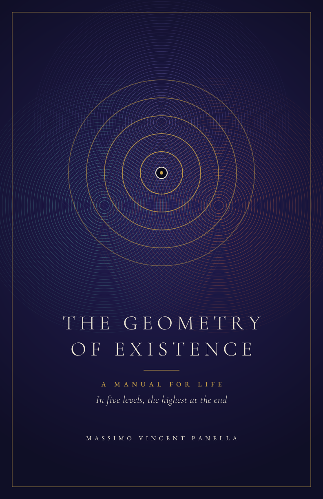
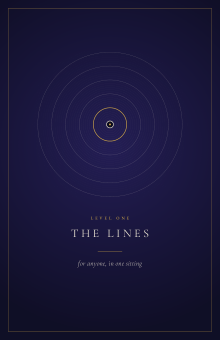
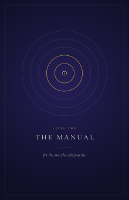
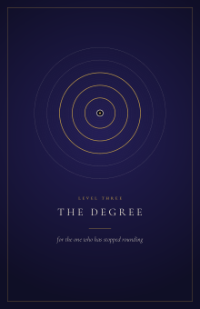
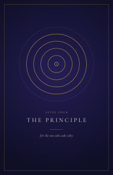
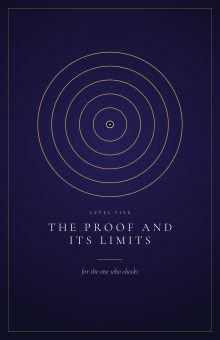

  

<h1 align="center">Contents</h1>

<i>One book in five levels. Each level says the same thing at a greater depth, and each is complete in itself. You may stop at any level and have the whole of that level.</i>

### Before the levels · Front Matter

*five levels, five marks, one promise*

- [Title Page](0-front/01-title-page.md) pp. 2–3
- [How This Book Is Built](0-front/02-how-this-book-is-built.md) pp. 4–5

 

### Level One · The Lines

*for anyone, in one sitting*

- [The First Principle](1-the-lines/01-the-first-principle.md) p. 9
- [The Stance](1-the-lines/02-the-stance.md) p. 10
- [In Plain Words](1-the-lines/03-in-plain-words.md) p. 11

 

### Level Two · The Manual

*for the one who will practise*

- **[Part I · The Ground](2-the-manual/part-1-the-ground.md)** — *what is*
  - [1 · The Three and the Zero](2-the-manual/01-the-three-and-the-zero.md) pp. 15–18 — *A binary with a waiting room is still a binary.*
  - [2 · The Given](2-the-manual/02-the-given.md) pp. 19–23 — *The ground does not negotiate. That is not its cruelty. That is its honesty.*
  - [3 · Attention](2-the-manual/03-attention.md) pp. 24–29 — *You have exactly as much life as you have attention.*
  - [4 · Witness](2-the-manual/04-witness.md) pp. 30–34 — *To be seen is not vanity. It is ontology.*
- **[Part II · The Practice](2-the-manual/part-2-the-practice.md)** — *how to stand*
  - [5 · Name the Binary](2-the-manual/05-name-the-binary.md) pp. 36–40 — *A binary you can see is no longer doing its job.*
  - [6 · Construct the Third](2-the-manual/06-construct-the-third.md) pp. 41–46 — *The third is built, never selected.*
  - [7 · Own the Ground](2-the-manual/07-own-the-ground.md) pp. 47–52 — *Insight without position is a discovery made on someone else’s behalf.*
  - [8 · Keep the Middle](2-the-manual/08-keep-the-middle.md) pp. 53–57 — *The zero is not the place you escape to. It is the place you return from.*
  - [9 · Refuse the Waiting Room](2-the-manual/09-refuse-the-waiting-room.md) pp. 58–63 — *A decision deferred so long it became the architecture was never deferred. It was made — by default, in secret, against you.*
- **[Part III · The Weight](2-the-manual/part-3-the-weight.md)** — *what it costs*
  - [10 · The Asymmetry](2-the-manual/10-the-asymmetry.md) pp. 65–70 — *Seeing the third is cheap and feels like enormous progress. Holding it costs years. Budget for the expensive half or do not begin.*
  - [11 · Continuity](2-the-manual/11-continuity.md) pp. 71–76 — *You are not the same person you were. You are also not a different one. Both facts are load-bearing, and confusing them is how lives break.*
  - [12 · The Losable Claim](2-the-manual/12-the-losable-claim.md) pp. 77–82 — *A claim that cannot lose cannot win. This applies to physics. It applies to you.*
- **[Part IV · The Care](2-the-manual/part-4-the-care.md)** — *what it is for*
  - [13 · Empathy as Catalyst](2-the-manual/13-empathy-as-catalyst.md) pp. 84–89 — *Empathy opens a door. It is not a force. What walks through the door is a different thing entirely, and it must be judged on its own.*
  - [14 · The Inviolate](2-the-manual/14-the-inviolate.md) pp. 90–96 — *Another person’s middle is not yours. Not even to help. Not even to love. Especially not to love.*
  - [15 · The Long Reclamation](2-the-manual/15-the-long-reclamation.md) pp. 97–102 — *The spark has never been destroyed. It has been buried. And the desire to find the spark is the spark itself, flickering.*
- [The Fifteen Lines](2-the-manual/16-the-fifteen-lines.md) pp. 103–104

 

### Level Three · The Degree

*for the one who has stopped rounding*

- [16 · The Degree](3-the-degree/16-the-degree.md) pp. 106–110 — *Most of what is true of you is true to a degree. The either/or rounds it off.*
- [17 · The Weakest Link](3-the-degree/17-the-weakest-link.md) pp. 111–114 — *When two things must both be true, the lower one is your answer.*
- [18 · Act Crisp](3-the-degree/18-act-crisp.md) pp. 115–118 — *Weigh in degrees. Move in one piece.*
- [The Graded Audits](3-the-degree/19-the-graded-audits.md) pp. 119–120

 

### Level Four · The Principle

*for the one who asks why*

- [19 · Existence Is Sufficient](4-the-principle/19-existence-is-sufficient.md) pp. 122–125 — *Nothing gives legitimacy to existence except existence itself.*
- [20 · Three Relationships, Not Three Requirements](4-the-principle/20-three-relationships.md) pp. 126–129 — *Existence is unconditional. Consciousness is an opportunity. Connection is a choice.*
- [21 · Change Without Erasure](4-the-principle/21-change-without-erasure.md) pp. 130–133 — *Change without erasure. Understanding without possession.*
- [22 · Dignity Is Owed, Respect Is Earned](4-the-principle/22-dignity-is-owed.md) pp. 134–137 — *Dignity is the floor. Respect is the ceiling.*

 

### Level Five · The Proof and Its Limits

*for the one who checks*

- [Sophonticism: The Research Book](5-the-proof/sophonticism/README.md) pp. 139–140
- [Part I — Ground (§1–§4)](5-the-proof/sophonticism/1-ground.md) pp. 141–146
- [Part II — The Established Bridges (§5–§11)](5-the-proof/sophonticism/2-the-established-bridges.md) pp. 147–155
- [Part III — The Third State and Consequence (§12–§17)](5-the-proof/sophonticism/3-the-third-state-and-consequence.md) pp. 156–171
- [Part IV — The Frontier (§18–§22)](5-the-proof/sophonticism/4-the-frontier.md) pp. 172–179
- [Appendices A–D](5-the-proof/sophonticism/5-appendices.md) pp. 180–187
- [23 · The Program, Preregistered](5-the-proof/23-the-program-preregistered.md) pp. 188–193 — *Small enough to calculate and precise enough to lose.*
- [24 · What the Axiom Does Not Prove](5-the-proof/24-what-the-axiom-does-not-prove.md) pp. 194–197 — *Existence legitimizes. It does not calculate.*
- [25 · Beyond Logic](5-the-proof/25-beyond-logic.md) pp. 198–202 — *What can be proved has been proved. What remains is what was always first.*

 

### After the levels · Back Matter

*the discipline, the lineage, the corrections, the checks*

- [The Discipline in One Page](6-back-matter/01-the-discipline-in-one-page.md) pp. 203–204
- [The Lineage](6-back-matter/02-the-lineage.md) pp. 205–207
- [Glossary of the Pure Terms](6-back-matter/03-glossary-of-the-pure-terms.md) pp. 208–209
- [Corrections and Open Accounts](6-back-matter/04-corrections-and-open-accounts.md) pp. 210–211
- [The Checks](6-back-matter/05-the-checks.md) pp. 212–213
- [Colophon](6-back-matter/06-colophon.md) p. 214

 

---

[Read the edition PDF](../edition/The_Geometry_of_Existence_A_Manual_for_Life.pdf) · [The gallery](../art/README.md) · [The workbook](../workbook/README.md) · [Run the checks](../checks/README.md)

