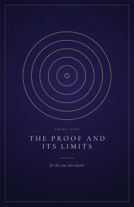

<p align="center"></p>

<h1 align="center">The Checks</h1>

<p align="center"><i>every computation this book relies on, re-run</i></p>

The back of the complete edition lists [every computation the book relies on](../book/6-back-matter/05-the-checks.md) and says that the program running the first group "accompanies the book as `verify_all.py`; it uses nothing outside the standard Python library." This folder holds that program, rebuilt from the definitions printed in the book.

```sh
python3 checks/verify_all.py        # all checks, one line each
python3 checks/verify_all.py -v     # with the computed values
python3 checks/verify_all.py -k e8  # only the checks whose name contains "e8"
```

Python 3.9 or newer. No packages. It takes under a second.

## What it checks

| Where in the book | What is recomputed |
|---|---|
| §12 Balanced ternary, corrected | the nine digit sums; negation's fixed digit; truncation in balanced radix 3 (all words to length 7), 5 and 7; the counterexamples for nearest rounding and signed binary |
| §4 Geometry is constraint, not destiny | the simplex identities p₀ = 1 − q, p± = (q ± m)/2, in exact arithmetic |
| §14 Zero as a measurable physical occupation | Blume–Capel zero probabilities; the three-spin model's 32/49 and 1/5, the reversal to 8/25 and 1/2 at K = 0, and the threshold ½ ln cosh 2βJ |
| §15 Consequence | 1/3 → 1/2 and the exact 1/6; the log-odds shift βχ·ΔC over a 6,000-case grid; the bounded record on 200 random histories |
| §16 and Appendix B | both six-site graphs, all 729 states each: ground energies and their counts, zero-site fractions to twelve places, at-least-one-zero probabilities, the fifteen frozen masks |
| Chapter 23 | the frozen-record probabilities 32/49 and 4/5; the dry-run z-score −2.371 |
| §17 | the 240 roots of E₈, their lengths and sums; the eight rings of thirty in the Coxeter plane; the Cantor set's dimension |
| §13 | the arithmetic of the source-reported learning table |
| Chapters 16–17 | the three graded "and"s of 0.9 and 0.2; the bound on each; standard and Łukasiewicz "A and not-A" |
| Chapter 21 | the protected part: P² = P and a change confined to the complement leaves P·x exactly unchanged (100 random cases, exact) |
| Chapter 24 | the countermodels and the eight models of axiom S₀ |

The second group on the book's page — the frozen workshop code `sophonticism_consequence_test.py`, `sixsite_mcmc.py` and `consequence_mcmc.py` — is not in this repository. The program prints those lines as **NOT RUN**. It never reports them as passed.

## How to break this book

From *Corrections and Open Accounts*:

- Run the checks. **Any failure is an error in Level Five.** Open an issue with the *A check failed* template.
- Find a sentence whose mark is wrong: an argument printed as a demonstration, a model value printed as a measurement. Use *A mark is wrong*.
- Build the six-site system of §16 on a calibrated device and measure the difference in zero-site occupancy. The prediction is **0.276990454809**. Use *A test result*.
- Do a Practice exactly as written, with your falsifier written first. If nothing you can observe changes, the practice failed for you. That is a result, and it counts.

Corrections go to the author. Each belongs in the next edition's list, dated and attributed.

---

<p align="center"><a href="../book/6-back-matter/05-the-checks.md">The Checks, in the book</a> · <a href="../README.md">Home</a></p>
