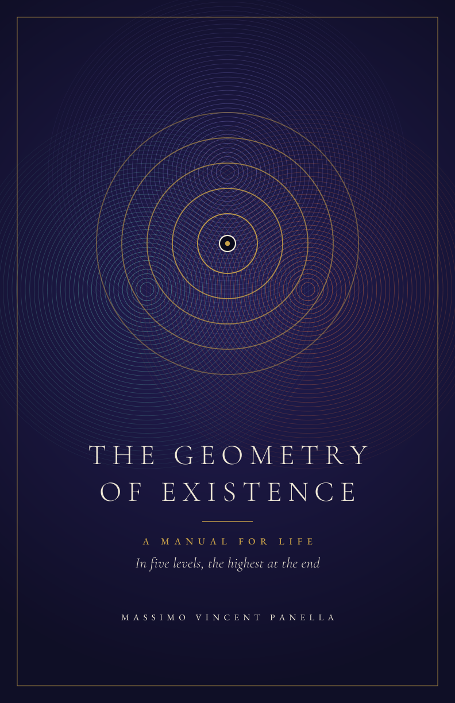

<h1 align="center">The Edition</h1>

<i>The Geometry of Existence: A Manual for Life</i> · complete edition, 15 November 2026

## Download

| | |
|---|---|
| **Download** | **[The_Geometry_of_Existence_A_Manual_for_Life.pdf](https://github.com/Mavioni/THE-GEOMETRY-OF-EXISTENCE/raw/main/edition/The_Geometry_of_Existence_A_Manual_for_Life.pdf)** — PDF, 214 pages, 1.4 MB |
| **View in the browser** | [Open on GitHub](The_Geometry_of_Existence_A_Manual_for_Life.pdf) |
| **Page size** | 5.5 × 8.5 in (digest), the plates printed full-bleed in navy and gold |
| **Typefaces** | EB Garamond and Cormorant Garamond, embedded |
| **SHA-256** | `f8c6def69ba691ad68eb59949f490fd8da6a277b775818f9e9d54d73f3356275` |

To check your copy: `sha256sum The_Geometry_of_Existence_A_Manual_for_Life.pdf` (macOS: `shasum -a 256 The_Geometry_of_Existence_A_Manual_for_Life.pdf`) should print the line above.

## Other ways to read it

The PDF is the edition of record. It is laid out for print and is **not a tagged PDF**, so screen readers and reflowing readers handle it poorly. The same text, with every plate and figure and with image descriptions, is available in two accessible forms:

- **[The reading edition](https://mavioni.github.io/THE-GEOMETRY-OF-EXISTENCE/)** — the website: reflows to any screen, follows light or dark mode, works with screen readers and browser zoom, and can be printed page by page.
- **[The book in Markdown](../book/README.md)** — one file per chapter, readable on GitHub or in any text editor.

Both are cut from this PDF by the tools in this repository, and a check confirms every printed word reaches them.

---

<a href="../README.md">Home</a> · <a href="../book/README.md">Contents</a> · <a href="https://mavioni.github.io/THE-GEOMETRY-OF-EXISTENCE/">Website</a>

