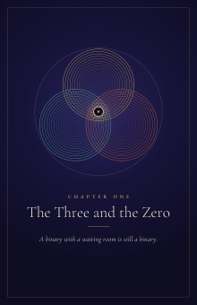

# 1 · The Three and the Zero

> *A binary with a waiting room is still a binary.*

Chapter One · [read the chapter](../book/2-the-manual/01-the-three-and-the-zero.md) · pages 15–18

 

## Before you begin — the falsifier

*“Do a Practice exactly as written, with your falsifier written first. If nothing you can observe changes, the practice failed for you. That is a result, and it counts.”* — Corrections and Open Accounts

If this practice works for me, I will be able to observe:

> &nbsp;

If it does not, I will see instead:

> &nbsp;

## ▲ Practice

> Today, once, when the either/or arrives — and it will — write the two options as one sentence, out loud or on paper. Then ask: *what question is this pair both answering?* Do not answer. Just ask, and stay in the asking for one full minute. That minute is the zero. Notice that you are *in* something, not between things.

| Date | What I did, exactly as written | What I observed |
|---|---|---|
|  |  |  |
|  |  |  |
|  |  |  |

## ◆ Audit

> Where in your own life have you implemented a null and called it a third option? The “later.” The “it depends.” The unfilled box. The deferred decision that has been deferred so long it became the architecture. Name one, honestly, and notice whether the naming loosens it. If it does not, that is data too. This manual does not require you to win. It requires you to stop pretending the waiting room is a room you chose.

My honest answer:

> &nbsp;

## The graded line

From *The Graded Audits*, Level Three. Mark it, date it, and mark it again in a month.

> *The line:* how often I see a pair as a pair. *Zero:* I pick a side at once. *Ten:* I write the pair as one sentence and ask what question it answers before I choose. *It moves when* I count the either/ors I wrote down this week.

| Date | Mark (0–10) | What would raise it one | What would lower it one |
|---|---|---|---|
|  |  |  |  |
|  |  |  |  |

## Result

- [ ] The falsifier was written before the practice began.
- [ ] Something I could observe changed.
- [ ] Nothing changed — the practice failed for me, and that result is recorded here.

---

Nothing here is medical, psychological, or legal advice. The practices are yours to try and yours to stop.

<a href="README.md">Workbook</a> · <a href="../book/2-the-manual/01-the-three-and-the-zero.md">Chapter</a>

