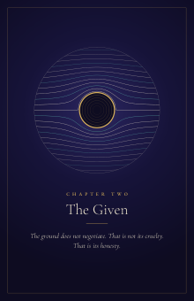

# 2 · The Given

> *The ground does not negotiate. That is not its cruelty. That is its honesty.*

Chapter Two · [read the chapter](../book/2-the-manual/02-the-given.md) · pages 19–23

 

## Before you begin — the falsifier

*“Do a Practice exactly as written, with your falsifier written first. If nothing you can observe changes, the practice failed for you. That is a result, and it counts.”* — Corrections and Open Accounts

If this practice works for me, I will be able to observe:

> &nbsp;

If it does not, I will see instead:

> &nbsp;

## ▲ Practice

> Today, name one thing that refuses you. Write it as a plain sentence with no adjectives of complaint — no *unfair*, no *always*, no *because of them*. Just the shape: *this door is closed. this body is this way. this hour is spent.* Then write one line about what the refusal has taught you about the actual shape of the world — something you could not have learned any other way. Stop there. Do not fix it today.

| Date | What I did, exactly as written | What I observed |
|---|---|---|
|  |  |  |
|  |  |  |
|  |  |  |

## ◆ Audit

> Where in your life do you call worship *realism*? Where do you call erasure *hope*? Take the one that stings more and ask: *what is this position costing me per week?* If you cannot find either one, look harder — everyone has both, and the one you cannot see is the one running you.

My honest answer:

> &nbsp;

## The graded line

From *The Graded Audits*, Level Three. Mark it, date it, and mark it again in a month.

> *The line:* how plainly I can state what refuses me. *Zero:* only with complaint or denial. *Ten:* one flat sentence, no adjectives, said aloud. *It moves when* I write the sentence and can read it to someone.

| Date | Mark (0–10) | What would raise it one | What would lower it one |
|---|---|---|---|
|  |  |  |  |
|  |  |  |  |

## Result

- [ ] The falsifier was written before the practice began.
- [ ] Something I could observe changed.
- [ ] Nothing changed — the practice failed for me, and that result is recorded here.

---

Nothing here is medical, psychological, or legal advice. The practices are yours to try and yours to stop.

<a href="README.md">Workbook</a> · <a href="../book/2-the-manual/02-the-given.md">Chapter</a>

