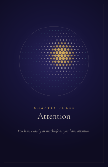

# 3 · Attention

> *You have exactly as much life as you have attention.*

Chapter Three · [read the chapter](../book/2-the-manual/03-attention.md) · pages 24–29

 

## Before you begin — the falsifier

*“Do a Practice exactly as written, with your falsifier written first. If nothing you can observe changes, the practice failed for you. That is a result, and it counts.”* — Corrections and Open Accounts

If this practice works for me, I will be able to observe:

> &nbsp;

If it does not, I will see instead:

> &nbsp;

## ▲ Practice

> Today, take one thing you would normally do while split — a meal, a conversation, a page — and give it the whole attention. Ten minutes is enough. When the pull comes to split it (it will come; it is not a failure, it is the pump’s reflex), just notice the pull, name where it wanted to go, and come back. That comingback, done once, deliberately, is worth more than a week of good intentions.

| Date | What I did, exactly as written | What I observed |
|---|---|---|
|  |  |  |
|  |  |  |
|  |  |  |

## ◆ Audit

> Two lists, five minutes, no mercy. First: what has been thickening in you lately that you never chose to feed? Second: what do you claim to value that has received no real attention — not intention, *attention* — in the last month? The gap between those two lists is not a character flaw. It is a map of who currently holds the reins. Look at it. Ownership starts with being willing to see the deed.

My honest answer:

> &nbsp;

## The graded line

From *The Graded Audits*, Level Three. Mark it, date it, and mark it again in a month.

> *The line:* how much of today’s attention I placed on purpose. *Zero:* all of it was taken. *Ten:* all of it was placed. *It moves when* I keep one evening’s honest log of where it went.

| Date | Mark (0–10) | What would raise it one | What would lower it one |
|---|---|---|---|
|  |  |  |  |
|  |  |  |  |

## Result

- [ ] The falsifier was written before the practice began.
- [ ] Something I could observe changed.
- [ ] Nothing changed — the practice failed for me, and that result is recorded here.

---

Nothing here is medical, psychological, or legal advice. The practices are yours to try and yours to stop.

<a href="README.md">Workbook</a> · <a href="../book/2-the-manual/03-attention.md">Chapter</a>

