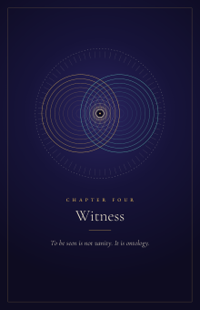

# 4 · Witness

> *To be seen is not vanity. It is ontology.*

Chapter Four · [read the chapter](../book/2-the-manual/04-witness.md) · pages 30–34

 

## Before you begin — the falsifier

*“Do a Practice exactly as written, with your falsifier written first. If nothing you can observe changes, the practice failed for you. That is a result, and it counts.”* — Corrections and Open Accounts

If this practice works for me, I will be able to observe:

> &nbsp;

If it does not, I will see instead:

> &nbsp;

## ▲ Practice

> This week, once, when someone you care about is distressed, do not fix it. Set a timer for five minutes in your head if you need to. Stay, look at them, let the silence be silence. Say only true things, or nothing. Notice how hard it is. That difficulty is your measure of how rarely you have been allowed to witness — or been witnessed.

| Date | What I did, exactly as written | What I observed |
|---|---|---|
|  |  |  |
|  |  |  |
|  |  |  |

## ◆ Audit

> Who witnessed you when you were small? Name the person, or name honestly the absence. Then: whom do you perform for now, and what do you call the performance — ambition? duty? being fine? The gap between the person who witnessed you and the audience you perform for is the map of the wandering. It is not a life sentence. It is a direction home.

My honest answer:

> &nbsp;

## The graded line

From *The Graded Audits*, Level Three. Mark it, date it, and mark it again in a month.

> *The line:* how long I can stay with someone’s pain before I reach for a fix. *Zero:* I fix at once. *Ten:* five full minutes. *It moves when* I time it, once, this week.

| Date | Mark (0–10) | What would raise it one | What would lower it one |
|---|---|---|---|
|  |  |  |  |
|  |  |  |  |

## Result

- [ ] The falsifier was written before the practice began.
- [ ] Something I could observe changed.
- [ ] Nothing changed — the practice failed for me, and that result is recorded here.

---

Nothing here is medical, psychological, or legal advice. The practices are yours to try and yours to stop.

<a href="README.md">Workbook</a> · <a href="../book/2-the-manual/04-witness.md">Chapter</a>

