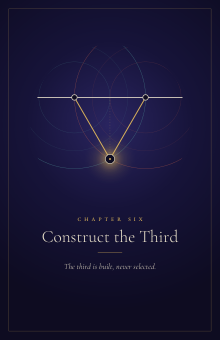

# 6 · Construct the Third

> *The third is built, never selected.*

Chapter Six · [read the chapter](../book/2-the-manual/06-construct-the-third.md) · pages 41–46

 

## Before you begin — the falsifier

*“Do a Practice exactly as written, with your falsifier written first. If nothing you can observe changes, the practice failed for you. That is a result, and it counts.”* — Corrections and Open Accounts

If this practice works for me, I will be able to observe:

> &nbsp;

If it does not, I will see instead:

> &nbsp;

## ▲ Practice

> Take the binary you named in Chapter Five. Write the dumb question the pair was both answering. Then write the truer question underneath it — the one the pair never asked. Do not answer it yet. Sit with the truer question for a day, and write down whatever position begins to form *underneath* the pair, not between them. One paragraph is enough. You are not building the cathedral this week. You are pouring the first footing.

| Date | What I did, exactly as written | What I observed |
|---|---|---|
|  |  |  |
|  |  |  |
|  |  |  |

## ◆ Audit

> Look back at your life for the “third ways” you have already attempted. Which of them were genuinely underneath the pair — and which were compromises that borrowed the third’s vocabulary? The test: did the construction cost you something real from both poles, or did it let you keep everything while feeling transcendent? Be honest. Most people’s history is mostly the second kind, and there is no shame in it — the second kind is what you do while you are learning what the first kind costs.

My honest answer:

> &nbsp;

## The graded line

From *The Graded Audits*, Level Three. Mark it, date it, and mark it again in a month.

> *Two lines:* what my third cost me from the first pole, and from the second. *Zero:* nothing. *Ten:* a real loss I can name. *The score is the lower.* A third that cost nothing from one side is a compromise with a better name.

| Date | Mark (0–10) | What would raise it one | What would lower it one |
|---|---|---|---|
|  |  |  |  |
|  |  |  |  |

## Result

- [ ] The falsifier was written before the practice began.
- [ ] Something I could observe changed.
- [ ] Nothing changed — the practice failed for me, and that result is recorded here.

---

Nothing here is medical, psychological, or legal advice. The practices are yours to try and yours to stop.

<a href="README.md">Workbook</a> · <a href="../book/2-the-manual/06-construct-the-third.md">Chapter</a>

