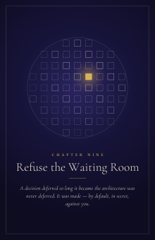

# 9 · Refuse the Waiting Room

> *A decision deferred so long it became the architecture was never deferred. It was made — by default, in secret, against you.*

Chapter Nine · [read the chapter](../book/2-the-manual/09-refuse-the-waiting-room.md) · pages 58–63

 

## Before you begin — the falsifier

*“Do a Practice exactly as written, with your falsifier written first. If nothing you can observe changes, the practice failed for you. That is a result, and it counts.”* — Corrections and Open Accounts

If this practice works for me, I will be able to observe:

> &nbsp;

If it does not, I will see instead:

> &nbsp;

## ▲ Practice

> The null audit, this week, one page. Left column: everything currently waiting. Middle column: what each is waiting on — date, condition, or nothing. Right column: who benefits from the not-deciding. Then close one. The smallest one first — the manual suggests the smallest, because the point this week is to feel the faucet close, and the smallest null closes loudest. Write its death certificate in one sentence. *I am not doing this, on purpose, and here is why.* Sign it with your actual name.

| Date | What I did, exactly as written | What I observed |
|---|---|---|
|  |  |  |
|  |  |  |
|  |  |  |

## ◆ Audit

> Which of your nulls is the oldest? Estimate its age. Then ask: *what would the person I was when this null was born think of me still paying its rent?* Do not answer quickly. The answer is usually the truest sentence you will write this year, and most people cannot write it without sitting down first.

My honest answer:

> &nbsp;

## The graded line

From *The Graded Audits*, Level Three. Mark it, date it, and mark it again in a month.

> *The line:* how many of my deferrals are waiting on something I can name. *Zero:* none has a date or a condition. *Ten:* every one does, or has its certificate.

| Date | Mark (0–10) | What would raise it one | What would lower it one |
|---|---|---|---|
|  |  |  |  |
|  |  |  |  |

## Result

- [ ] The falsifier was written before the practice began.
- [ ] Something I could observe changed.
- [ ] Nothing changed — the practice failed for me, and that result is recorded here.

---

Nothing here is medical, psychological, or legal advice. The practices are yours to try and yours to stop.

<a href="README.md">Workbook</a> · <a href="../book/2-the-manual/09-refuse-the-waiting-room.md">Chapter</a>

