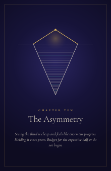

# 10 · The Asymmetry

> *Seeing the third is cheap and feels like enormous progress. Holding it costs years. Budget for the expensive half or do not begin.*

Chapter Ten · [read the chapter](../book/2-the-manual/10-the-asymmetry.md) · pages 65–70

 

## Before you begin — the falsifier

*“Do a Practice exactly as written, with your falsifier written first. If nothing you can observe changes, the practice failed for you. That is a result, and it counts.”* — Corrections and Open Accounts

If this practice works for me, I will be able to observe:

> &nbsp;

If it does not, I will see instead:

> &nbsp;

## ▲ Practice

> Take the construction you are currently holding — the third you have built or are building — and price it this week, in writing, with four numbers or dates: how many years you commit before judging; what comfort you pre-agree to refuse; what you will do during the unaccompanied stretch; and what evidence would end it. Put the paper somewhere you will find it in three years. The paper is the load-bearing wall. Most people’s walls are made of the original feeling, and the feeling does not survive the second winter.

| Date | What I did, exactly as written | What I observed |
|---|---|---|
|  |  |  |
|  |  |  |
|  |  |  |

## ◆ Audit

> Look at the constructions you have already lost — the movements, the projects, the ways of living that were once so clear and are now so gone. For each, ask honestly: *did it die because it was wrong, or because the insight-feeling was spent and the holding had never been priced?* The answer matters more than almost any other answer in this manual, because it tells you what your actual failure mode is. And the failure mode, once named, can be budgeted for. Everything else is weather.

My honest answer:

> &nbsp;

## The graded line

From *The Graded Audits*, Level Three. Mark it, date it, and mark it again in a month.

> *Four lines:* years, comfort, company, evidence — is each cost written down? *The score is the least-priced cost.* A construction priced on three sides fails on the fourth.

| Date | Mark (0–10) | What would raise it one | What would lower it one |
|---|---|---|---|
|  |  |  |  |
|  |  |  |  |

## Result

- [ ] The falsifier was written before the practice began.
- [ ] Something I could observe changed.
- [ ] Nothing changed — the practice failed for me, and that result is recorded here.

---

Nothing here is medical, psychological, or legal advice. The practices are yours to try and yours to stop.

<a href="README.md">Workbook</a> · <a href="../book/2-the-manual/10-the-asymmetry.md">Chapter</a>

