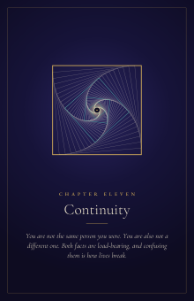

# 11 · Continuity

> *You are not the same person you were. You are also not a different one. Both facts are load-bearing, and confusing them is how lives break.*

Chapter Eleven · [read the chapter](../book/2-the-manual/11-continuity.md) · pages 71–76

 

## Before you begin — the falsifier

*“Do a Practice exactly as written, with your falsifier written first. If nothing you can observe changes, the practice failed for you. That is a result, and it counts.”* — Corrections and Open Accounts

If this practice works for me, I will be able to observe:

> &nbsp;

If it does not, I will see instead:

> &nbsp;

## ▲ Practice

> The stripping exercise, once, with honesty. Take the three arrangements you currently use most to define yourself — the manual will not guess them for you — and imagine, concretely, each one gone. Not dramatically; just gone. After the third stripping, sit in the stripped place for five minutes and write down what is still there, looking back. That list — it will be short, and it will be strangely unsurprising — is your candidate throughline. Do not tattoo it. Do not build a movement around it. Just know it, and let the next revision be judged against it.

| Date | What I did, exactly as written | What I observed |
|---|---|---|
|  |  |  |
|  |  |  |
|  |  |  |

## ◆ Audit

> Where in your life are you keeping a past arrangement as a reason to stay wrong? Be specific: name the commitment, name the year it was made, and ask — honestly, in the stripped place — whether the throughline still holds it, or whether the photograph is governing. The answer will be one of two things, and only one of them is shameful: *the commitment still holds and I will renew it on purpose*, or *the photograph has been governing and I will stop calling that loyalty.* Both are honest. The third option — never asking — is the only failure this chapter recognizes.

My honest answer:

> &nbsp;

## The graded line

From *The Graded Audits*, Level Three. Mark it, date it, and mark it again in a month.

> *The line:* how clearly I can name what survives the stripping. *Zero:* I am my arrangements. *Ten:* one written line, and my last revision was judged against it.

| Date | Mark (0–10) | What would raise it one | What would lower it one |
|---|---|---|---|
|  |  |  |  |
|  |  |  |  |

## Result

- [ ] The falsifier was written before the practice began.
- [ ] Something I could observe changed.
- [ ] Nothing changed — the practice failed for me, and that result is recorded here.

---

Nothing here is medical, psychological, or legal advice. The practices are yours to try and yours to stop.

<a href="README.md">Workbook</a> · <a href="../book/2-the-manual/11-continuity.md">Chapter</a>

