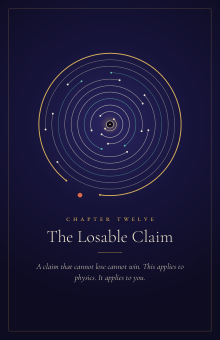

# 12 · The Losable Claim

> *A claim that cannot lose cannot win. This applies to physics. It applies to you.*

Chapter Twelve · [read the chapter](../book/2-the-manual/12-the-losable-claim.md) · pages 77–82

 

## Before you begin — the falsifier

*“Do a Practice exactly as written, with your falsifier written first. If nothing you can observe changes, the practice failed for you. That is a result, and it counts.”* — Corrections and Open Accounts

If this practice works for me, I will be able to observe:

> &nbsp;

If it does not, I will see instead:

> &nbsp;

## ▲ Practice

> This week, in writing, complete the sentence: *I would know I was wrong about myself if—* Name one observation that would count against your most load-bearing self-claim. Pre-commit: *if I observe this, I will revisit the claim before I reexplain the observation.* Put the paper with the paper from Chapter Ten. These two documents together are the whole discipline — the priced holding and the losable claim — and they fit in one envelope.

| Date | What I did, exactly as written | What I observed |
|---|---|---|
|  |  |  |
|  |  |  |
|  |  |  |

## ◆ Audit

> Think of the last three people whose testimony about you hurt. For each, ask: *was my disqualification of them a test of their reliability, or a defense of my claim?* Be slower on this one than on any audit in the manual so far. If, after honest review, even one disqualification was defense — the witness was inconvenient, and you made them wrong so the claim could stay right — you owe that testimony a second hearing. Not agreement. A hearing. The cell’s walls are made of exactly those unheard testimonies, and every one you genuinely re-hear is a brick out of the wall.

My honest answer:

> &nbsp;

## The graded line

From *The Graded Audits*, Level Three. Mark it, date it, and mark it again in a month.

> *The line:* how losable my chief claim about myself is. *Zero:* nothing could count against it. *Ten:* a written falsifier, committed in advance, and one witness knows it.

| Date | Mark (0–10) | What would raise it one | What would lower it one |
|---|---|---|---|
|  |  |  |  |
|  |  |  |  |

## Result

- [ ] The falsifier was written before the practice began.
- [ ] Something I could observe changed.
- [ ] Nothing changed — the practice failed for me, and that result is recorded here.

---

Nothing here is medical, psychological, or legal advice. The practices are yours to try and yours to stop.

<a href="README.md">Workbook</a> · <a href="../book/2-the-manual/12-the-losable-claim.md">Chapter</a>

