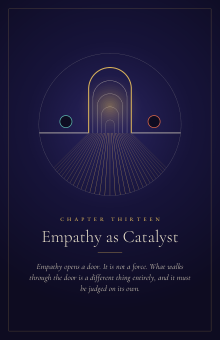

# 13 · Empathy as Catalyst

> *Empathy opens a door. It is not a force. What walks through the door is a different thing entirely, and it must be judged on its own.*

Chapter Thirteen · [read the chapter](../book/2-the-manual/13-empathy-as-catalyst.md) · pages 84–89

 

## Before you begin — the falsifier

*“Do a Practice exactly as written, with your falsifier written first. If nothing you can observe changes, the practice failed for you. That is a result, and it counts.”* — Corrections and Open Accounts

If this practice works for me, I will be able to observe:

> &nbsp;

If it does not, I will see instead:

> &nbsp;

## ▲ Practice

> This week, take one person you are in real conflict with — small conflict is fine; the practice scales — and write their position as they would sign it. Not the caricature. Their version, with their history, in their terms, to their satisfaction. You will know you have it when reading your own paragraph makes you slightly uncomfortable — because it is fair, and fairness to the other side always stings a little. That discomfort is accuracy arriving. Then, and only then, decide what their welfare actually requires of you, and do the harder of the two columns.

| Date | What I did, exactly as written | What I observed |
|---|---|---|
|  |  |  |
|  |  |  |
|  |  |  |

## ◆ Audit

> When you have felt most proud of your own empathy — the moments you would cite as evidence of your goodness — whose benefit was the warmth actually serving? Look at the last three times. If even one of them was the door opened, admired, and closed — the feeling consumed as self-image, the other person’s situation unchanged — do not flinch from it. Almost everyone who reads this chapter will find at least one. The finding is not the failure; the *keeping* is the failure. Empathy that knows it is a catalyst stops performing and starts working.

My honest answer:

> &nbsp;

## The graded line

From *The Graded Audits*, Level Three. Mark it, date it, and mark it again in a month.

> *Two lines:* accuracy — would they sign my statement of their position? — and welfare — did I do what their situation required? *The score is the lower.*

| Date | Mark (0–10) | What would raise it one | What would lower it one |
|---|---|---|---|
|  |  |  |  |
|  |  |  |  |

## Result

- [ ] The falsifier was written before the practice began.
- [ ] Something I could observe changed.
- [ ] Nothing changed — the practice failed for me, and that result is recorded here.

---

Nothing here is medical, psychological, or legal advice. The practices are yours to try and yours to stop.

<a href="README.md">Workbook</a> · <a href="../book/2-the-manual/13-empathy-as-catalyst.md">Chapter</a>

