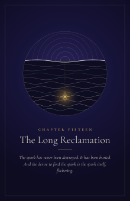

# 15 · The Long Reclamation

> *The spark has never been destroyed. It has been buried. And the desire to find the spark is the spark itself, flickering.*

Chapter Fifteen · [read the chapter](../book/2-the-manual/15-the-long-reclamation.md) · pages 97–102

 

## Before you begin — the falsifier

*“Do a Practice exactly as written, with your falsifier written first. If nothing you can observe changes, the practice failed for you. That is a result, and it counts.”* — Corrections and Open Accounts

If this practice works for me, I will be able to observe:

> &nbsp;

If it does not, I will see instead:

> &nbsp;

## ▲ Practice

> The smallest possible beginning, today: one of the gentle questions — *what did I actually feel, before I was told what to feel?* — asked once, answered in one sentence or answered not at all, with the not-answering also counting as contact. Then the same question tomorrow. The reclamation does not begin with a vow. It begins with a flicker, and the flicker is already here.

| Date | What I did, exactly as written | What I observed |
|---|---|---|
|  |  |  |
|  |  |  |
|  |  |  |

## ◆ Audit

> Nothing. The last chapter’s audit is the book itself. Keep it. Come back to it when the season turns — the manual will keep, the way the ground keeps — and notice, each return, that the sentences have not changed and you have. That noticing, repeated across a life, is the whole discipline. There is no final audit. There is only the standing, and the standing is open-ended on purpose, because the ground is, and the ground — the manual’s first word and its last — holds.

My honest answer:

> &nbsp;

## The graded line

From *The Graded Audits*, Level Three. Mark it, date it, and mark it again in a month.

> *The line:* days this week I asked one small question and let the answer be small. Count them. There is no ten to reach here. There is only the next day.

| Date | Mark (0–10) | What would raise it one | What would lower it one |
|---|---|---|---|
|  |  |  |  |
|  |  |  |  |

## Result

- [ ] The falsifier was written before the practice began.
- [ ] Something I could observe changed.
- [ ] Nothing changed — the practice failed for me, and that result is recorded here.

---

Nothing here is medical, psychological, or legal advice. The practices are yours to try and yours to stop.

<a href="README.md">Workbook</a> · <a href="../book/2-the-manual/15-the-long-reclamation.md">Chapter</a>

