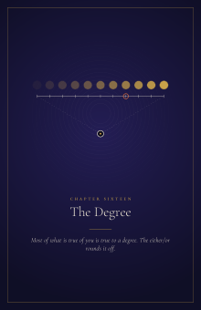

# 16 · The Degree

> *Most of what is true of you is true to a degree. The either/or rounds it off.*

Chapter Sixteen · [read the chapter](../book/3-the-degree/16-the-degree.md) · pages 106–110

 

## Before you begin — the falsifier

*“Do a Practice exactly as written, with your falsifier written first. If nothing you can observe changes, the practice failed for you. That is a result, and it counts.”* — Corrections and Open Accounts

If this practice works for me, I will be able to observe:

> &nbsp;

If it does not, I will see instead:

> &nbsp;

## ▲ Practice

> Take the binary you named in Chapter Five. Draw one line. Write what zero means at the left end and what ten means at the right, in plain words a stranger could check. Mark where you stand today. Then write two sentences: *this mark goes up one when I see —* and *this mark goes down one when I see —*. Keep the page. You will need it in Chapter Eighteen.

| Date | What I did, exactly as written | What I observed |
|---|---|---|
|  |  |  |
|  |  |  |
|  |  |  |

## ◆ Audit

> Where do you use “sort of,” “kind of,” or “it’s complicated” as a place to hide? Pick one. Give it a line, two anchors, a mark, and the two observations. If you cannot name what would move the mark, say so plainly: it was never a degree. It was a waiting room.

My honest answer:

> &nbsp;

## Result

- [ ] The falsifier was written before the practice began.
- [ ] Something I could observe changed.
- [ ] Nothing changed — the practice failed for me, and that result is recorded here.

---

Nothing here is medical, psychological, or legal advice. The practices are yours to try and yours to stop.

<a href="README.md">Workbook</a> · <a href="../book/3-the-degree/16-the-degree.md">Chapter</a>

