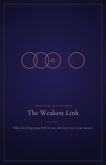

# 17 · The Weakest Link

> *When two things must both be true, the lower one is your answer.*

Chapter Seventeen · [read the chapter](../book/3-the-degree/17-the-weakest-link.md) · pages 111–114

 

## Before you begin — the falsifier

*“Do a Practice exactly as written, with your falsifier written first. If nothing you can observe changes, the practice failed for you. That is a result, and it counts.”* — Corrections and Open Accounts

If this practice works for me, I will be able to observe:

> &nbsp;

If it does not, I will see instead:

> &nbsp;

## ▲ Practice

> Choose one thing you want that has several requirements — a hard conversation that needs honesty, kindness, and the right moment; a piece of work that needs skill, time, and someone to receive it. Grade each requirement from zero to ten, with anchors. Circle the lowest. That is your score. For seven days, work only on the circled one.

| Date | What I did, exactly as written | What I observed |
|---|---|---|
|  |  |  |
|  |  |  |
|  |  |  |

## ◆ Audit

> Where are you letting a nine excuse a two? Name the nine you are proud of and the two it is covering. Then ask who has been living with the two.

My honest answer:

> &nbsp;

## Result

- [ ] The falsifier was written before the practice began.
- [ ] Something I could observe changed.
- [ ] Nothing changed — the practice failed for me, and that result is recorded here.

---

Nothing here is medical, psychological, or legal advice. The practices are yours to try and yours to stop.

<a href="README.md">Workbook</a> · <a href="../book/3-the-degree/17-the-weakest-link.md">Chapter</a>

