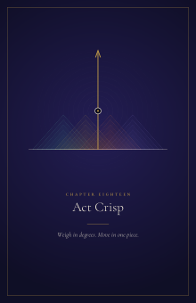

# 18 · Act Crisp

> *Weigh in degrees. Move in one piece.*

Chapter Eighteen · [read the chapter](../book/3-the-degree/18-act-crisp.md) · pages 115–118

 

## Before you begin — the falsifier

*“Do a Practice exactly as written, with your falsifier written first. If nothing you can observe changes, the practice failed for you. That is a result, and it counts.”* — Corrections and Open Accounts

If this practice works for me, I will be able to observe:

> &nbsp;

If it does not, I will see instead:

> &nbsp;

## ▲ Practice

> Take one deferral from your null audit in Chapter Nine. On one card write four lines: the grades, with anchors; the rule, with its “and” or “or”; the act, with its date; and the observation that would reverse it. Sign the card. Put it with the papers from Chapters Ten and Twelve.

| Date | What I did, exactly as written | What I observed |
|---|---|---|
|  |  |  |
|  |  |  |
|  |  |  |

## ◆ Audit

> Where are you acting at one-half? Name the thing you are half in. Then choose, in writing: raise it to a whole act with a date, or close it with the one-sentence certificate from Chapter Nine. Both are honest. Staying at one-half is the only answer this chapter refuses.

My honest answer:

> &nbsp;

## Result

- [ ] The falsifier was written before the practice began.
- [ ] Something I could observe changed.
- [ ] Nothing changed — the practice failed for me, and that result is recorded here.

---

Nothing here is medical, psychological, or legal advice. The practices are yours to try and yours to stop.

<a href="README.md">Workbook</a> · <a href="../book/3-the-degree/18-act-crisp.md">Chapter</a>

