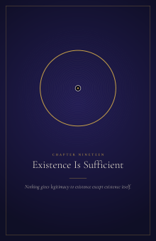

# 19 · Existence Is Sufficient

> *Nothing gives legitimacy to existence except existence itself.*

Chapter Nineteen · [read the chapter](../book/4-the-principle/19-existence-is-sufficient.md) · pages 122–125

 

## Before you begin — the falsifier

*“Do a Practice exactly as written, with your falsifier written first. If nothing you can observe changes, the practice failed for you. That is a result, and it counts.”* — Corrections and Open Accounts

If this practice works for me, I will be able to observe:

> &nbsp;

If it does not, I will see instead:

> &nbsp;

## ▲ Practice

> Choose one thing you have been dismissing: a person, a fact, a part of yourself. Write one sentence about it with no judgment in it: *this exists.* Stop there for one full minute. Then, on a separate line, ask the further question — *what, if anything, do I owe it?* — and notice that the second question is open, and the first is closed.

| Date | What I did, exactly as written | What I observed |
|---|---|---|
|  |  |  |
|  |  |  |
|  |  |  |

## ◆ Audit

> Where do you make another’s standing as real depend on their usefulness to you, their intelligence, or their recognition of you? Where do you make your own depend on the same three things? Name one of each. The second is usually older.

My honest answer:

> &nbsp;

## Result

- [ ] The falsifier was written before the practice began.
- [ ] Something I could observe changed.
- [ ] Nothing changed — the practice failed for me, and that result is recorded here.

---

Nothing here is medical, psychological, or legal advice. The practices are yours to try and yours to stop.

<a href="README.md">Workbook</a> · <a href="../book/4-the-principle/19-existence-is-sufficient.md">Chapter</a>

