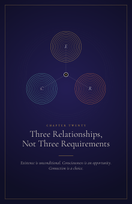

# 20 · Three Relationships, Not Three Requirements

> *Existence is unconditional. Consciousness is an opportunity. Connection is a choice.*

Chapter Twenty · [read the chapter](../book/4-the-principle/20-three-relationships.md) · pages 126–129

 

## Before you begin — the falsifier

*“Do a Practice exactly as written, with your falsifier written first. If nothing you can observe changes, the practice failed for you. That is a result, and it counts.”* — Corrections and Open Accounts

If this practice works for me, I will be able to observe:

> &nbsp;

If it does not, I will see instead:

> &nbsp;

## ▲ Practice

> Take one being in your life — a person, an animal, a place. Make three short columns. *What exists:* plain facts only. *What I understand:* and, beneath it, what I do not. *How I honor it:* one act this week, small enough to do. Notice which column was hardest to fill honestly.

| Date | What I did, exactly as written | What I observed |
|---|---|---|
|  |  |  |
|  |  |  |
|  |  |  |

## ◆ Audit

> Where have you treated understanding as ownership — of a child, a partner, a friend, a student? And where have you waited to be understood before you would allow yourself to count? Name one of each.

My honest answer:

> &nbsp;

## Result

- [ ] The falsifier was written before the practice began.
- [ ] Something I could observe changed.
- [ ] Nothing changed — the practice failed for me, and that result is recorded here.

---

Nothing here is medical, psychological, or legal advice. The practices are yours to try and yours to stop.

<a href="README.md">Workbook</a> · <a href="../book/4-the-principle/20-three-relationships.md">Chapter</a>

