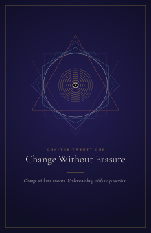

# 21 · Change Without Erasure

> *Change without erasure. Understanding without possession.*

Chapter Twenty-One · [read the chapter](../book/4-the-principle/21-change-without-erasure.md) · pages 130–133

 

## Before you begin — the falsifier

*“Do a Practice exactly as written, with your falsifier written first. If nothing you can observe changes, the practice failed for you. That is a result, and it counts.”* — Corrections and Open Accounts

If this practice works for me, I will be able to observe:

> &nbsp;

If it does not, I will see instead:

> &nbsp;

## ▲ Practice

> Before your next real change — of work, of place, of habit — write two lists. *Carried:* three things this change must bring through intact. A skill. A relationship. A way of noticing. *Free:* everything else, named, that may be revised without betrayal. Make the change against the lists.

| Date | What I did, exactly as written | What I observed |
|---|---|---|
|  |  |  |
|  |  |  |
|  |  |  |

## ◆ Audit

> Where have you tried to change by wiping — the new city, the new name, the deleted history? What, specifically, did you lose in the wiping that you later had to rebuild? Estimate what the rebuilding cost. That number is the price of the null point.

My honest answer:

> &nbsp;

## Result

- [ ] The falsifier was written before the practice began.
- [ ] Something I could observe changed.
- [ ] Nothing changed — the practice failed for me, and that result is recorded here.

---

Nothing here is medical, psychological, or legal advice. The practices are yours to try and yours to stop.

<a href="README.md">Workbook</a> · <a href="../book/4-the-principle/21-change-without-erasure.md">Chapter</a>

